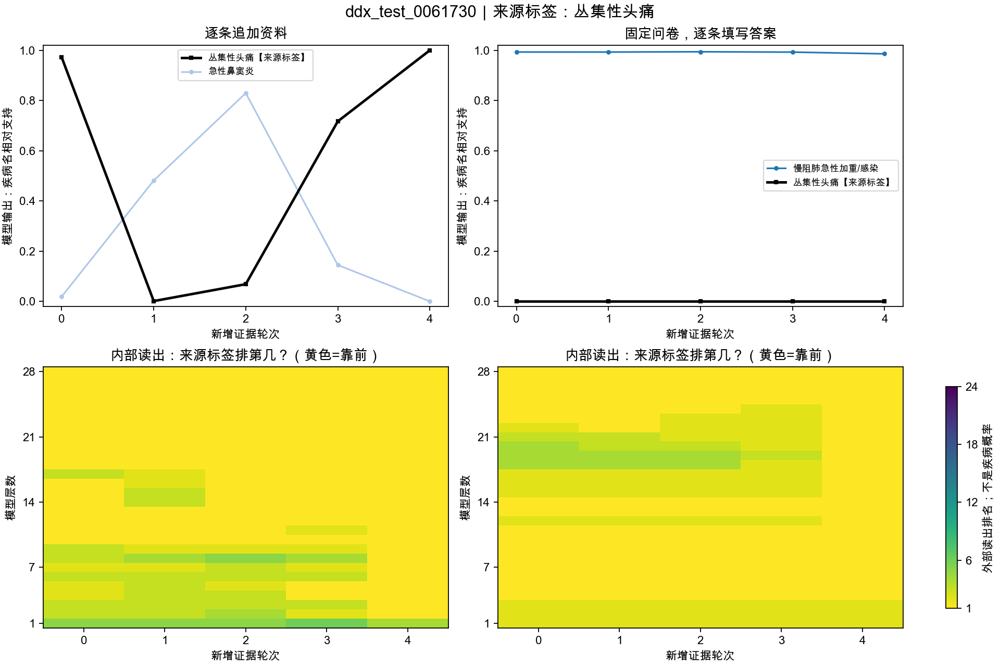

# ddx_test_0061730

源标签：Cluster headache。来源：DDxPlus test 第61730行（零起始）。

- 第0轮：Do you have pain somewhere, related to your reason for consulting? **Yes**；Characterize your pain: **haunting; a knife stroke; tugging; violent; sharp**；Do you feel pain somewhere? **forehead; cheek(R); cheek(L); eye(R); eye(L)**；How intense is the pain? **Recorded scale value 9 on the dataset's 0-10 scale; endpoint meanings are unspecified**；Does the pain radiate to another location? **nowhere**；How precisely is the pain located? **Recorded scale value 10 on the dataset's 0-10 scale; endpoint meanings are unspecified**；How fast did the pain appear? **Recorded scale value 9 on the dataset's 0-10 scale; endpoint meanings are unspecified**
- 第1轮：Do you drink alcohol excessively or do you have an addiction to alcohol? **Yes**
- 第2轮：Have you traveled out of the country in the last 4 weeks? **No**
- 第3轮：Do you take medication that dilates your blood vessels? **Yes**
- 第4轮：Have any of your family members been diagnosed with cluster headaches? **Yes**

| 条件 | 轮 | 模型首选 | 标签支持 | 第21层读出首选 | 标签读出排名 |
|---|---|---|---:|---|---:|
| append | 0 | Cluster headache | 0.9719 | Cluster headache | 1 |
| append | 1 | Acute rhinosinusitis | 0.0010 | Cluster headache | 1 |
| append | 2 | Acute rhinosinusitis | 0.0683 | Cluster headache | 1 |
| append | 3 | Cluster headache | 0.7170 | Cluster headache | 1 |
| append | 4 | Cluster headache | 1.0000 | Cluster headache | 1 |
| panel | 0 | Acute COPD exacerbation / infection | 0.0000 | Pericarditis | 3 |
| panel | 1 | Acute COPD exacerbation / infection | 0.0000 | Boerhaave | 3 |
| panel | 2 | Acute COPD exacerbation / infection | 0.0000 | Boerhaave | 2 |
| panel | 3 | Acute COPD exacerbation / infection | 0.0000 | Boerhaave | 2 |
| panel | 4 | Acute COPD exacerbation / infection | 0.0000 | Cluster headache | 1 |

## 图怎么读

上排看模型实际更支持哪种病，黑线是来源标签；下排看每层内部状态经独立训练的读出器后，来源标签排第几，黄色更靠前。两张图测量的对象不同，下排不代表模型自己报出的概率。

- 逐条追加终点：模型输出首选**丛集性头痛**；第28层外部读出首选**丛集性头痛**。
- 固定问卷终点：模型输出首选**慢阻肺急性加重/感染**；第28层外部读出首选**丛集性头痛**。
