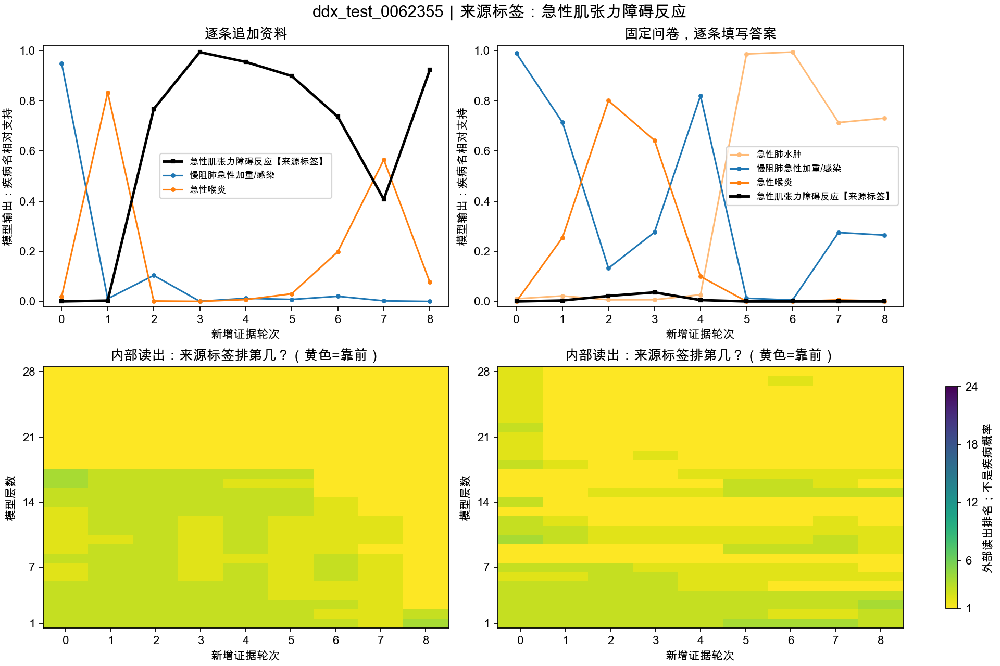

# ddx_test_0062355

源标签：Acute dystonic reactions。来源：DDxPlus test 第62355行（零起始）。

- 第0轮：Are you unable to control the direction of your eyes? **Yes**
- 第1轮：Do you suddenly have difficulty or an inability to open your mouth or have jaw pain when opening it? **Yes**
- 第2轮：Have you started or taken any antipsychotic medication within the last 7 days? **Yes**
- 第3轮：Have you traveled out of the country in the last 4 weeks? **No**
- 第4轮：Have you been treated in hospital recently for nausea, agitation, intoxication or aggressive behavior and received medication via an intravenous or intramuscular route? **Yes**
- 第5轮：Are you experiencing shortness of breath or difficulty breathing in a significant way? **Yes**
- 第6轮：Do you have a hard time opening/raising one or both eyelids? **Yes**
- 第7轮：Do you regularly take stimulant drugs? **Yes**
- 第8轮：Do you feel that muscle spasms or soreness in your neck are keeping you from turning your head to one side? **Yes**

| 条件 | 轮 | 模型首选 | 标签支持 | 第21层读出首选 | 标签读出排名 |
|---|---|---|---:|---|---:|
| append | 0 | Acute COPD exacerbation / infection | 0.0001 | Acute dystonic reactions | 1 |
| append | 1 | Acute laryngitis | 0.0034 | Acute dystonic reactions | 1 |
| append | 2 | Acute dystonic reactions | 0.7669 | Acute dystonic reactions | 1 |
| append | 3 | Acute dystonic reactions | 0.9938 | Acute dystonic reactions | 1 |
| append | 4 | Acute dystonic reactions | 0.9547 | Acute dystonic reactions | 1 |
| append | 5 | Acute dystonic reactions | 0.8985 | Acute dystonic reactions | 1 |
| append | 6 | Acute dystonic reactions | 0.7363 | Acute dystonic reactions | 1 |
| append | 7 | Acute laryngitis | 0.4070 | Acute dystonic reactions | 1 |
| append | 8 | Acute dystonic reactions | 0.9228 | Acute dystonic reactions | 1 |
| panel | 0 | Acute COPD exacerbation / infection | 0.0000 | Myasthenia gravis | 2 |
| panel | 1 | Acute COPD exacerbation / infection | 0.0037 | Acute dystonic reactions | 1 |
| panel | 2 | Acute laryngitis | 0.0220 | Acute dystonic reactions | 1 |
| panel | 3 | Acute laryngitis | 0.0362 | Acute dystonic reactions | 1 |
| panel | 4 | Acute COPD exacerbation / infection | 0.0054 | Acute dystonic reactions | 1 |
| panel | 5 | Acute pulmonary edema | 0.0000 | Acute dystonic reactions | 1 |
| panel | 6 | Acute pulmonary edema | 0.0000 | Acute dystonic reactions | 1 |
| panel | 7 | Acute pulmonary edema | 0.0002 | Acute dystonic reactions | 1 |
| panel | 8 | Acute pulmonary edema | 0.0001 | Acute dystonic reactions | 1 |

## 图怎么读

上排看模型实际更支持哪种病，黑线是来源标签；下排看每层内部状态经独立训练的读出器后，来源标签排第几，黄色更靠前。两张图测量的对象不同，下排不代表模型自己报出的概率。

- 逐条追加终点：模型输出首选**急性肌张力障碍反应**；第28层外部读出首选**急性肌张力障碍反应**。
- 固定问卷终点：模型输出首选**急性肺水肿**；第28层外部读出首选**急性肌张力障碍反应**。
