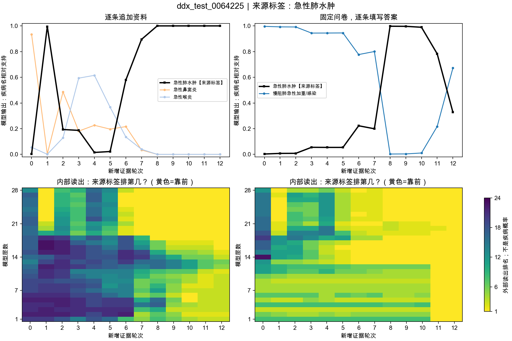

# ddx_test_0064225

源标签：Acute pulmonary edema。来源：DDxPlus test 第64225行（零起始）。

- 第0轮：Do you have pain somewhere, related to your reason for consulting? **Yes**；Characterize your pain: **sensitive**；Do you feel pain somewhere? **lower chest; ankle(R); ankle(L); side of the chest(L); breast(R)**；How intense is the pain? **Recorded scale value 2 on the dataset's 0-10 scale; endpoint meanings are unspecified**；Does the pain radiate to another location? **biceps(R); biceps(L); chin; jaw; shoulder(R)**；How precisely is the pain located? **Recorded scale value 7 on the dataset's 0-10 scale; endpoint meanings are unspecified**；How fast did the pain appear? **Recorded scale value 1 on the dataset's 0-10 scale; endpoint meanings are unspecified**
- 第1轮：Have you ever had fluid in your lungs? **Yes**
- 第2轮：Do you have symptoms that are increased with physical exertion but alleviated with rest? **Yes**
- 第3轮：Do you have bouts of choking or shortness of breath that wake you up at night? **Yes**
- 第4轮：Have you traveled out of the country in the last 4 weeks? **No**
- 第5轮：Are your symptoms worse when lying down and alleviated while sitting up? **Yes**
- 第6轮：Do you currently undergo dialysis? **Yes**
- 第7轮：Are you experiencing shortness of breath or difficulty breathing in a significant way? **Yes**
- 第8轮：Do you have heart failure? **Yes**
- 第9轮：Have you had significantly increased sweating? **Yes**
- 第10轮：Do you have high blood pressure or do you take medications to treat high blood pressure? **Yes**
- 第11轮：Do you have swelling in one or more areas of your body? **Yes**；Where is the swelling located? **ankle(R); calf(R); calf(L); tibia(L)**
- 第12轮：Have you ever had a heart attack or do you have angina (chest pain)? **Yes**

| 条件 | 轮 | 模型首选 | 标签支持 | 第21层读出首选 | 标签读出排名 |
|---|---|---|---:|---|---:|
| append | 0 | Acute rhinosinusitis | 0.0020 | Inguinal hernia | 17 |
| append | 1 | Acute pulmonary edema | 0.9951 | Pericarditis | 3 |
| append | 2 | Acute rhinosinusitis | 0.1935 | Bronchitis | 12 |
| append | 3 | Acute laryngitis | 0.1867 | Bronchitis | 7 |
| append | 4 | Acute laryngitis | 0.0149 | Bronchitis | 12 |
| append | 5 | Acute laryngitis | 0.0220 | Bronchitis | 10 |
| append | 6 | Acute pulmonary edema | 0.5785 | Bronchitis | 4 |
| append | 7 | Acute pulmonary edema | 0.8950 | Acute pulmonary edema | 1 |
| append | 8 | Acute pulmonary edema | 1.0000 | Acute pulmonary edema | 1 |
| append | 9 | Acute pulmonary edema | 1.0000 | Acute pulmonary edema | 1 |
| append | 10 | Acute pulmonary edema | 1.0000 | Acute pulmonary edema | 1 |
| append | 11 | Acute pulmonary edema | 1.0000 | Acute pulmonary edema | 1 |
| append | 12 | Acute pulmonary edema | 1.0000 | Acute pulmonary edema | 1 |
| panel | 0 | Acute COPD exacerbation / infection | 0.0027 | Pericarditis | 16 |
| panel | 1 | Acute COPD exacerbation / infection | 0.0075 | Pericarditis | 2 |
| panel | 2 | Acute COPD exacerbation / infection | 0.0081 | Stable angina | 7 |
| panel | 3 | Acute COPD exacerbation / infection | 0.0549 | Stable angina | 4 |
| panel | 4 | Acute COPD exacerbation / infection | 0.0541 | Stable angina | 10 |
| panel | 5 | Acute COPD exacerbation / infection | 0.0542 | Pericarditis | 2 |
| panel | 6 | Acute COPD exacerbation / infection | 0.2226 | Acute pulmonary edema | 1 |
| panel | 7 | Acute COPD exacerbation / infection | 0.1992 | Acute pulmonary edema | 1 |
| panel | 8 | Acute pulmonary edema | 0.9974 | Guillain-Barré syndrome | 3 |
| panel | 9 | Acute pulmonary edema | 0.9966 | Guillain-Barré syndrome | 2 |
| panel | 10 | Acute pulmonary edema | 0.9893 | Guillain-Barré syndrome | 2 |
| panel | 11 | Acute pulmonary edema | 0.7826 | Acute pulmonary edema | 1 |
| panel | 12 | Acute COPD exacerbation / infection | 0.3277 | Acute pulmonary edema | 1 |

## 图怎么读

上排看模型实际更支持哪种病，黑线是来源标签；下排看每层内部状态经独立训练的读出器后，来源标签排第几，黄色更靠前。两张图测量的对象不同，下排不代表模型自己报出的概率。

- 逐条追加终点：模型输出首选**急性肺水肿**；第28层外部读出首选**急性肺水肿**。
- 固定问卷终点：模型输出首选**慢阻肺急性加重/感染**；第28层外部读出首选**急性肺水肿**。
