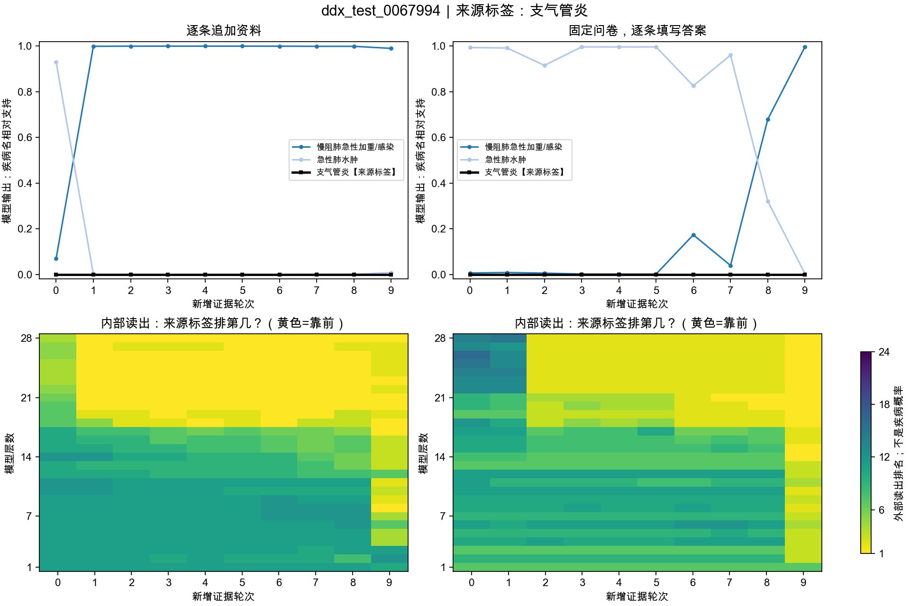

# ddx_test_0067994

源标签：Bronchitis。来源：DDxPlus test 第67994行（零起始）。

- 第0轮：Are you experiencing shortness of breath or difficulty breathing in a significant way? **Yes**
- 第1轮：Do you smoke cigarettes? **Yes**
- 第2轮：Have you noticed a wheezing sound when you exhale? **Yes**
- 第3轮：Do you have a fever (either felt or measured with a thermometer)? **Yes**
- 第4轮：Are your symptoms more prominent at night? **Yes**
- 第5轮：Have you traveled out of the country in the last 4 weeks? **No**
- 第6轮：Do you have a cough? **Yes**
- 第7轮：Do you have a cough that produces colored or more abundant sputum than usual? **Yes**
- 第8轮：Do you have a chronic obstructive pulmonary disease (COPD)? **Yes**
- 第9轮：Do you have pain somewhere, related to your reason for consulting? **Yes**；Characterize your pain: **sensitive; burning**；Do you feel pain somewhere? **breast(R); posterior chest wall(R); posterior chest wall(L)**；How intense is the pain? **Recorded scale value 2 on the dataset's 0-10 scale; endpoint meanings are unspecified**；Does the pain radiate to another location? **nowhere**；How precisely is the pain located? **Recorded scale value 5 on the dataset's 0-10 scale; endpoint meanings are unspecified**；How fast did the pain appear? **Recorded scale value 1 on the dataset's 0-10 scale; endpoint meanings are unspecified**

| 条件 | 轮 | 模型首选 | 标签支持 | 第21层读出首选 | 标签读出排名 |
|---|---|---|---:|---|---:|
| append | 0 | Acute pulmonary edema | 0.0000 | Acute pulmonary edema | 6 |
| append | 1 | Acute COPD exacerbation / infection | 0.0000 | Bronchitis | 1 |
| append | 2 | Acute COPD exacerbation / infection | 0.0000 | Bronchitis | 1 |
| append | 3 | Acute COPD exacerbation / infection | 0.0000 | Bronchitis | 1 |
| append | 4 | Acute COPD exacerbation / infection | 0.0000 | Bronchitis | 1 |
| append | 5 | Acute COPD exacerbation / infection | 0.0000 | Bronchitis | 1 |
| append | 6 | Acute COPD exacerbation / infection | 0.0000 | Bronchitis | 1 |
| append | 7 | Acute COPD exacerbation / infection | 0.0000 | Bronchitis | 1 |
| append | 8 | Acute COPD exacerbation / infection | 0.0000 | Bronchitis | 1 |
| append | 9 | Acute COPD exacerbation / infection | 0.0000 | Bronchitis | 1 |
| panel | 0 | Acute pulmonary edema | 0.0000 | Guillain-Barré syndrome | 9 |
| panel | 1 | Acute pulmonary edema | 0.0000 | Guillain-Barré syndrome | 8 |
| panel | 2 | Acute pulmonary edema | 0.0000 | Bronchospasm / acute asthma exacerbation | 4 |
| panel | 3 | Acute pulmonary edema | 0.0000 | Guillain-Barré syndrome | 4 |
| panel | 4 | Acute pulmonary edema | 0.0000 | Guillain-Barré syndrome | 4 |
| panel | 5 | Acute pulmonary edema | 0.0000 | Guillain-Barré syndrome | 4 |
| panel | 6 | Acute pulmonary edema | 0.0000 | Bronchospasm / acute asthma exacerbation | 2 |
| panel | 7 | Acute pulmonary edema | 0.0000 | Bronchitis | 1 |
| panel | 8 | Acute COPD exacerbation / infection | 0.0000 | Bronchitis | 1 |
| panel | 9 | Acute COPD exacerbation / infection | 0.0000 | Bronchitis | 1 |

## 图怎么读

上排看模型实际更支持哪种病，黑线是来源标签；下排看每层内部状态经独立训练的读出器后，来源标签排第几，黄色更靠前。两张图测量的对象不同，下排不代表模型自己报出的概率。

- 逐条追加终点：模型输出首选**慢阻肺急性加重/感染**；第28层外部读出首选**支气管炎**。
- 固定问卷终点：模型输出首选**慢阻肺急性加重/感染**；第28层外部读出首选**支气管炎**。
