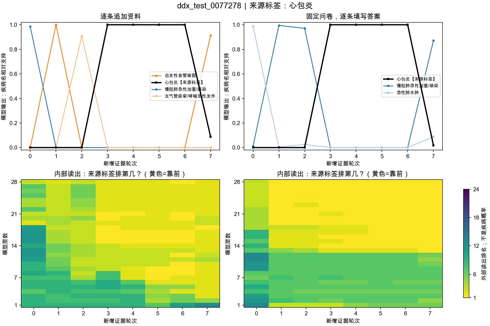

# ddx_test_0077278

源标签：Pericarditis。来源：DDxPlus test 第77278行（零起始）。

- 第0轮：Are you experiencing shortness of breath or difficulty breathing in a significant way? **Yes**
- 第1轮：Do you have pain somewhere, related to your reason for consulting? **Yes**；Characterize your pain: **a knife stroke; sharp**；Do you feel pain somewhere? **lower chest; breast(R)**；How intense is the pain? **Recorded scale value 8 on the dataset's 0-10 scale; endpoint meanings are unspecified**；Does the pain radiate to another location? **nowhere**；How precisely is the pain located? **Recorded scale value 7 on the dataset's 0-10 scale; endpoint meanings are unspecified**；How fast did the pain appear? **Recorded scale value 7 on the dataset's 0-10 scale; endpoint meanings are unspecified**
- 第2轮：Do you have pain that is increased when you breathe in deeply? **Yes**
- 第3轮：Have you ever had a pericarditis? **Yes**
- 第4轮：Have you traveled out of the country in the last 4 weeks? **No**
- 第5轮：Do you feel your heart is beating fast (racing), irregularly (missing a beat) or do you feel palpitations? **Yes**
- 第6轮：Are your symptoms worse when lying down and alleviated while sitting up? **Yes**
- 第7轮：Have you recently had a viral infection? **Yes**

| 条件 | 轮 | 模型首选 | 标签支持 | 第21层读出首选 | 标签读出排名 |
|---|---|---|---:|---|---:|
| append | 0 | Acute COPD exacerbation / infection | 0.0000 | Bronchitis | 3 |
| append | 1 | Boerhaave | 0.0000 | Pulmonary embolism | 3 |
| append | 2 | Bronchospasm / acute asthma exacerbation | 0.0000 | Acute dystonic reactions | 3 |
| append | 3 | Pericarditis | 1.0000 | Pericarditis | 1 |
| append | 4 | Pericarditis | 1.0000 | Pericarditis | 1 |
| append | 5 | Pericarditis | 0.9999 | SLE | 2 |
| append | 6 | Pericarditis | 1.0000 | Pericarditis | 1 |
| append | 7 | Boerhaave | 0.0876 | Pulmonary embolism | 2 |
| panel | 0 | Acute pulmonary edema | 0.0000 | Guillain-Barré syndrome | 4 |
| panel | 1 | Acute COPD exacerbation / infection | 0.0000 | Pericarditis | 1 |
| panel | 2 | Acute COPD exacerbation / infection | 0.0000 | Pericarditis | 1 |
| panel | 3 | Pericarditis | 1.0000 | Spontaneous pneumothorax | 2 |
| panel | 4 | Pericarditis | 1.0000 | Pericarditis | 1 |
| panel | 5 | Pericarditis | 1.0000 | Pericarditis | 1 |
| panel | 6 | Pericarditis | 1.0000 | Pericarditis | 1 |
| panel | 7 | Acute COPD exacerbation / infection | 0.0179 | Pericarditis | 1 |

## 图怎么读

上排看模型实际更支持哪种病，黑线是来源标签；下排看每层内部状态经独立训练的读出器后，来源标签排第几，黄色更靠前。两张图测量的对象不同，下排不代表模型自己报出的概率。

- 逐条追加终点：模型输出首选**自发性食管破裂**；第28层外部读出首选**肺栓塞**。
- 固定问卷终点：模型输出首选**慢阻肺急性加重/感染**；第28层外部读出首选**心包炎**。
