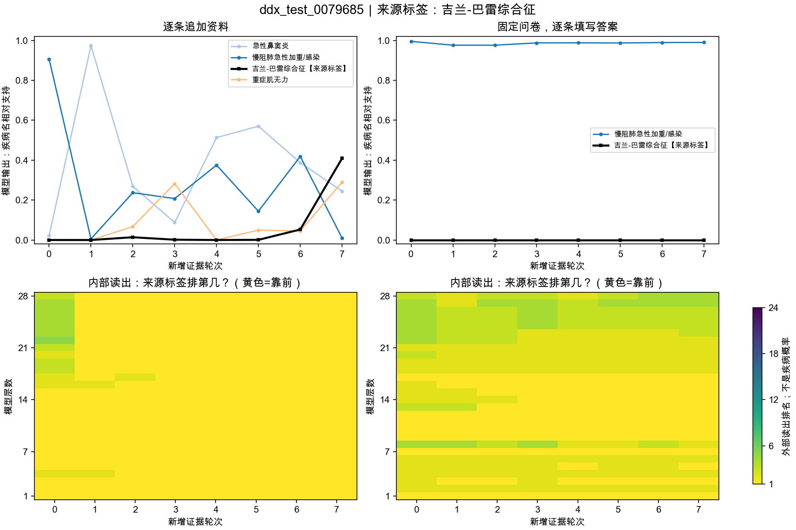

# ddx_test_0079685

源标签：Guillain-Barré syndrome。来源：DDxPlus test 第79685行（零起始）。

- 第0轮：Have you had weakness or paralysis on one side of the face, which may still be present or completely resolved? **Yes**
- 第1轮：Do you have numbness, loss of sensation or tingling in the feet? **Yes**
- 第2轮：Did you previously, or do you currently, have any weakness/paralysis in one or more of your limbs or in your face? **Yes**
- 第3轮：Do you feel weakness in both arms and/or both legs? **Yes**
- 第4轮：Have you recently had a viral infection? **Yes**
- 第5轮：Have you recently had numbness, loss of sensation or tingling, in both arms and legs and around your mouth? **Yes**
- 第6轮：Have you traveled out of the country in the last 4 weeks? **No**
- 第7轮：Do you currently, or did you ever, have numbness, loss of sensitivity or tingling anywhere on your body? **Yes**

| 条件 | 轮 | 模型首选 | 标签支持 | 第21层读出首选 | 标签读出排名 |
|---|---|---|---:|---|---:|
| append | 0 | Acute COPD exacerbation / infection | 0.0000 | Bronchitis | 3 |
| append | 1 | Acute rhinosinusitis | 0.0000 | Guillain-Barré syndrome | 1 |
| append | 2 | Acute rhinosinusitis | 0.0139 | Guillain-Barré syndrome | 1 |
| append | 3 | Myasthenia gravis | 0.0015 | Guillain-Barré syndrome | 1 |
| append | 4 | Acute rhinosinusitis | 0.0000 | Guillain-Barré syndrome | 1 |
| append | 5 | Acute rhinosinusitis | 0.0008 | Guillain-Barré syndrome | 1 |
| append | 6 | Acute COPD exacerbation / infection | 0.0526 | Guillain-Barré syndrome | 1 |
| append | 7 | Guillain-Barré syndrome | 0.4097 | Guillain-Barré syndrome | 1 |
| panel | 0 | Acute COPD exacerbation / infection | 0.0000 | Myasthenia gravis | 2 |
| panel | 1 | Acute COPD exacerbation / infection | 0.0000 | Myasthenia gravis | 2 |
| panel | 2 | Acute COPD exacerbation / infection | 0.0000 | Myasthenia gravis | 2 |
| panel | 3 | Acute COPD exacerbation / infection | 0.0000 | Myasthenia gravis | 2 |
| panel | 4 | Acute COPD exacerbation / infection | 0.0000 | Myasthenia gravis | 2 |
| panel | 5 | Acute COPD exacerbation / infection | 0.0000 | Myasthenia gravis | 2 |
| panel | 6 | Acute COPD exacerbation / infection | 0.0000 | Myasthenia gravis | 2 |
| panel | 7 | Acute COPD exacerbation / infection | 0.0000 | Myasthenia gravis | 2 |

## 图怎么读

上排看模型实际更支持哪种病，黑线是来源标签；下排看每层内部状态经独立训练的读出器后，来源标签排第几，黄色更靠前。两张图测量的对象不同，下排不代表模型自己报出的概率。

- 逐条追加终点：模型输出首选**吉兰-巴雷综合征**；第28层外部读出首选**吉兰-巴雷综合征**。
- 固定问卷终点：模型输出首选**慢阻肺急性加重/感染**；第28层外部读出首选**重症肌无力**。
