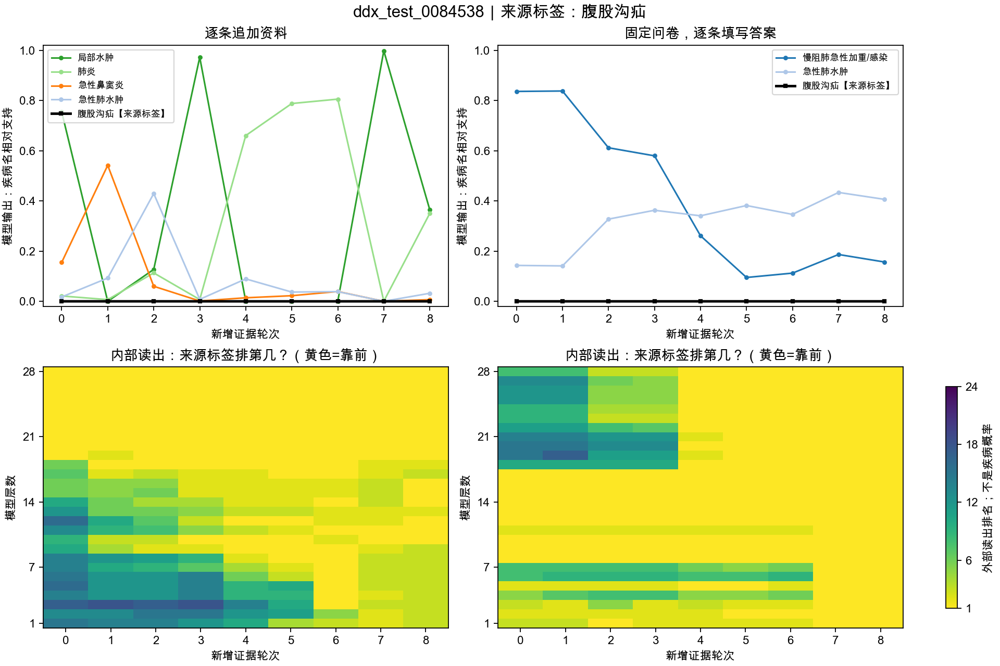

# ddx_test_0084538

源标签：Inguinal hernia。来源：DDxPlus test 第84538行（零起始）。

- 第0轮：Do you have any lesions, redness or problems on your skin that you believe are related to the condition you are consulting for? **Yes**；What color is the rash? **pale**；Do your lesions peel off? **No**；Is the rash swollen? **Recorded scale value 4 on the dataset's 0-10 scale; endpoint meanings are unspecified**；Where is the affected region located? **iliac fossa(R); iliac fossa(L)**；How intense is the pain caused by the rash? **Recorded scale value 6 on the dataset's 0-10 scale; endpoint meanings are unspecified**；Is the lesion (or are the lesions) larger than 1cm? **Yes**；How severe is the itching? **Recorded scale value 0 on the dataset's 0-10 scale; endpoint meanings are unspecified**
- 第1轮：Were you born prematurely or did you suffer any complication at birth? **Yes**
- 第2轮：Do you feel your abdomen is bloated or distended (swollen due to pressure from inside)? **Yes**
- 第3轮：Have you been able to pass stools or gas since your symptoms increased? **Yes**
- 第4轮：Do you have intense coughing fits? **Yes**
- 第5轮：Are the symptoms or pain increased with coughing, with an effort like lifting a weight or from forcing a bowel movement? **Yes**
- 第6轮：Have you traveled out of the country in the last 4 weeks? **No**
- 第7轮：Do you have pain somewhere, related to your reason for consulting? **Yes**；Characterize your pain: **heavy**；Do you feel pain somewhere? **iliac fossa(R); iliac fossa(L); hip(R); hip(L)**；How intense is the pain? **Recorded scale value 3 on the dataset's 0-10 scale; endpoint meanings are unspecified**；Does the pain radiate to another location? **nowhere**；How precisely is the pain located? **Recorded scale value 0 on the dataset's 0-10 scale; endpoint meanings are unspecified**；How fast did the pain appear? **Recorded scale value 1 on the dataset's 0-10 scale; endpoint meanings are unspecified**
- 第8轮：Are you significantly overweight compared to people of the same height as you? **Yes**

| 条件 | 轮 | 模型首选 | 标签支持 | 第21层读出首选 | 标签读出排名 |
|---|---|---|---:|---|---:|
| append | 0 | Localized edema | 0.0001 | Inguinal hernia | 1 |
| append | 1 | Acute rhinosinusitis | 0.0000 | Inguinal hernia | 1 |
| append | 2 | Acute pulmonary edema | 0.0001 | Inguinal hernia | 1 |
| append | 3 | Localized edema | 0.0000 | Inguinal hernia | 1 |
| append | 4 | Pneumonia | 0.0000 | Inguinal hernia | 1 |
| append | 5 | Pneumonia | 0.0000 | Inguinal hernia | 1 |
| append | 6 | Pneumonia | 0.0000 | Inguinal hernia | 1 |
| append | 7 | Localized edema | 0.0000 | Inguinal hernia | 1 |
| append | 8 | Localized edema | 0.0000 | Inguinal hernia | 1 |
| panel | 0 | Acute COPD exacerbation / infection | 0.0000 | Myasthenia gravis | 14 |
| panel | 1 | Acute COPD exacerbation / infection | 0.0000 | Myasthenia gravis | 14 |
| panel | 2 | Acute COPD exacerbation / infection | 0.0000 | Myasthenia gravis | 12 |
| panel | 3 | Acute COPD exacerbation / infection | 0.0000 | Myasthenia gravis | 12 |
| panel | 4 | Acute pulmonary edema | 0.0000 | HIV (initial infection) | 2 |
| panel | 5 | Acute pulmonary edema | 0.0000 | Inguinal hernia | 1 |
| panel | 6 | Acute pulmonary edema | 0.0000 | Inguinal hernia | 1 |
| panel | 7 | Acute pulmonary edema | 0.0000 | Inguinal hernia | 1 |
| panel | 8 | Acute pulmonary edema | 0.0000 | Inguinal hernia | 1 |

## 图怎么读

上排看模型实际更支持哪种病，黑线是来源标签；下排看每层内部状态经独立训练的读出器后，来源标签排第几，黄色更靠前。两张图测量的对象不同，下排不代表模型自己报出的概率。

- 逐条追加终点：模型输出首选**局部水肿**；第28层外部读出首选**腹股沟疝**。
- 固定问卷终点：模型输出首选**急性肺水肿**；第28层外部读出首选**腹股沟疝**。
