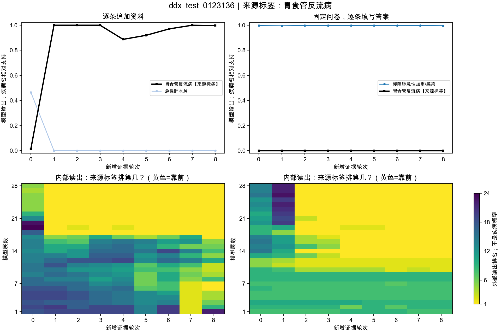

# ddx_test_0123136

源标签：GERD。来源：DDxPlus test 第123136行（零起始）。

- 第0轮：Do you have pain somewhere, related to your reason for consulting? **Yes**；Characterize your pain: **sensitive; burning; sickening; scary**；Do you feel pain somewhere? **upper chest; hypochondrium(L); epigastric**；How intense is the pain? **Recorded scale value 4 on the dataset's 0-10 scale; endpoint meanings are unspecified**；Does the pain radiate to another location? **upper chest**；How precisely is the pain located? **Recorded scale value 2 on the dataset's 0-10 scale; endpoint meanings are unspecified**；How fast did the pain appear? **Recorded scale value 2 on the dataset's 0-10 scale; endpoint meanings are unspecified**
- 第1轮：Do you have a hiatal hernia? **Yes**
- 第2轮：Do you have symptoms that get worse after eating? **Yes**
- 第3轮：Do you think you are pregnant or are you currently pregnant? **Yes**
- 第4轮：Have you recently thrown up blood or something resembling coffee beans? **Yes**
- 第5轮：Do you smoke cigarettes? **Yes**
- 第6轮：Do you have asthma or have you ever had to use a bronchodilator in the past? **Yes**
- 第7轮：Have you traveled out of the country in the last 4 weeks? **No**
- 第8轮：Do you have a burning sensation that starts in your stomach then goes up into your throat, and can be associated with a bitter taste in your mouth? **Yes**

| 条件 | 轮 | 模型首选 | 标签支持 | 第21层读出首选 | 标签读出排名 |
|---|---|---|---:|---|---:|
| append | 0 | Acute pulmonary edema | 0.0161 | Pericarditis | 13 |
| append | 1 | GERD | 1.0000 | GERD | 1 |
| append | 2 | GERD | 1.0000 | GERD | 1 |
| append | 3 | GERD | 1.0000 | GERD | 1 |
| append | 4 | GERD | 0.8872 | GERD | 1 |
| append | 5 | GERD | 0.9196 | GERD | 1 |
| append | 6 | GERD | 0.9707 | GERD | 1 |
| append | 7 | GERD | 0.9998 | GERD | 1 |
| append | 8 | GERD | 0.9977 | GERD | 1 |
| panel | 0 | Acute COPD exacerbation / infection | 0.0000 | Pericarditis | 11 |
| panel | 1 | Acute COPD exacerbation / infection | 0.0000 | Pericarditis | 19 |
| panel | 2 | Acute COPD exacerbation / infection | 0.0000 | Pericarditis | 3 |
| panel | 3 | Acute COPD exacerbation / infection | 0.0000 | GERD | 1 |
| panel | 4 | Acute COPD exacerbation / infection | 0.0000 | GERD | 1 |
| panel | 5 | Acute COPD exacerbation / infection | 0.0000 | GERD | 1 |
| panel | 6 | Acute COPD exacerbation / infection | 0.0000 | GERD | 1 |
| panel | 7 | Acute COPD exacerbation / infection | 0.0000 | GERD | 1 |
| panel | 8 | Acute COPD exacerbation / infection | 0.0000 | GERD | 1 |

## 图怎么读

上排看模型实际更支持哪种病，黑线是来源标签；下排看每层内部状态经独立训练的读出器后，来源标签排第几，黄色更靠前。两张图测量的对象不同，下排不代表模型自己报出的概率。

- 逐条追加终点：模型输出首选**胃食管反流病**；第28层外部读出首选**胃食管反流病**。
- 固定问卷终点：模型输出首选**慢阻肺急性加重/感染**；第28层外部读出首选**胃食管反流病**。
