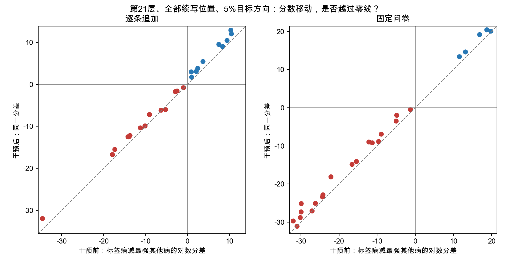

# 方向有效，为什么没有新增正确诊断？

阶段15完成后的事后分解。原主检验检验目标/预定竞争病分数是否定向改变；这里另计算标签病与每个条件下49病最强其他病的分差。分差大于0才表示标签病成为首选。该阈值是当前字符串排序的决策边界，不是临床概率阈值。

## 第21层、全部续写位置、5%方向增量

| 呈现 | 原始命中 | 干预后命中 | 由错转对 | 原本错误病例的落后幅度中位数 | 这些病例的分差增益中位数 |
|---|---:|---:|---:|---:|---:|
| 逐条追加 | 10/24 | 10/24 | 0 | 10.681 | 1.166 |
| 固定问卷 | 5/24 | 5/24 | 0 | 22.119 | 1.516 |

高于斜虚线表示标签病相对最强其他病得到了加强；越过水平零线才会从错变对。目标方向造成可测量的输出作用，却没有在当前强度下新增正确诊断。8种主条件均未出现由错转对，也未出现由对转错；少数首选变化发生在错误病之间。

这将结论具体化为：**这些方向有影响输出的能力，但在当前病例和干预强度下，没有取得足以改变诊断正确性的影响。** 未运行更强剂量的剂量扫描，不推断增加强度一定能修复诊断。

[全部条件分差](decision_margins.csv) · [精确汇总](decision_summary.json) · [主检验](RESULTS.md)
