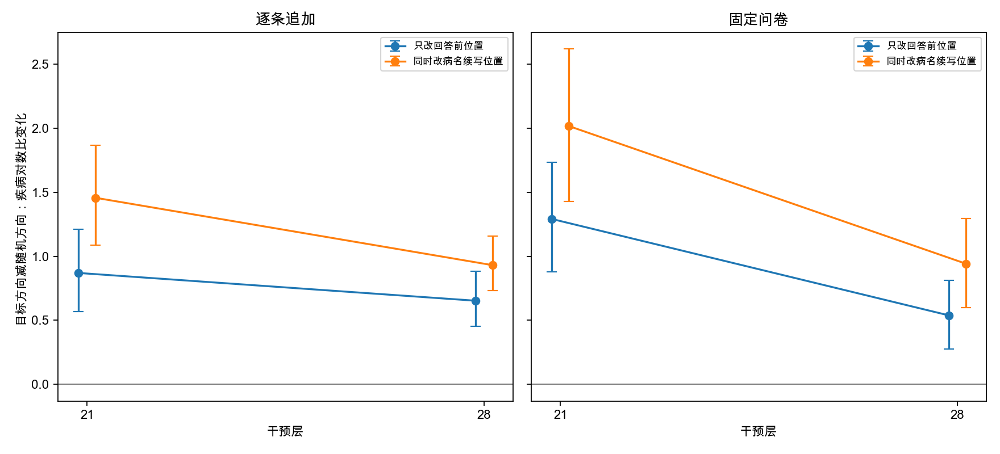
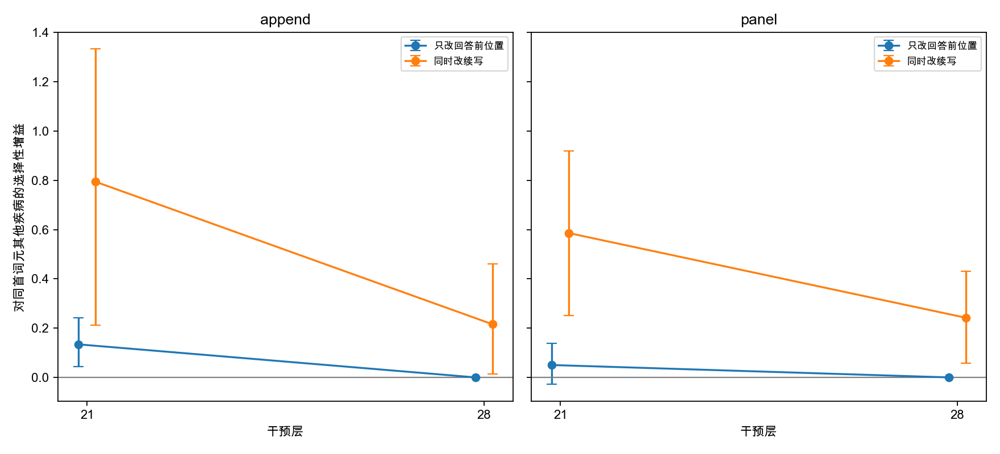

# 阶段15：可读出的疾病方向，能否真正改变诊断？

## 方法

仅用旧120例终点学习24类疾病线性读出器，在新24例预定中间轮干预。比较逐条追加与固定问卷两条件、第21与28层、仅回答前位置与同时覆盖整个答案续写位置（含JSON闭合符及EOS预测）。目标为来源疾病，竞争者为未干预模型的最高非目标候选（24类内）。目标方向为两类权重之差；5%原状态范数为主剂量，2%为锚点敏感性。反向与同范数随机方向为对照。标签用于实验靶向，不作为可部署方法的输入。根据分词字符偏移，将病名词元与其余格式词元的贡献另行分解。

共672个有效记录中的干预条件（包含数值不稳定者的原始记录），48个零干预；通过零干预数值标准48/48个病例×呈现前缀。未通过者排除主要效应但保留在原始表。疾病相对支持采用完整序列评分。

## 结果

| 呈现 | 干预位置 | 层 | 目标方向减随机：目标/竞争病对数比增益 | 对同首词元疾病的选择性增益 | 主对比Holm p |
|---|---|---|---|---|---|
| append | anchor | 21 | 0.8697 [0.5675, 1.2130] | 0.1340 [0.0440, 0.2419] | 0.00040 |
| append | anchor | 28 | 0.6530 [0.4544, 0.8815] | 0.00（样本内全零） | 0.00040 |
| append | all_answer_positions | 21 | 1.4567 [1.0879, 1.8663] | 0.7941 [0.2124, 1.3336] | 0.00040 |
| append | all_answer_positions | 28 | 0.9308 [0.7337, 1.1562] | 0.2158 [0.0135, 0.4600] | 0.00040 |
| panel | anchor | 21 | 1.2913 [0.8799, 1.7327] | 0.0502 [-0.0281, 0.1375] | 0.00040 |
| panel | anchor | 28 | 0.5387 [0.2738, 0.8142] | 0.00（样本内全零） | 0.00065 |
| panel | all_answer_positions | 21 | 2.0169 [1.4270, 2.6184] | 0.5857 [0.2516, 0.9188] | 0.00040 |
| panel | all_answer_positions | 28 | 0.9426 [0.5979, 1.2940] | 0.2422 [0.0577, 0.4314] | 0.00040 |

第一项检验目标方向是否比随机方向更能改变相应疾病的相对输出；第二项检验变化是否超出病名首词元共同变化。第二项只有目标病存在同首词元其他候选时才适用，分母在summary中独立报告。所有区间按病例重采样，8个主对比采用配对符号置换并Holm校正；其他指标为描述性。由于原生49病首选可能不在24类读出空间内，另补充目标病相对原生49病最强非目标的对数比，以及目标干预减随机干预的49病命中差；这些事后补充不替换预定主对比。

## 解释范围

沿读出器权重方向改变状态，会直接改变该读出器自身的分数，这不是独立证据。独立结果是原模型完整病名的输出如何变化。最后层锚点只影响首词元；续写全位置干预也可能直接改变词汇生成。只有方向效应、同首词元选择性和不同呈现条件共同支持时，才能将结论推进到跨词汇形式的疾病信息使用。

[逐条件结果](conditions.csv) · [逐病例配对](paired_cases.csv) · [零干预检查](shams.csv) · [精确汇总](summary.json)
