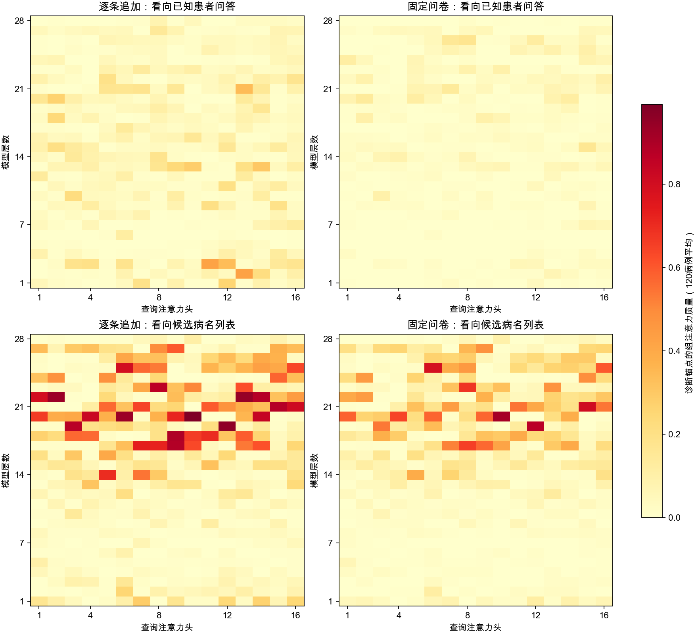

# 120例的逐层、逐头注意力

## 测量

同一新120例终点、1.7B的28层×16个查询头，测量回答前诊断位置看向输入各部分的注意力质量。先在每例内部汇总，再对病例求均值及区间。固定问卷的已知项为当前症状和病史问答；追加式将全部已揭示证据组合并。格式包含系统/任务指令、特殊词元、证据标记及回答前缀；不是“没有信息”的同义词。

| 输入方式 | 第21—28层：已知问答 | 候选列表 | 未知字段 | 格式与指令 |
|---|---|---|---|---|
| 逐条追加 | 4.23% [4.02, 4.45] | 21.98% [21.51, 22.42] | 0.00%（样本内全零） | 73.61% [73.24, 74.00] |
| 固定问卷 | 2.92% [2.72, 3.12] | 15.44% [15.07, 15.81] | 7.71% [7.50, 7.91] | 73.82% [73.56, 74.07] |

颜色越深表示该头在诊断位置分配给相应输入组的注意力越多。两个输入条件的token数量不同，原始质量不能单独判断是否忽略信息；逐头CSV同时给出每token质量。头编号只在同一个模型配置中对应，不代表不同模型中的同一种功能。

注意力质量是信息读取位置的描述，不是该信息对疾病选择的因果贡献。阶段19固定长度的已知资料前移/后移对照显示，注意力增多未伴随更好的诊断；阶段15才进一步检验内部方向的输出作用。

[全部107520个病例×层×头记录](endpoint_attention_heads.csv) · [病例汇总](endpoint_attention_patients.csv) · [精确均值与区间](attention_summary.json)
