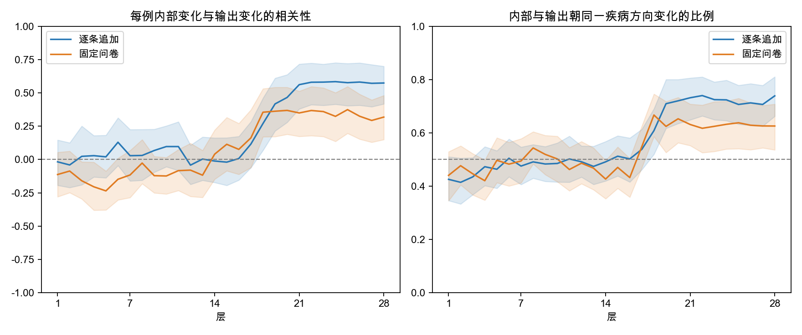

# 内部与输出不同步，是否意味着完全无关？

## 方法

事后连续量分析，沿用全部24例、每种呈现184次自然证据更新。对一次更新固定“来源标签病—前轮24类中最强非标签病”，分别计算外部读出分差与原模型完整序列对数分差的变化。先在每例内部计算相关及同方向比例，再按病例汇总；竞争病可以在不同事件间变化，但一次事件前后固定。近零变化不进入同方向比例，病例分母和有效事件数均保存。

## 结果

| 呈现 | 层 | 病例平均Spearman相关 | 同方向变化比例 |
|---|---:|---|---|
| 逐条追加 | 21 | 0.5627 [0.3804, 0.7177] | 73.22% [64.92, 80.65] |
| 逐条追加 | 28 | 0.5753 [0.4179, 0.7009] | 73.93% [66.27, 81.10] |
| 固定问卷 | 21 | 0.3501 [0.1738, 0.5140] | 63.17% [55.25, 70.84] |
| 固定问卷 | 28 | 0.3190 [0.1501, 0.4817] | 62.60% [53.62, 70.82] |

首选是否更换与连续分数是否一起移动回答不同问题。前者受排名交叉影响，后者描述变化的方向与幅度关联；内部首选保持，仍可能发生与输出一致的分差变化。相关性不估计自然更新的因果中介比例，也不把两个不同评分系统校准为同一疾病概率。图中0.5仅为同向比例参考线，不是经置换得到的统计零假设。

同病例固定问卷减追加式的第28层相关差为-0.2563 [-0.4463, -0.0591]，同向比例差为-0.1134 [-0.2205, -0.0047]。这是事后配对描述，不对所有层重复进行显著性筛选。

[每次更新](natural_alignment_updates.csv) · [病例统计](natural_alignment_cases.csv) · [精确汇总](natural_alignment_summary.json)
