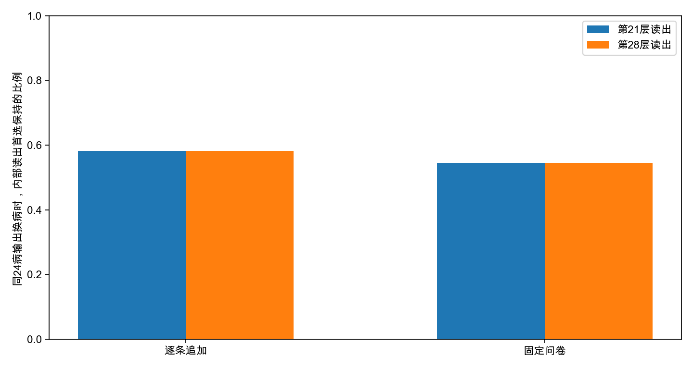
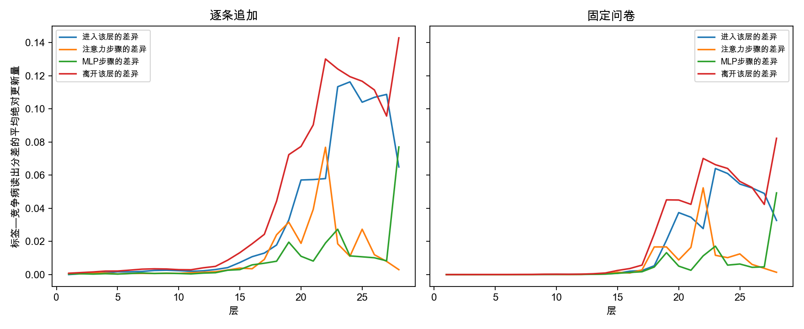

# 阶段16：把输出转向与内部疾病变化接起来

## 问题

新增证据后模型换病时，各层可读出的疾病也同步更换吗？变化经过attention和MLP时怎样被增减？

## 方法

沿用新24例两种呈现的全部轮次，读出头只在旧120例终点训练。统计每次输出首选更换时，第21/28层读出首选是否保持。先病例内求比例，再对有相应事件的病例汇总，分母在summary中保留。

| 呈现 | 同24病输出换病次数 | 第21层首选保持比例 | 第28层首选保持比例 |
|---|---:|---|---|
| append | 59 | 58.17% [38.83, 77.17] | 58.17% [41.67, 75.84] |
| panel | 16 | 54.55% [27.27, 77.39] | 54.55% [27.27, 81.82] |

主要比较统一限制到同24病；49病原始转向和病名分解另行保留。首选保持不代表内部向量没有变化，也不自动代表内部判断正确；同一表中进一步保存“保持的是最终标签病”的比例。读出分差方向与模型输出方向相反的比例独立记录，使用同一疾病对，避免随轮次换竞争病造成假变化。

## 每层计算怎样改变疾病相关分差

对每次更新固定“最终标签病—上一轮最强非标签病”作为比较，分别读取进入层、attention后、MLP后的归一化状态。新旧轮次的离层分差变化严格分解为：进入层的变化＋attention步骤变化＋MLP步骤变化。这是读出分数的数学分解，不把线性读出分量当作模块的医学因果贡献；阶段15的干预才检验输出作用。

## 自然更新与输出路径

自然新增证据改变整段输入，既能改变病名开头，也能改变后续词元。与最后层锚点干预不同，同首词元疾病之间的自然转向是真正由病名后续条件概率决定的。因此不能把全部诊断跳变都归为首词元效应，也不能用一个最后层锚点替换覆盖整个诊断更新机制。

[逐证据内部变化](evidence_internal_changes.csv) · [28层计算分解](block_readout_decomposition.csv) · [自然转向分解](natural_switches.csv) · [精确结果](summary.json)
