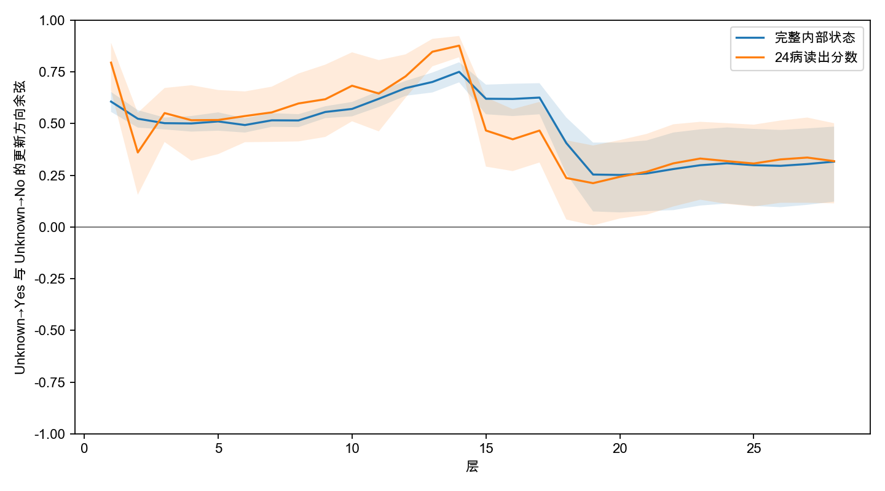

# 阶段17：模型是否区分“有”和“没有”？

## 方法

在新24例中，各选一个距中间轮最近的单字段二元证据组。固定223问题和其他答案，将来源Yes改为No，与同字段Unknown比较。Yes和Unknown复用自然观测，No为新增反事实；全部选择只依据字段类型与轮次。Yes/No同token长度：24/24。反事实未设置最终疾病标签，不评价其诊断正确率。

## 结果

- Yes与No使49病首选不同：20.83% [4.17, 37.50]。
- Yes/No分布JS：0.1001 [0.0164, 0.2079]。
- 第21层外部读出首选随Yes/No改变：29.17% [12.50, 50.00]；第28层：16.67% [4.17, 33.33]。
- 第21层完整状态中，Unknown→Yes与Unknown→No的更新方向余弦：0.2586 [0.0767, 0.4182]；第28层：0.3160 [0.1227, 0.4852]。

更新方向同向并不自动证明模型忽略否定，因为两者都包含“未知变为已知”的共同变化。输出与读出首选是否区分Yes/No、两个条件分别转向什么疾病，需要同时查看。相同首选也不代表完整分布相同。

## 全部病例

| 病例 | 被修改的问题 | Unknown首选 | Yes首选 | No首选 |
|---|---|---|---|---|
| ddx_test_0005881 | Do you have chronic kidney failure? | Anemia | Anemia | Anemia |
| ddx_test_0006854 | Is your BMI less than 18.5, or are you underweight? | Anemia | Anemia | Anemia |
| ddx_test_0017896 | Have you had sexual intercourse with an HIV-positive partner in the past 12 months? | Acute COPD exacerbation / infection | Acute COPD exacerbation / infection | Acute COPD exacerbation / infection |
| ddx_test_0027885 | Are you significantly overweight compared to people of the same height as you? | Acute COPD exacerbation / infection | Acute COPD exacerbation / infection | Acute COPD exacerbation / infection |
| ddx_test_0032489 | Do you suddenly have difficulty or an inability to open your mouth or have jaw pain when opening it? | Acute COPD exacerbation / infection | Acute COPD exacerbation / infection | Acute COPD exacerbation / infection |
| ddx_test_0037913 | Have you ever had a pericarditis? | Acute COPD exacerbation / infection | Pericarditis | Acute COPD exacerbation / infection |
| ddx_test_0041136 | Do you have a fever (either felt or measured with a thermometer)? | Acute COPD exacerbation / infection | Acute COPD exacerbation / infection | Acute COPD exacerbation / infection |
| ddx_test_0042118 | Do you have a cough that produces colored or more abundant sputum than usual? | Acute COPD exacerbation / infection | Acute COPD exacerbation / infection | Acute COPD exacerbation / infection |
| ddx_test_0044249 | Are you feeling nauseous or do you feel like vomiting? | Acute COPD exacerbation / infection | Acute COPD exacerbation / infection | Acute COPD exacerbation / infection |
| ddx_test_0045887 | Have you had significantly increased sweating? | Acute COPD exacerbation / infection | Acute COPD exacerbation / infection | Acute COPD exacerbation / infection |
| ddx_test_0048692 | Have you been coughing up blood? | Pulmonary embolism | Acute COPD exacerbation / infection | Pulmonary embolism |
| ddx_test_0060159 | Do you suddenly have difficulty or an inability to open your mouth or have jaw pain when opening it? | Acute pulmonary edema | Acute pulmonary edema | Acute pulmonary edema |
| ddx_test_0061730 | Do you drink alcohol excessively or do you have an addiction to alcohol? | Acute COPD exacerbation / infection | Acute COPD exacerbation / infection | Acute COPD exacerbation / infection |
| ddx_test_0062355 | Have you been treated in hospital recently for nausea, agitation, intoxication or aggressive behavior and received medication via an intravenous or intramuscular route? | Acute laryngitis | Acute COPD exacerbation / infection | Acute COPD exacerbation / infection |
| ddx_test_0064225 | Do you currently undergo dialysis? | Acute COPD exacerbation / infection | Acute COPD exacerbation / infection | Acute COPD exacerbation / infection |
| ddx_test_0067994 | Are your symptoms more prominent at night? | Acute pulmonary edema | Acute pulmonary edema | Acute pulmonary edema |
| ddx_test_0077278 | Have you ever had a pericarditis? | Acute COPD exacerbation / infection | Pericarditis | Acute COPD exacerbation / infection |
| ddx_test_0079685 | Do you feel weakness in both arms and/or both legs? | Acute COPD exacerbation / infection | Acute COPD exacerbation / infection | Acute COPD exacerbation / infection |
| ddx_test_0084538 | Do you have intense coughing fits? | Acute COPD exacerbation / infection | Acute pulmonary edema | Acute COPD exacerbation / infection |
| ddx_test_0101113 | Do you have pain that is increased when you breathe in deeply? | Spontaneous pneumothorax | Spontaneous pneumothorax | Spontaneous pneumothorax |
| ddx_test_0108184 | Are you experiencing shortness of breath or difficulty breathing in a significant way? | Acute COPD exacerbation / infection | Acute pulmonary edema | Acute COPD exacerbation / infection |
| ddx_test_0110714 | Did you lose consciousness? | Acute COPD exacerbation / infection | Acute COPD exacerbation / infection | Acute COPD exacerbation / infection |
| ddx_test_0123136 | Have you recently thrown up blood or something resembling coffee beans? | Acute COPD exacerbation / infection | Acute COPD exacerbation / infection | Acute COPD exacerbation / infection |
| ddx_test_0134351 | Have you been coughing up blood? | Acute COPD exacerbation / infection | Acute COPD exacerbation / infection | Acute COPD exacerbation / infection |

[逐病例指标](case_results.csv) · [逐层更新](layer_updates.csv) · [精确汇总](summary.json)
