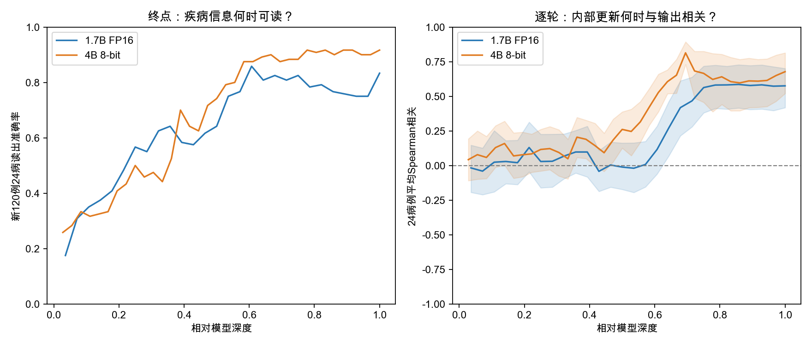

# 4B：信息可读与输出更新的逐层关系

沿用1.7B的连续量分析：每次新证据固定标签病与前轮24类最强非标签病，比较读出分差和原输出对数分差的变化。使用相同24例184次更新、36层读出，先病例内计算再汇总。此为在观察1.7B曲线后追加的描述性复核，未预定特定转折层。

| 层 | 病例平均相关 | 同方向比例 |
|---:|---|---|
| 9 | 0.1159 [-0.0396, 0.2614] | 44.82% [38.46, 51.09] |
| 18 | 0.2607 [0.1261, 0.3875] | 59.76% [53.42, 65.94] |
| 27 | 0.6654 [0.4562, 0.8246] | 80.50% [71.54, 88.61] |
| 36 | 0.6774 [0.5203, 0.8137] | 81.35% [73.30, 88.48] |

左图是120例终点分类，右图是24例自然证据更新，两图统计对象与纵轴不同。比较曲线形状用于区分可读性与更新关联，不能从某个层的拐点直接定位因果回路。4B为8-bit、1.7B为FP16，不把差异只归于参数规模。

[病例统计](natural_alignment_cases.csv) · [每次更新](natural_alignment_updates.csv) · [精确汇总](natural_alignment_summary.json)
