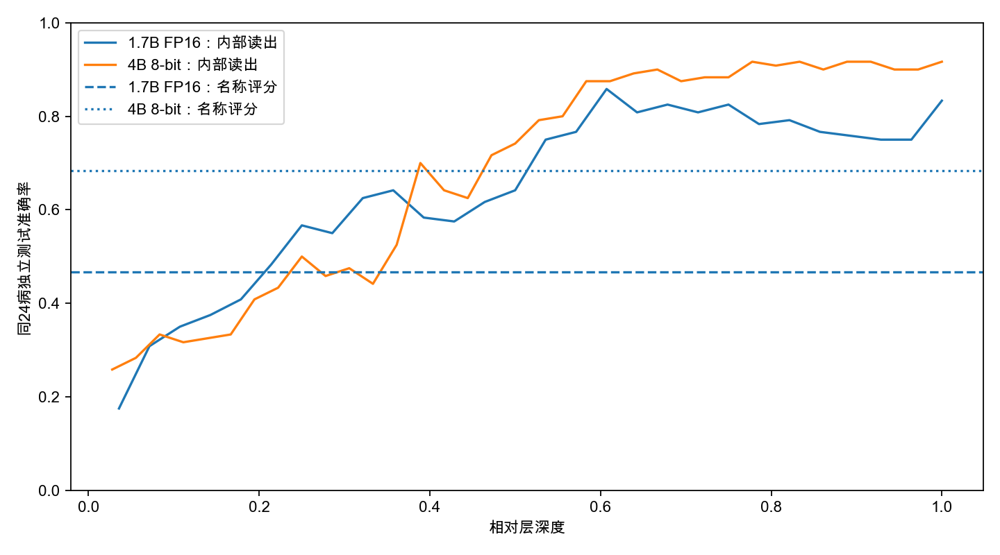

# 阶段18：在4B配置上复核

同一旧120例训练、新120例测试，24例全部逐轮前缀，共424次追加式观测；另加同24例固定问卷终点复核，共448次。模型为项目已下载的Qwen3-4B 8-bit，36层、隐藏维2560、32个查询注意力头；聊天模板关闭显式thinking。此处不运行疾病方向干预，也不训练4B固定问卷专用读出头。

| 指标 | 1.7B FP16 | 4B 8-bit |
|---|---|---|
| 原模型49病终点命中 | 36.67% [28.33, 45.83] | 62.50% [53.33, 70.85] |
| 原模型限制24病命中 | 46.67% [37.50, 55.00] | 68.33% [60.00, 76.67] |
| 四分之三深度内部读出 | 82.50% [75.00, 89.17] | 88.33% [82.50, 94.17] |
| 最终层内部读出 | 83.33% [76.67, 90.00] | 91.67% [86.67, 96.67] |

新24例共184次证据更新：4B配置首选切换55次，任一病支持单次变化≥50个百分点53次；至少一次命中后偏离标签的病例比例为37.50% [20.83, 58.33]。

同24类输出切换时，第27层读出首选保持比例为56.98% [38.10, 75.24]，第36层为51.43% [33.96, 69.37]。按有切换的病例先求比例再汇总。

这项复核改变了参数规模和量化设置，不能把差异单独归因于模型更大；两者均来自Qwen3系列、同一模拟来源，不能称跨架构或外部临床验证。当前因果干预结果仍限定1.7B。

评分接口补充：4B贪心实际续写标签命中62.50% [53.33, 70.85]，117/120例生成可解析的规范候选病名；规范字符串总质量中位数0.9999，低于0.1的有0例。序列总分与每token平均分的首选一致率为99.17%。

额外24例固定问卷的49病终点准确率为16.67% [4.17, 33.33]，同24例追加式为66.67% [49.90, 83.33]。该项在1.7B呈现现象出现后预定，属于另一模型配置的探索性复核；完整预测分布见[固定问卷病例表](fixed_panel_cases.csv)。

[逐病例终点](endpoint_cases.csv) · [逐轮变化](evidence_updates.csv) · [逐轮读出](prefix_trajectories.csv) · [精确汇总](summary.json)
