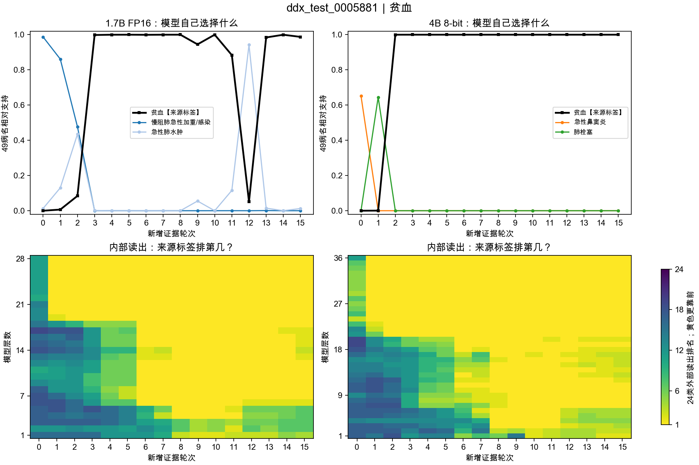

# ddx_test_0005881：两模型配置的同一条证据轨迹

来源标签：贫血（Anemia）。全部轮次使用相同追加式事实。

上排黑线是来源标签病的模型支持；下排黄色表示从内部更容易识别来源标签。两模型读出器分别只用相同旧120例训练；隐藏维、层数及精度不同。

| 模型配置 | 轮次 | 模型首选 | 标签病支持 | 最后层读出首选 | 标签读出排名 |
|---|---:|---|---:|---|---:|
| 1.7B FP16 | 0 | 慢阻肺急性加重/感染 | 0.00000 | 支气管炎 | 11 |
| 1.7B FP16 | 1 | 慢阻肺急性加重/感染 | 0.00651 | 贫血 | 1 |
| 1.7B FP16 | 2 | 慢阻肺急性加重/感染 | 0.08403 | 贫血 | 1 |
| 1.7B FP16 | 3 | 贫血 | 0.99826 | 贫血 | 1 |
| 1.7B FP16 | 4 | 贫血 | 0.99977 | 贫血 | 1 |
| 1.7B FP16 | 5 | 贫血 | 0.99997 | 贫血 | 1 |
| 1.7B FP16 | 6 | 贫血 | 0.99921 | 贫血 | 1 |
| 1.7B FP16 | 7 | 贫血 | 0.99992 | 贫血 | 1 |
| 1.7B FP16 | 8 | 贫血 | 0.99998 | 贫血 | 1 |
| 1.7B FP16 | 9 | 贫血 | 0.94497 | 贫血 | 1 |
| 1.7B FP16 | 10 | 贫血 | 0.99995 | 贫血 | 1 |
| 1.7B FP16 | 11 | 贫血 | 0.88395 | 贫血 | 1 |
| 1.7B FP16 | 12 | 急性肺水肿 | 0.05154 | 贫血 | 1 |
| 1.7B FP16 | 13 | 贫血 | 0.98428 | 贫血 | 1 |
| 1.7B FP16 | 14 | 贫血 | 0.99963 | 贫血 | 1 |
| 1.7B FP16 | 15 | 贫血 | 0.98753 | 贫血 | 1 |
| 4B 8-bit | 0 | 急性鼻窦炎 | 0.00000 | 支气管炎 | 11 |
| 4B 8-bit | 1 | 肺栓塞 | 0.00057 | 贫血 | 1 |
| 4B 8-bit | 2 | 贫血 | 0.99990 | 贫血 | 1 |
| 4B 8-bit | 3 | 贫血 | 1.00000 | 贫血 | 1 |
| 4B 8-bit | 4 | 贫血 | 1.00000 | 贫血 | 1 |
| 4B 8-bit | 5 | 贫血 | 1.00000 | 贫血 | 1 |
| 4B 8-bit | 6 | 贫血 | 1.00000 | 贫血 | 1 |
| 4B 8-bit | 7 | 贫血 | 1.00000 | 贫血 | 1 |
| 4B 8-bit | 8 | 贫血 | 1.00000 | 贫血 | 1 |
| 4B 8-bit | 9 | 贫血 | 1.00000 | 贫血 | 1 |
| 4B 8-bit | 10 | 贫血 | 1.00000 | 贫血 | 1 |
| 4B 8-bit | 11 | 贫血 | 1.00000 | 贫血 | 1 |
| 4B 8-bit | 12 | 贫血 | 1.00000 | 贫血 | 1 |
| 4B 8-bit | 13 | 贫血 | 1.00000 | 贫血 | 1 |
| 4B 8-bit | 14 | 贫血 | 1.00000 | 贫血 | 1 |
| 4B 8-bit | 15 | 贫血 | 1.00000 | 贫血 | 1 |

[每轮实际新增证据](../../14_fixed_panel/cases/ddx_test_0005881.md)。这些轮次表示获得资料的顺序，不是患者病情的时间进展。
