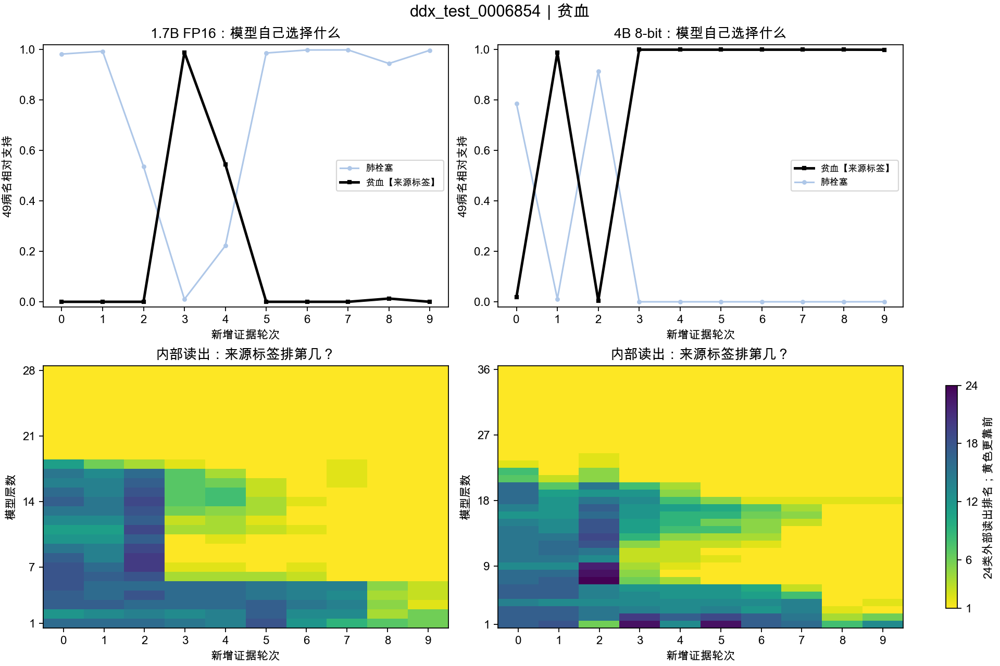

# ddx_test_0006854：两模型配置的同一条证据轨迹

来源标签：贫血（Anemia）。全部轮次使用相同追加式事实。

上排黑线是来源标签病的模型支持；下排黄色表示从内部更容易识别来源标签。两模型读出器分别只用相同旧120例训练；隐藏维、层数及精度不同。

| 模型配置 | 轮次 | 模型首选 | 标签病支持 | 最后层读出首选 | 标签读出排名 |
|---|---:|---|---:|---|---:|
| 1.7B FP16 | 0 | 肺栓塞 | 0.00000 | 贫血 | 1 |
| 1.7B FP16 | 1 | 肺栓塞 | 0.00000 | 贫血 | 1 |
| 1.7B FP16 | 2 | 肺栓塞 | 0.00000 | 贫血 | 1 |
| 1.7B FP16 | 3 | 贫血 | 0.98960 | 贫血 | 1 |
| 1.7B FP16 | 4 | 贫血 | 0.54568 | 贫血 | 1 |
| 1.7B FP16 | 5 | 肺栓塞 | 0.00001 | 贫血 | 1 |
| 1.7B FP16 | 6 | 肺栓塞 | 0.00000 | 贫血 | 1 |
| 1.7B FP16 | 7 | 肺栓塞 | 0.00000 | 贫血 | 1 |
| 1.7B FP16 | 8 | 肺栓塞 | 0.01288 | 贫血 | 1 |
| 1.7B FP16 | 9 | 肺栓塞 | 0.00000 | 贫血 | 1 |
| 4B 8-bit | 0 | 肺栓塞 | 0.01910 | 贫血 | 1 |
| 4B 8-bit | 1 | 贫血 | 0.98814 | 贫血 | 1 |
| 4B 8-bit | 2 | 肺栓塞 | 0.00415 | 贫血 | 1 |
| 4B 8-bit | 3 | 贫血 | 1.00000 | 贫血 | 1 |
| 4B 8-bit | 4 | 贫血 | 1.00000 | 贫血 | 1 |
| 4B 8-bit | 5 | 贫血 | 0.99997 | 贫血 | 1 |
| 4B 8-bit | 6 | 贫血 | 0.99998 | 贫血 | 1 |
| 4B 8-bit | 7 | 贫血 | 1.00000 | 贫血 | 1 |
| 4B 8-bit | 8 | 贫血 | 1.00000 | 贫血 | 1 |
| 4B 8-bit | 9 | 贫血 | 0.99974 | 贫血 | 1 |

[每轮实际新增证据](../../14_fixed_panel/cases/ddx_test_0006854.md)。这些轮次表示获得资料的顺序，不是患者病情的时间进展。
