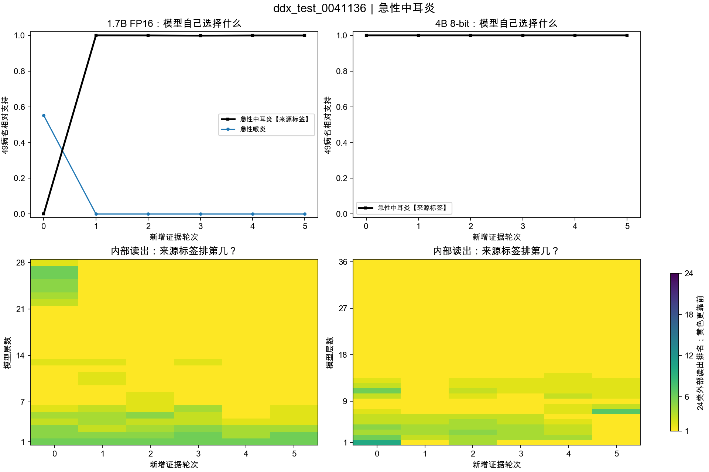

# ddx_test_0041136：两模型配置的同一条证据轨迹

来源标签：急性中耳炎（Acute otitis media）。全部轮次使用相同追加式事实。

上排黑线是来源标签病的模型支持；下排黄色表示从内部更容易识别来源标签。两模型读出器分别只用相同旧120例训练；隐藏维、层数及精度不同。

| 模型配置 | 轮次 | 模型首选 | 标签病支持 | 最后层读出首选 | 标签读出排名 |
|---|---:|---|---:|---|---:|
| 1.7B FP16 | 0 | 急性喉炎 | 0.00001 | 丛集性头痛 | 2 |
| 1.7B FP16 | 1 | 急性中耳炎 | 0.99999 | 急性中耳炎 | 1 |
| 1.7B FP16 | 2 | 急性中耳炎 | 0.99977 | 急性中耳炎 | 1 |
| 1.7B FP16 | 3 | 急性中耳炎 | 0.99857 | 急性中耳炎 | 1 |
| 1.7B FP16 | 4 | 急性中耳炎 | 0.99954 | 急性中耳炎 | 1 |
| 1.7B FP16 | 5 | 急性中耳炎 | 0.99957 | 急性中耳炎 | 1 |
| 4B 8-bit | 0 | 急性中耳炎 | 1.00000 | 急性中耳炎 | 1 |
| 4B 8-bit | 1 | 急性中耳炎 | 1.00000 | 急性中耳炎 | 1 |
| 4B 8-bit | 2 | 急性中耳炎 | 1.00000 | 急性中耳炎 | 1 |
| 4B 8-bit | 3 | 急性中耳炎 | 1.00000 | 急性中耳炎 | 1 |
| 4B 8-bit | 4 | 急性中耳炎 | 1.00000 | 急性中耳炎 | 1 |
| 4B 8-bit | 5 | 急性中耳炎 | 1.00000 | 急性中耳炎 | 1 |

[每轮实际新增证据](../../14_fixed_panel/cases/ddx_test_0041136.md)。这些轮次表示获得资料的顺序，不是患者病情的时间进展。
