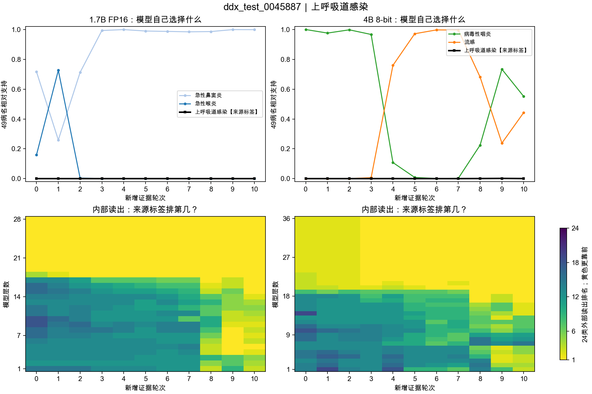

# ddx_test_0045887：两模型配置的同一条证据轨迹

来源标签：上呼吸道感染（URTI）。全部轮次使用相同追加式事实。

上排黑线是来源标签病的模型支持；下排黄色表示从内部更容易识别来源标签。两模型读出器分别只用相同旧120例训练；隐藏维、层数及精度不同。

| 模型配置 | 轮次 | 模型首选 | 标签病支持 | 最后层读出首选 | 标签读出排名 |
|---|---:|---|---:|---|---:|
| 1.7B FP16 | 0 | 急性鼻窦炎 | 0.00000 | 上呼吸道感染 | 1 |
| 1.7B FP16 | 1 | 急性喉炎 | 0.00000 | 上呼吸道感染 | 1 |
| 1.7B FP16 | 2 | 急性鼻窦炎 | 0.00000 | 上呼吸道感染 | 1 |
| 1.7B FP16 | 3 | 急性鼻窦炎 | 0.00000 | 上呼吸道感染 | 1 |
| 1.7B FP16 | 4 | 急性鼻窦炎 | 0.00000 | 上呼吸道感染 | 1 |
| 1.7B FP16 | 5 | 急性鼻窦炎 | 0.00000 | 上呼吸道感染 | 1 |
| 1.7B FP16 | 6 | 急性鼻窦炎 | 0.00000 | 上呼吸道感染 | 1 |
| 1.7B FP16 | 7 | 急性鼻窦炎 | 0.00000 | 上呼吸道感染 | 1 |
| 1.7B FP16 | 8 | 急性鼻窦炎 | 0.00000 | 上呼吸道感染 | 1 |
| 1.7B FP16 | 9 | 急性鼻窦炎 | 0.00000 | 上呼吸道感染 | 1 |
| 1.7B FP16 | 10 | 急性鼻窦炎 | 0.00000 | 上呼吸道感染 | 1 |
| 4B 8-bit | 0 | 病毒性咽炎 | 0.00000 | 病毒性咽炎 | 2 |
| 4B 8-bit | 1 | 病毒性咽炎 | 0.00000 | 病毒性咽炎 | 2 |
| 4B 8-bit | 2 | 病毒性咽炎 | 0.00000 | 病毒性咽炎 | 2 |
| 4B 8-bit | 3 | 病毒性咽炎 | 0.00004 | 上呼吸道感染 | 1 |
| 4B 8-bit | 4 | 流感 | 0.00018 | 上呼吸道感染 | 1 |
| 4B 8-bit | 5 | 流感 | 0.00003 | 上呼吸道感染 | 1 |
| 4B 8-bit | 6 | 流感 | 0.00000 | 上呼吸道感染 | 1 |
| 4B 8-bit | 7 | 流感 | 0.00000 | 上呼吸道感染 | 1 |
| 4B 8-bit | 8 | 流感 | 0.00059 | 上呼吸道感染 | 1 |
| 4B 8-bit | 9 | 病毒性咽炎 | 0.00142 | 上呼吸道感染 | 1 |
| 4B 8-bit | 10 | 病毒性咽炎 | 0.00046 | 上呼吸道感染 | 1 |

[每轮实际新增证据](../../14_fixed_panel/cases/ddx_test_0045887.md)。这些轮次表示获得资料的顺序，不是患者病情的时间进展。
