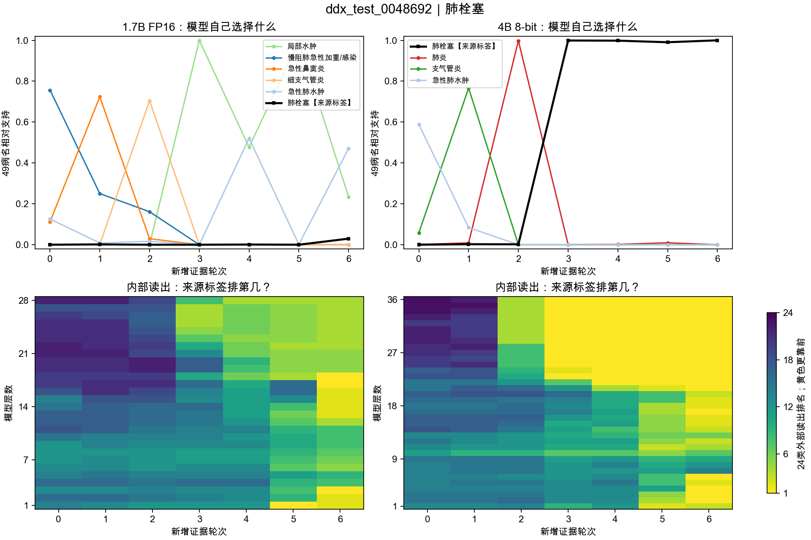

# ddx_test_0048692：两模型配置的同一条证据轨迹

来源标签：肺栓塞（Pulmonary embolism）。全部轮次使用相同追加式事实。

上排黑线是来源标签病的模型支持；下排黄色表示从内部更容易识别来源标签。两模型读出器分别只用相同旧120例训练；隐藏维、层数及精度不同。

| 模型配置 | 轮次 | 模型首选 | 标签病支持 | 最后层读出首选 | 标签读出排名 |
|---|---:|---|---:|---|---:|
| 1.7B FP16 | 0 | 慢阻肺急性加重/感染 | 0.00001 | 支气管炎 | 22 |
| 1.7B FP16 | 1 | 急性鼻窦炎 | 0.00158 | 支气管炎 | 22 |
| 1.7B FP16 | 2 | 细支气管炎 | 0.00007 | 支气管炎 | 19 |
| 1.7B FP16 | 3 | 局部水肿 | 0.00000 | 急性肺水肿 | 8 |
| 1.7B FP16 | 4 | 急性肺水肿 | 0.00088 | 急性肺水肿 | 4 |
| 1.7B FP16 | 5 | 局部水肿 | 0.00006 | 急性肺水肿 | 4 |
| 1.7B FP16 | 6 | 急性肺水肿 | 0.02967 | 自发性气胸 | 4 |
| 4B 8-bit | 0 | 急性肺水肿 | 0.00005 | 支气管炎 | 23 |
| 4B 8-bit | 1 | 支气管炎 | 0.00248 | 支气管炎 | 22 |
| 4B 8-bit | 2 | 肺炎 | 0.00205 | 肺炎 | 4 |
| 4B 8-bit | 3 | 肺栓塞 | 0.99907 | 肺栓塞 | 1 |
| 4B 8-bit | 4 | 肺栓塞 | 0.99835 | 肺栓塞 | 1 |
| 4B 8-bit | 5 | 肺栓塞 | 0.99059 | 肺栓塞 | 1 |
| 4B 8-bit | 6 | 肺栓塞 | 0.99998 | 肺栓塞 | 1 |

[每轮实际新增证据](../../14_fixed_panel/cases/ddx_test_0048692.md)。这些轮次表示获得资料的顺序，不是患者病情的时间进展。
