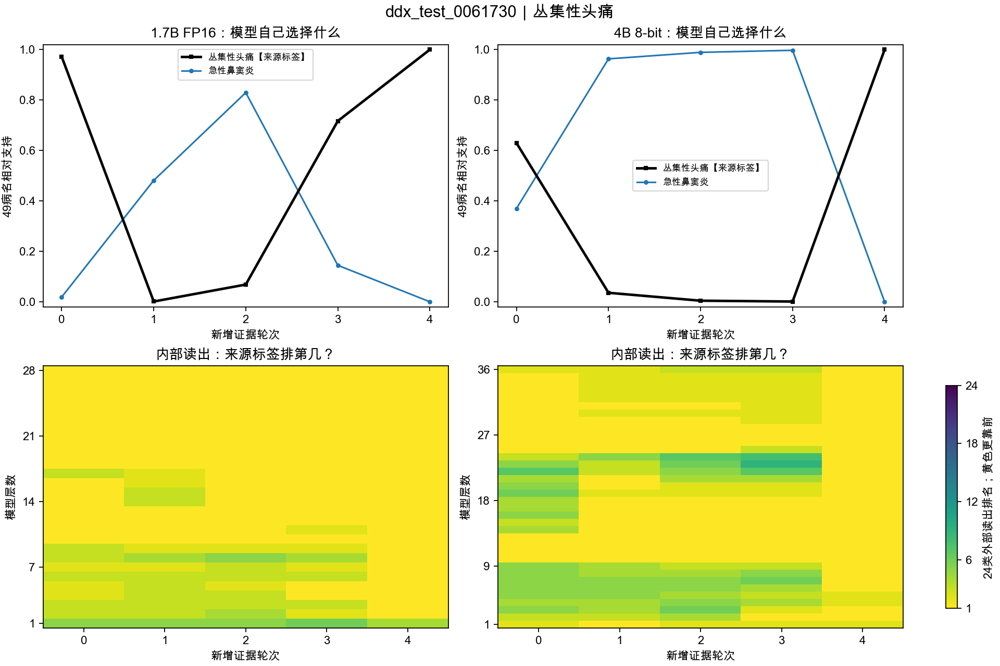

# ddx_test_0061730：两模型配置的同一条证据轨迹

来源标签：丛集性头痛（Cluster headache）。全部轮次使用相同追加式事实。

上排黑线是来源标签病的模型支持；下排黄色表示从内部更容易识别来源标签。两模型读出器分别只用相同旧120例训练；隐藏维、层数及精度不同。

| 模型配置 | 轮次 | 模型首选 | 标签病支持 | 最后层读出首选 | 标签读出排名 |
|---|---:|---|---:|---|---:|
| 1.7B FP16 | 0 | 丛集性头痛 | 0.97185 | 丛集性头痛 | 1 |
| 1.7B FP16 | 1 | 急性鼻窦炎 | 0.00103 | 丛集性头痛 | 1 |
| 1.7B FP16 | 2 | 急性鼻窦炎 | 0.06829 | 丛集性头痛 | 1 |
| 1.7B FP16 | 3 | 丛集性头痛 | 0.71696 | 丛集性头痛 | 1 |
| 1.7B FP16 | 4 | 丛集性头痛 | 1.00000 | 丛集性头痛 | 1 |
| 4B 8-bit | 0 | 丛集性头痛 | 0.62978 | 系统性红斑狼疮 | 2 |
| 4B 8-bit | 1 | 急性鼻窦炎 | 0.03568 | 系统性红斑狼疮 | 2 |
| 4B 8-bit | 2 | 急性鼻窦炎 | 0.00427 | 系统性红斑狼疮 | 3 |
| 4B 8-bit | 3 | 急性鼻窦炎 | 0.00098 | 系统性红斑狼疮 | 3 |
| 4B 8-bit | 4 | 丛集性头痛 | 1.00000 | 丛集性头痛 | 1 |

[每轮实际新增证据](../../14_fixed_panel/cases/ddx_test_0061730.md)。这些轮次表示获得资料的顺序，不是患者病情的时间进展。
