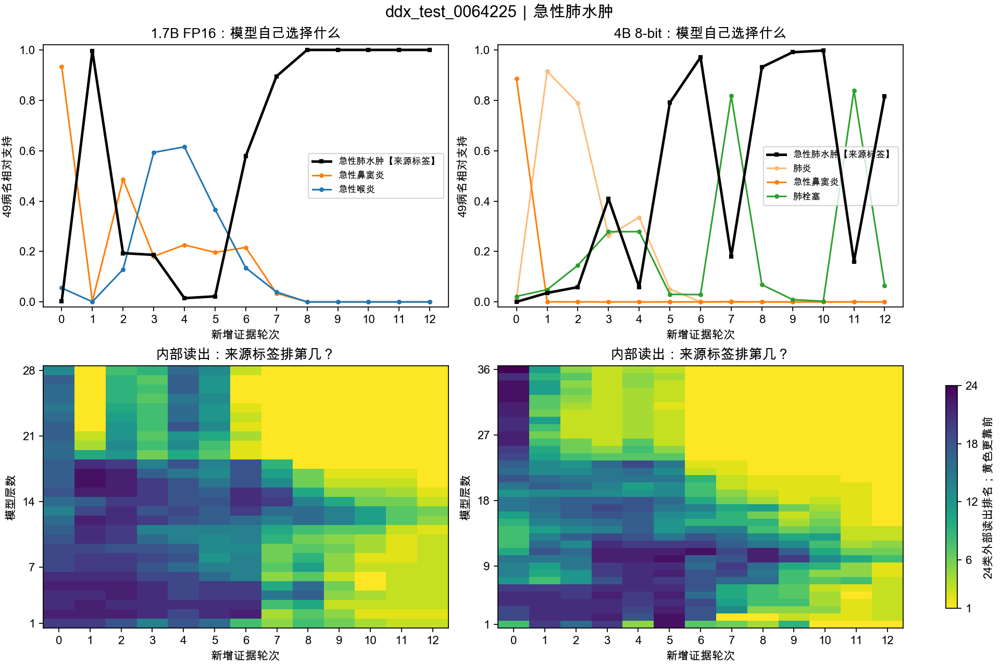

# ddx_test_0064225：两模型配置的同一条证据轨迹

来源标签：急性肺水肿（Acute pulmonary edema）。全部轮次使用相同追加式事实。

上排黑线是来源标签病的模型支持；下排黄色表示从内部更容易识别来源标签。两模型读出器分别只用相同旧120例训练；隐藏维、层数及精度不同。

| 模型配置 | 轮次 | 模型首选 | 标签病支持 | 最后层读出首选 | 标签读出排名 |
|---|---:|---|---:|---|---:|
| 1.7B FP16 | 0 | 急性鼻窦炎 | 0.00195 | 腹股沟疝 | 13 |
| 1.7B FP16 | 1 | 急性肺水肿 | 0.99511 | 急性肺水肿 | 1 |
| 1.7B FP16 | 2 | 急性鼻窦炎 | 0.19349 | 支气管炎 | 8 |
| 1.7B FP16 | 3 | 急性喉炎 | 0.18665 | 支气管炎 | 9 |
| 1.7B FP16 | 4 | 急性喉炎 | 0.01493 | 支气管炎 | 16 |
| 1.7B FP16 | 5 | 急性喉炎 | 0.02204 | 支气管炎 | 13 |
| 1.7B FP16 | 6 | 急性肺水肿 | 0.57849 | 支气管炎 | 3 |
| 1.7B FP16 | 7 | 急性肺水肿 | 0.89503 | 急性肺水肿 | 1 |
| 1.7B FP16 | 8 | 急性肺水肿 | 1.00000 | 急性肺水肿 | 1 |
| 1.7B FP16 | 9 | 急性肺水肿 | 1.00000 | 急性肺水肿 | 1 |
| 1.7B FP16 | 10 | 急性肺水肿 | 1.00000 | 急性肺水肿 | 1 |
| 1.7B FP16 | 11 | 急性肺水肿 | 1.00000 | 急性肺水肿 | 1 |
| 1.7B FP16 | 12 | 急性肺水肿 | 1.00000 | 急性肺水肿 | 1 |
| 4B 8-bit | 0 | 急性鼻窦炎 | 0.00014 | 可能的心肌梗死 | 24 |
| 4B 8-bit | 1 | 肺炎 | 0.03563 | 心包炎 | 11 |
| 4B 8-bit | 2 | 肺炎 | 0.05858 | 心包炎 | 5 |
| 4B 8-bit | 3 | 急性肺水肿 | 0.40963 | 支气管炎 | 3 |
| 4B 8-bit | 4 | 肺炎 | 0.05881 | 支气管炎 | 4 |
| 4B 8-bit | 5 | 急性肺水肿 | 0.79054 | 支气管炎 | 3 |
| 4B 8-bit | 6 | 急性肺水肿 | 0.97072 | 急性肺水肿 | 1 |
| 4B 8-bit | 7 | 肺栓塞 | 0.18062 | 急性肺水肿 | 1 |
| 4B 8-bit | 8 | 急性肺水肿 | 0.93178 | 急性肺水肿 | 1 |
| 4B 8-bit | 9 | 急性肺水肿 | 0.99062 | 急性肺水肿 | 1 |
| 4B 8-bit | 10 | 急性肺水肿 | 0.99757 | 急性肺水肿 | 1 |
| 4B 8-bit | 11 | 肺栓塞 | 0.16035 | 急性肺水肿 | 1 |
| 4B 8-bit | 12 | 急性肺水肿 | 0.81671 | 急性肺水肿 | 1 |

[每轮实际新增证据](../../14_fixed_panel/cases/ddx_test_0064225.md)。这些轮次表示获得资料的顺序，不是患者病情的时间进展。
