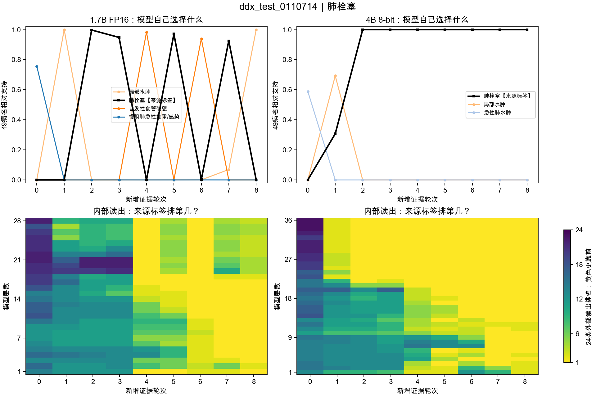

# ddx_test_0110714：两模型配置的同一条证据轨迹

来源标签：肺栓塞（Pulmonary embolism）。全部轮次使用相同追加式事实。

上排黑线是来源标签病的模型支持；下排黄色表示从内部更容易识别来源标签。两模型读出器分别只用相同旧120例训练；隐藏维、层数及精度不同。

| 模型配置 | 轮次 | 模型首选 | 标签病支持 | 最后层读出首选 | 标签读出排名 |
|---|---:|---|---:|---|---:|
| 1.7B FP16 | 0 | 慢阻肺急性加重/感染 | 0.00001 | 支气管炎 | 22 |
| 1.7B FP16 | 1 | 局部水肿 | 0.00000 | 急性肺水肿 | 9 |
| 1.7B FP16 | 2 | 肺栓塞 | 0.99751 | 贫血 | 10 |
| 1.7B FP16 | 3 | 肺栓塞 | 0.94825 | 急性肺水肿 | 10 |
| 1.7B FP16 | 4 | 自发性食管破裂 | 0.00004 | 肺栓塞 | 1 |
| 1.7B FP16 | 5 | 肺栓塞 | 0.97133 | 急性肺水肿 | 4 |
| 1.7B FP16 | 6 | 自发性食管破裂 | 0.00264 | 肺栓塞 | 1 |
| 1.7B FP16 | 7 | 肺栓塞 | 0.92534 | 急性肺水肿 | 4 |
| 1.7B FP16 | 8 | 局部水肿 | 0.00010 | 急性肺水肿 | 3 |
| 4B 8-bit | 0 | 急性肺水肿 | 0.00005 | 支气管炎 | 23 |
| 4B 8-bit | 1 | 局部水肿 | 0.30710 | 急性肺水肿 | 2 |
| 4B 8-bit | 2 | 肺栓塞 | 1.00000 | 肺栓塞 | 1 |
| 4B 8-bit | 3 | 肺栓塞 | 1.00000 | 肺栓塞 | 1 |
| 4B 8-bit | 4 | 肺栓塞 | 1.00000 | 肺栓塞 | 1 |
| 4B 8-bit | 5 | 肺栓塞 | 1.00000 | 肺栓塞 | 1 |
| 4B 8-bit | 6 | 肺栓塞 | 0.99999 | 肺栓塞 | 1 |
| 4B 8-bit | 7 | 肺栓塞 | 0.99999 | 肺栓塞 | 1 |
| 4B 8-bit | 8 | 肺栓塞 | 0.99999 | 肺栓塞 | 1 |

[每轮实际新增证据](../../14_fixed_panel/cases/ddx_test_0110714.md)。这些轮次表示获得资料的顺序，不是患者病情的时间进展。
