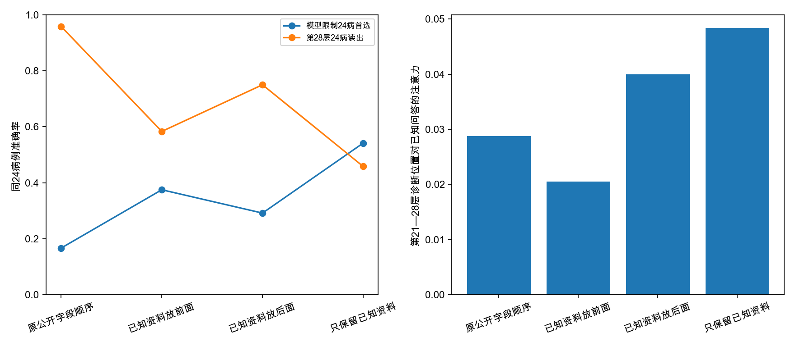

# 阶段19：有信息，却在什么位置影响诊断？

## 方法

由新24例固定问卷的输出集中现象触发的探索性追加。对全部预定24例，不筛选失败病例。known_first与known_last含相同223问题、相同所有答案与候选，仅改变已知问答所在位置；compact删去Unknown行，保留全部已知事实与原字段顺序。首选准确率与内部读出分别报告，24病读出与49病首选的数值不作直接差值。

## 结果

| 呈现方式 | 模型49病终点命中 | 原问卷训练头的第28层24病读出 | 已知问答注意力总量 |
|---|---|---|---|
| 原公开字段顺序 | 12.50% [0.00, 25.00] | 95.83% [87.50, 100.00] | 2.88% [2.41, 3.35] |
| 已知资料放前面 | 29.17% [12.50, 45.83] | 58.33% [37.50, 79.17] | 2.05% [1.61, 2.55] |
| 已知资料放后面 | 8.33% [0.00, 20.83] | 75.00% [54.17, 91.67] | 3.99% [3.53, 4.43] |
| 只保留已知资料 | 50.00% [29.17, 70.83] | 45.83% [25.00, 66.67] | 4.83% [4.28, 5.49] |

相同全部问题与答案，已知资料放后面减放前面的准确率差：-20.83% [-37.50, -8.33]；标签支持差：-0.2185 [-0.3809, -0.0835]。同token长度病例比例：100.00% [85.75, 100.00]。两个配对p值为探索性未多重校正结果，见summary。

已知资料位置的改变是输入层面的配对干预；注意力变化是同时观察到的量，不能单独指定某个头的医学因果作用。compact同时减少未知问题内容和长度，不能只归因于其中一个因素。内部读出头不在新条件重新拟合，体现跨呈现迁移而非每个条件单独训练后的最好结果。

## 提示候选数的补充控制

真正把提示列表改为24病，而非对原49病分数事后重排：固定问卷命中25.00% [8.33, 41.67]，原49提示限制24类重排为16.67% [4.17, 33.33]；追加式命中62.50% [41.67, 79.17]，原49提示重排为50.00% [33.33, 70.83]。该对照控制了候选提示范围，仍没有给予原模型与分类器相同的监督训练。[逐例候选控制](candidate_prompt_controls.csv)

[全部病例](case_results.csv) · [配对差值](paired_cases.csv) · [精确汇总](summary.json)
