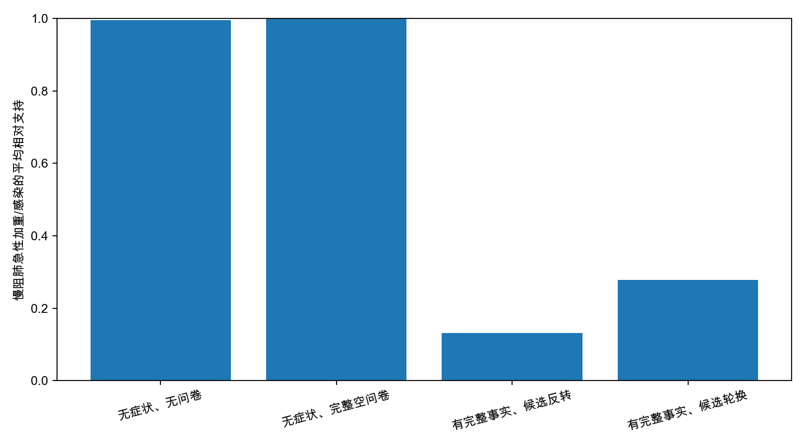

# 阶段20：共同答案来自空问卷，还是候选首位？

## 方法

由固定问卷输出集中触发的探索性追踪，全部预定24例。空问卷与无问题列表均只保留年龄性别和49候选，不包含患者症状事实。另两条件保留完整事实，只反转或固定轮换候选表。所有分数还原到统一疾病顺序。

## 结果

| 条件 | 首选COPD相关诊断比例 | 该病平均支持 | 选择当前列表第一项比例 |
|---|---|---|---|
| 无症状、无问卷 | 100.00% [85.75, 100.00] | 99.50% [99.14, 99.76] | 100.00% [85.75, 100.00] |
| 无症状、完整空问卷 | 100.00% [85.75, 100.00] | 99.90% [99.89, 99.91] | 100.00% [85.75, 100.00] |
| 有完整事实、候选反转 | 8.33% [0.00, 20.83] | 13.22% [4.07, 24.85] | 0.00% [0.00, 14.25] |
| 有完整事实、候选轮换 | 33.33% [16.67, 54.17] | 27.82% [14.81, 42.47] | 0.00% [0.00, 14.25] |

空问卷减无问题列表的COPD支持差为0.0040 [0.0014, 0.0076]。完整事实下，反转候选的标签命中为16.67% [4.17, 33.33]；固定轮换为20.83% [4.17, 37.50]。

空条件不计算准确率，也不把模型输出叫作人群患病概率。该对照检验提示文本和候选位置如何形成条件输出偏向；其结果不能自动说明真实医疗记录中的普遍偏差。

[全部病例](case_results.csv) · [精确汇总](summary.json)
