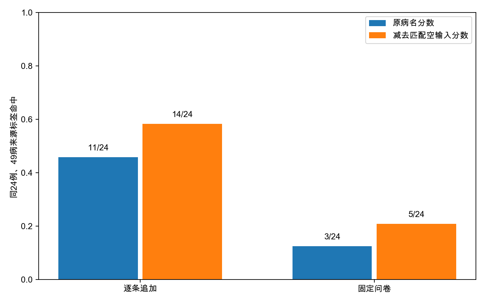

# 将空输入偏向作为评分对照

阶段20观测前登记的探索性分析，无新增模型调用。对同24例，完整事实病名对数分数减去匹配年龄性别及候选顺序的空输入分数，系数固定为1；不使用测试标签调参。对全部49病重新排序。

| 输入 | 原始命中 | 差值排序命中 | 配对准确率差 | COPD相关选择例数 |
|---|---|---|---|---|
| 逐条追加 | 45.83% [29.17, 66.67] | 58.33% [37.50, 79.17] | 0.1250 [0.0000, 0.2500] | 2 → 0 |
| 固定问卷 | 12.50% [0.00, 25.00] | 20.83% [4.17, 37.50] | 0.0833 [0.0000, 0.2083] | 17 → 0 |

该操作借鉴已有contextual calibration，不作为新算法。差值排序衡量患者事实相对空输入如何改变字符串支持；它不是临床后验，也没有证明背景和证据能被完全加性分离。[方法先例](https://proceedings.mlr.press/v139/zhao21c.html)

[全部49病分数对照](empty_score_contrast.csv) · [逐病例结果](empty_score_contrast_cases.csv) · [精确汇总](empty_score_contrast_summary.json) · [分析登记](../../protocol/TEMPLATE_SCORE_CONTRAST_V2.md)
