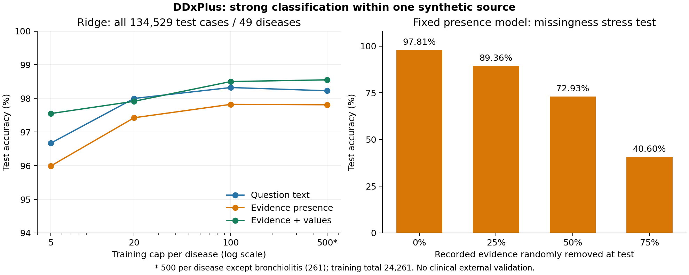

# DDxPlus 分类器扩大验证：问题列表究竟透露了多少信息？

2026-11-19，北京时间。本轮使用本地 CPU，没有调用大语言模型或付费 API。

**现象扩大后仍成立：简单分类器能从问题列表和证据集合中恢复绝大多数疾病标签。但“120/120”没有扩大成普遍的100%，也不表示输入没有医学信息。**

## 这次扩大了什么

原结果是24类、120例的五折交叉验证，每折96例训练、24例测试。本轮独立复算仍为120/120；旧120训练、新120测试仍为119/120。见[逐项复算](original_reproduction.json)。

扩大后不再筛选年龄、不再要求至少5组问题，纳入官方测试集全部 **134,529例、49类**。新模型从官方训练集确定性抽样，最多每类500例；毛细支气管炎在训练集中只有261例，因此合计 **24,261例**。测试集该病只有36例，应结合每病召回率看待总体分数。

旧120例模型也单独扩大测试：同24类全部83,024例，问题文字 **97.11%**，证据出现位置 **97.42%**。此处训练保留原问题顺序，扩大测试按证据ID规范排序，因此不是对原呈现顺序的严格复制。

| 输入与分类器 | 正确数 / 全部测试数 | 准确率 | 各疾病召回率的平均值 |
|---|---:|---:|---:|
| 只看问题文字：TF-IDF + Ridge | 132,143/134,529 | 98.23% | 98.23% |
| 只看证据是否出现：Ridge | 131,583/134,529 | 97.81% | 97.66% |
| 保留证据及答案值：Ridge | 132,580/134,529 | 98.55% | 98.33% |
| 只看证据是否出现：逻辑回归 | 133,426/134,529 | 99.18% | 99.07% |
| 保留证据及答案值：逻辑回归 | 134,088/134,529 | 99.67% | 99.59% |

Ridge均固定 alpha=1，词汇及IDF只在训练病例拟合；逻辑回归是看到初步Ridge结果后追加的常规对照，固定 C=1、最多1000次迭代，未用测试分数选择参数。全部条件均报告，不把效果最好的训练规模冒充预先选定结果。这里比较的是单一 `PATHOLOGY` 标签，未评估鉴别诊断分布质量。

## 只用少量病例能学到多少

| 每类训练上限 | 实际训练数 | 问题文字 Ridge | 出现位置 Ridge | 答案值 Ridge |
|---:|---:|---:|---:|---:|
| 5 | 245 | 96.67% | 95.99% | 97.55% |
| 20 | 980 | 98.00% | 97.42% | 97.91% |
| 100 | 4,900 | 98.32% | 97.82% | 98.50% |
| 500 | 24,261 | 98.23% | 97.81% | 98.55% |

学习曲线并非严格单调，尤其Ridge在较大规模出现平台；未按测试结果挑选训练规模。



## 为什么删了Yes还能预测

原始 `EVIDENCES` 存储病例具有的证据，不是医生问过的所有问题。223个字段中208个为二元字段：例如咳嗽证据被列出，本身就表示咳嗽为阳性。把这条证据翻成“你是否咳嗽？”，再删除“Yes”，保留下来的问题身份仍能恢复这一信息。官方[数据字段说明](https://github.com/mila-iqia/ddxplus#patient-description)支持这种读取方式。

因此，二元部分的“问题列表”实际接近阳性症状/病史向量。它不是没有答案信息，也不能把这个结果单独当作大模型无需理解答案的证据。合法使用症状预测疾病本身并不等于把疾病标签偷放进输入；真正需要纠正的是“答案已经全部被去掉”的实验解释。取值型问题则不同：知道问过疼痛部位，不等于知道疼痛在何处。

## 分类器怎么做；是不是相似度匹配

原程序用 TF-IDF 将词及相邻二词组合变成向量，再训练 RidgeClassifier。每种疾病有一组权重；预测时计算 `score(d) = bias(d) + Σ weight(d,j) × feature(j)`，取分数最高的疾病。这是学习文字特征与疾病标签的对应关系，并不计算症状词与疾病名称的语义相似度。Ridge分数也不是经过校准的诊断概率。参见[scikit-learn方法说明](https://scikit-learn.org/stable/modules/generated/sklearn.linear_model.RidgeClassifier.html)。

本轮另做了真正的相似度基线：对训练病例按疾病求平均证据向量，新病例与49个平均向量做余弦比较，达到 **98.76%**。它不需要优化分类权重，但平均向量仍从有标签病例估计，仍属于有监督拟合。

证据ID模型只接收 E_53 等不带医学词义的代号，不接收疾病名称作为输入特征。将特征代号整体重命名、同时保持训练测试映射一致，在数值核对中保持相同分数。这进一步说明强信号来自证据组合，而不需要理解词义。分类器仍是模型；对新病例算分也属于机器学习里的推断。我们验证的是不生成长推理文本、不使用LLM也能取得高分。

## 排查重复病例与已见组合

| 模型 | 排除训练集中相同事实集合：病例数 / 准确率 | 排除训练中见过的问题集合：病例数 / 准确率 |
|---|---:|---:|
| 问题文字 Ridge | 120,940 / 98.03% | 61,104 / 97.74% |
| 出现位置 Ridge | 120,940 / 97.57% | 61,104 / 97.46% |
| 答案值 Ridge | 120,940 / 98.39% | 61,104 / 98.25% |
| 出现位置逻辑回归 | 120,940 / 99.09% | 61,104 / 99.28% |
| 答案值逻辑回归 | 120,940 / 99.64% | 61,104 / 99.71% |

事实集合包含证据ID及具体值，忽略年龄、性别、问题顺序。上表同时提示官方划分确实存在一些相同事实组合，不能声称完全无跨划分重复。`summary.json`另有测试集内部去重后的结果、Wilson 95%区间、每病召回率；这些区间只描述该抽样/生成来源，不反映换医院、换数据生成器的分布差异。原先分析过的120个测试ID也单独排除后复算，见 `previously_unstudied_test_cases`。

## 问题相同，能不能疾病不同

**能，已经找到真实的官方数据反例。** 全部测试集中有340种问题集合对应多个疾病，涉及4,153例。仅以问题集合为输入的任意确定性函数，在这批固定测试数据上的理论最好结果至多是 **133,775/134,529 = 99.44%**。该上限用测试标签事后计算，绝不是可部署模型的测试准确率，也不代表总体上限。

下面两例有完全相同的8个问题，顺序统一后问题文本也完全相同：

- `ddx_test_0000325`：标签 **Acute otitis media**；仅问题模型预测 Acute otitis media；保留答案值模型预测 Acute otitis media。
- `ddx_test_0062812`：标签 **Cluster headache**；仅问题模型预测 Acute otitis media；保留答案值模型预测 Cluster headache。

| 相同的问题 | 第一例的答案 | 第二例的答案 |
|---|---|---|
| Characterize your pain: | sharp | tugging; violent; sharp |
| Do you feel pain somewhere? | ear(R); ear(L) | cheek(R); cheek(L); eye(L); temple(R); forehead |
| How intense is the pain? | Recorded scale value 7 | Recorded scale value 10 |
| How precisely is the pain located? | Recorded scale value 8 | Recorded scale value 9 |
| How fast did the pain appear? | Recorded scale value 6 | Recorded scale value 7 |

这是“问题单独不能总是确定标签”的证据；不主张这些差异本身就足以构成临床诊断规则。完整问题及更多成对反例保存在[成对病例](matched_question_different_disease_cases.json)。

## 稳健性与负对照

| 条件 | 全部49类测试准确率 |
|---|---:|
| 只保留症状的证据ID | 90.37% |
| 只保留病史的证据ID | 83.82% |
| 只保留二元证据ID | 97.82% |
| 训练标签随机打乱一次 | 2.17% |
| 将问题中的字面疾病名替换为 condition | 98.23% |
| 对测试问题随机换序，分类器保持不变 | 96.54% |
| 直接与各疾病的平均证据向量做余弦相似度比较 | 98.76% |
| 随机删掉 25% 已记录证据，Ridge模型保持不变 | 89.36% |
| 随机删掉 50% 已记录证据，Ridge模型保持不变 | 72.93% |
| 随机删掉 75% 已记录证据，Ridge模型保持不变 | 40.60% |

疾病名替换只覆盖定义的字面名称及部分拆分名称，共修改14个问题；没有声称清除所有同义词或医学信息。换序只检验排列敏感性，不等于自由改写泛化。缺失实验是随机删除证据的压力测试，不代表现实问诊策略。

如果给每个人完全相同的223个问题、删除全部答案且不留下“哪些项目已记录”的标记，输入向量必然相同。常量分类器只能输出同一疾病；其平均每病召回率为1/49。这是构造上的无信息对照，不是新的医学发现。一次训练标签打乱仅作工程负对照，不当作正式置换检验。

## 有人做过吗；这算不算重大新发现

**用普通分类器从症状预测疾病已有先例。** 2024年的[A Predictive Diagnosis Assistant](https://papers.ssrn.com/sol3/Delivery.cfm/4878046.pdf?abstractid=4878046&mirid=1&type=2)及[作者代码](https://github.com/faithNassiwa/predictive-diagnosis-assistant)已在DDXPlus上研究常规分类与XGBoost。不能把“分类器取代LLM做这项分类”当作全新范式。

DDXPlus的[2022年原论文表3](https://arxiv.org/html/2205.09148v3#S4.T3)中，只优化单疾病标签的AARLC基线已经报告99.21%的首选准确率；该方法是问诊系统，输入流程、训练规模和目标不同，不能直接与本轮静态全证据分类器排高低。

“只看部分输入仍能预测标签”的审计思路也有先例，如[2018年Annotation Artifacts](https://aclanthology.org/N18-2017/)和[Hypothesis Only Baselines](https://aclanthology.org/S18-2023/)。它们研究NLI，并非声称已经做过本轮DDXPlus问题清单消融。本轮检索尚不能确认这项具体消融是否首次发表。

当前可支持的研究结论是：**DDXPlus的完整阳性证据及问题呈现方式使疾病标签高度可学习；仅靠问题的高分不足以证明模型处理了答案语义。** 更有价值的下一步是固定提问策略、配对改变答案并保留合理标签，及跨来源病例验证。当前实验没有完成独立真实临床验证、自由文本输入抽取、疾病集合外识别或共病诊断，不能外推成普遍免推理诊断。

## 文件与复现

- [全部结果](summary.json)、[追加对照](followup_checks.json)、[逐例预测](predictions.csv)、[错误病例](error_cases.jsonl)、[混淆统计](confusions.json)。逻辑回归逐例预测另见 `logistic_evidence_presence.npz` 与 `logistic_evidence_values.npz`。
- [扩大病例及来源哈希](../../data/ddx_classifier_expansion/manifest.json)：固定训练样本和全部测试病例已存为JSONL，未编造新病例。
- [冻结的主实验方案](../../protocol/DDX_CLASSIFIER_EXPANSION.json)、[主程序](../../src/ddx_classifier_expansion.py)、[追加核对](../../src/ddx_classifier_followup.py)、[报告生成](../../src/report_ddx_classifier_expansion.py)。
- 保存了三种Ridge模型及两种逻辑回归模型，均可本地复用；主实验运行约213秒。批量预测计时仅适用于本机及已编码特征，不能当作端到端临床系统延迟。

```bash
OPENBLAS_NUM_THREADS=1 OMP_NUM_THREADS=1 MedicalBeliefMechanisms/.runtime/bin/python MedicalBeliefStudy/src/ddx_classifier_expansion.py
OPENBLAS_NUM_THREADS=1 OMP_NUM_THREADS=1 MedicalBeliefMechanisms/.runtime/bin/python MedicalBeliefStudy/src/ddx_classifier_followup.py
MedicalBeliefMechanisms/.runtime/bin/python MedicalBeliefStudy/src/report_ddx_classifier_expansion.py
```
