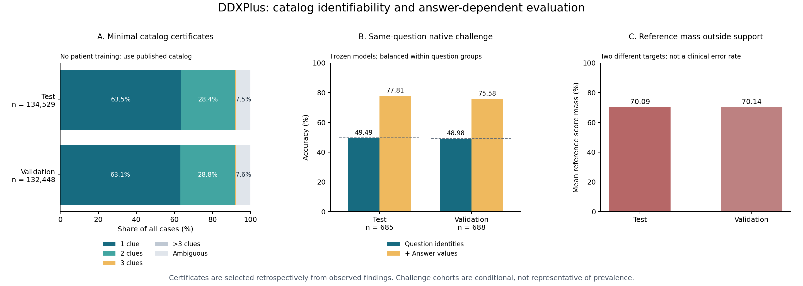

# DDxPlus：从分类器高分到生成规则与评测目标审计

2026-11-19。本阶段接续[分类器扩大验证](../22_ddx_classifier_expansion/RESULTS.md)。全部新增计算在本地 CPU 完成，没有新增付费 API 或大模型推理；大模型部分只复核历史记录。

**2026-11-20 查重补充：** “直接使用疾病知识、不训练患者分类器”不是新方法。[Guan 与 Baral，2021](https://arxiv.org/abs/2110.08393) 已用 QMR 网络直接做贝叶斯诊断；其 SymCAT/HPO 实验直接使用知识网络，Muzhi/Dxy 分支则从训练集估计网络。[2024 TPKA 论文](https://www.mdpi.com/1099-4300/26/9/740) 也在 DDxPlus 比较中纳入 BED。集合关系诊断的历史更早，可追溯到 [1983 年的集合覆盖诊断系统](https://doi.org/10.1016/S0020-7373(83)80065-0)。本阶段可能的新意只能落在特定 DDxPlus 目录约束的定量审计上，不能宣称发明了零患者训练诊断。后续五个数据集实验见[多数据集报告](../24_lightweight_multidataset/RESULTS.md)。

**判断：不能把“传统分类器在 DDxPlus 上接近满分”称为我们的重大发现。已经得到一个更具体、可复核的研究结果：公开疾病目录中的线索组合，足以在约 92.4% 的官方留出病例上唯一确定生成标签，无需患者训练；控制问题列表后，回答值的作用才明显显现。** 这是生成数据与评测机制的发现候选，还没有获得首次性或临床外推的证据。



## 1. 与已有工作的实际区别

| 工作 | 已经做过的内容 | 本阶段能够增加的内容 |
|---|---|---|
| [DDXPlus 原始论文，2022](https://arxiv.org/html/2205.09148v3) | 模拟患者、生成疾病标签、独立规则系统给出鉴别诊断；原文已区分两种目标 | 量化公开目录约束能确定多少生成标签，以及参考分数落在目录兼容集合之外的程度 |
| [Nassiwa 等，2024，作者代码](https://github.com/faithNassiwa/predictive-diagnosis-assistant) | DDxPlus 的结构化分类、逻辑回归与 XGBoost 等 | “不用大模型也能高分”没有充分新意；本阶段改为零患者训练的目录排除和逐例证据证明 |
| [Auditing Evidence Use in Medical LLM Diagnosis，2026](https://arxiv.org/html/2607.20848) | 证据子集、低阶交互与临床复核；准确率不能单独说明证据使用正确 | 本阶段检查数据生成标签的可识别性，不把目录上的短证明当作 LLM 内部推理或临床有效性 |
| [CLIMB，2026](https://arxiv.org/html/2609.35462) | 在 DDxPlus 衍生多病场景中使用逻辑回归参考读出器，证明生成记录通常足以恢复标签 | “分类器高分而 LLM 低分”仍是已有方向；本阶段需以精确目录约束、覆盖率和同问题条件对照建立区别 |
| [MedSafe-Dx v0.3，2026](https://msdx.cortico.health/report.html) | 审计固定疾病严重性标签、缺乏表现支持的 DXA 候选、文本转换问题和封闭疾病集合，并评测 GPT-6 系列 | 广义的 DDxPlus 临床有效性缺陷已有先例；目录生成约束的精确结果仍须进一步逐项查重，不能从数值不同推断新颖 |

2024 作者仓库的三个相关 notebook 已按 commit `91f40604a61b8eef5fdb8e6a2468cce46b1df9e8` 保存并校验：[来源清单](prior_work/manifest.json)。查看了 DDxPlus 预处理、dataset2 逻辑回归及 49 病种 XGBoost。作者仓库另一个使用 `prognosis` 的 notebook 并非同一 DDxPlus 实验，不能把其中的 100% 移用于这里。当前没有重跑作者完整环境，因此不把不同配置分数当作公平排名。

查重结论截至本轮检索：上述工作已经覆盖分类器强基线、生成数据易识别、证据使用审计等大方向。本轮尚未找到与下述三个结果完全相同的报告；这不等于已经证明首次发现。集合排除、短证据证明、条件分组及概率距离下界都不是新算法或新数学。

## 2. 真正不用患者训练的目录解码

对每种疾病 d，从官方 `release_conditions.json` 读取它的症状与病史字段集合 S(d)。患者记录出现的字段身份集合记为 E。计算：

\[
C(E)=\{d:E\subseteq S(d)\}.
\]

也就是：每个已记录线索各自允许哪些疾病，把这些疾病集合求交。如果只剩一个疾病，输出它；如果剩多个，弃答。不使用患者训练样本、回答值、年龄、性别、疾病名语义、参考鉴别诊断，也不从测试标签选择规则。

**“没有训练”不等于“没有知识”，更不等于“没有推理”。** 这里直接读取了官方 49 种病、223 个字段之间的 888 条目录关系；集合排除本身是符号推断。把目录未列出的关系当作不可能，是针对这份模拟数据的操作假设，不能移植为临床排除规则。

| 数据划分 | 病例数 | 唯一兼容疾病的病例 | 覆盖率 | 在已覆盖病例中的正确率 |
|---|---:|---:|---:|---:|
| 官方 test，探索 | 134,529 | 124,397 | 92.47% | 124,397 / 124,397 |
| 官方 validate，规则固定后复核 | 132,448 | 122,408 | 92.42% | 122,408 / 122,408 |

未覆盖的 10,132 / 10,040 例保留多个候选，不能把选择性正确率写成全体病例“100% 准确”。进一步检查全部 1,025,602 条训练记录，加上两个留出划分，共 **1,292,579 条记录的生成标签都在兼容集合中**。这是有限数据全集审计，不能证明未来任意数据也不会违反约束。

复核不只重跑同一个位运算：另用 Python 集合包含关系核验全部 132,448 条 validation，并逐一核验两个划分共 246,805 份唯一诊断证明。[独立核验结果](followup.json)

探索首先发生在 test，之后才冻结[协议](../../protocol/DDX_GENERATOR_AUDIT.json)，不声称事前预注册。两个官方划分来自同一个生成机制；validation 过去有 120 个病例 ID 被其他实验使用。另排除 test 全部精确事实组合及分类器训练子集中的组合后，validation 剩 111,449 例，其中 101,485 例仍唯一可解，覆盖率 **91.06%**，已覆盖部分仍全部正确。这是同源复核，尚非跨数据源泛化。

### 一个可直接检查的病例

原始 test 第 3 行，`ddx_test_0000003`，生成疾病为 Acute laryngitis：

- “声音变低、变轻或嘶哑”在目录中对应 {Acute laryngitis, Epiglottitis}。
- “在托儿所工作或就读”在目录中对应 {Acute laryngitis, URTI, Viral pharyngitis}。
- 两个集合相交只剩 Acute laryngitis。

没有词向量、相似度或训练。这里的“目录只列这几种病”是模拟器性质，不是现实医学的完整关联表。更多原始例子及每条线索的候选集合见 [support_certificate_examples.json](support_certificate_examples.json)。

标准库即可运行的独立解码器见 [ddx_support_decoder.py](../../src/ddx_support_decoder.py)：

```bash
python3 MedicalBeliefStudy/src/ddx_support_decoder.py --split test --row 3
```

该程序在计算结束后才附上标签供人检查；标签不进入解码。

## 3. 绝大部分可解病例只需要很短的目录证明

从已经观察到的完整线索中，寻找能够唯一留下生成疾病的最小子集。精确枚举大小 1、2、3；超过 3 的部分只记录已找到证明的上界。

| 最小证明长度 | test 病例数 | 占 test 全体 | validation 病例数 |
|---|---:|---:|---:|
| 1 个线索 | 85,433 | 63.51% | 83,549 |
| 2 个线索 | 38,223 | 28.41% | 38,098 |
| 3 个线索 | 741 | 0.55% | 760 |
| 大于 3 | 0 | 0.00% | 1 |
| 全部线索仍不唯一 | 10,132 | 7.53% | 10,040 |

**这不是“只问三个问题就能诊断”。** 它是看完全部已记录事实后回溯选出一个短证明；主动问诊怎样找到这些线索尚未评估。也没有证明现有分类器实际使用了我们挑选的那个证明。

目录中有 **120 / 223 个字段只连接一个疾病**。例如咖啡/茶摄入字段 E_35 只连接 PSVT，test 中 1,367 个记录该字段的病例也全是 PSVT；建筑工作字段 E_199 只连接 COPD 急性加重/感染，相关 test 病例为 1,187。这些例子揭示目录的限制，不能理解为对应生活习惯或职业足以在现实中确诊。[全部独占字段](exclusive_evidence.json)

不过，“高分全靠这些独占词”被后续实验否定：

| 控制 | test 结果 |
|---|---:|
| 只保留二元字段，零训练目录排除 | 92.40% 唯一覆盖，覆盖部分全部正确 |
| 删除 14 个直接含目标疾病名称的问题字段 | 90.59% 唯一覆盖，覆盖部分全部正确 |
| 删除全部 120 个独占字段，再做目录排除 | 82.68% 唯一覆盖 |
| 训练、测试同时删除全部 120 个独占字段，重新训练固定配置逻辑回归 | 98.59% 准确率；validation 98.49% |

因此，高可识别性还存在于共享线索的组合及统计分布中。删掉几个明显字段，不能保证解决评测过于容易的问题；这也不证明所有有预测力的医学线索都是不合理捷径。

## 4. 原始病例上的同问题条件挑战

为区分“问题列表已泄露线索身份”和“模型真正利用回答值”，从原始数据中找出：**问题身份列表完全相同，但生成疾病不同**的病例。每个问题组、每个疾病保留一个原始病例，形成组内标签平衡的条件挑战；不改写问题，不伪造回答，不改标签。

选择通过病例 ID 的固定哈希完成，不按模型是否出错选择。排除与 24,261 条分类器训练样本相同的精确事实组合；validation 还排除与整个 test 相同的精确事实组合。五个分类器使用阶段 22 保存的模型，未在挑战集重新训练或调参，仍在 49 个疾病中选择。

| 方法 | test：685 例、340 组、15 病种 | validation：688 例、340 组、14 病种 |
|---|---:|---:|
| 问题文字 TF-IDF + Ridge | 49.05% | 49.13% |
| 字段出现身份 + Ridge | 48.61% | 48.84% |
| 字段身份及回答值 + Ridge | 67.88% | 65.12% |
| 字段出现身份 + 逻辑回归 | 49.49% | 48.98% |
| 字段身份及回答值 + 逻辑回归 | **77.81%** | **75.58%** |
| 只看相同问题列表的确定性分类器上限 | 49.64% | 49.42% |

上限不是拟合结果：同一个问题组给模型的输入完全相同，且每个疾病恰好一个病例，确定性模型每组至多答对一个。共 340 组，故上限分别为 340/685 与 340/688。它只约束这个条件队列及严格仅问题输入，不约束带年龄、回答、病例 ID 等额外输入的模型。随机分类器对应的是期望上限。

回答值带来的逻辑回归增益分别为 **28.32、26.60 个百分点**。按问题组 bootstrap 4,000 次，95% 区间分别为 [25.58, 31.10] 与 [23.65, 29.57] 个百分点；区间描述该条件队列的问题组变动，不代表自然临床患病率下的增益。

病例组成存在明显偏斜：急性/慢性鼻窦炎占 test 460/685、validation 468/688。排除所有涉及这两种疾病的组，结果仍为：

| 排除鼻窦炎后的队列 | 只看问题身份 | 加回答值 |
|---|---:|---:|
| test，225 例 | 48.44% | 80.89% |
| validation，220 例 | 46.82% | 76.82% |

部分疾病对仍难区分，例如稳定/不稳定心绞痛组，两种逻辑回归均只有 50%。因此不能把“回答值有作用”升级成“回答值模型已经解决所有鉴别”。本挑战所有病例的完整事实向量在各自划分内均不同，没有发现相同完整向量却不同标签的冲突；这也不能证明尚未观察到的相同向量没有歧义。[输入可识别性审计](native_challenge_identifiability.json)

可复用数据：[test JSONL](native_challenge_test.jsonl)、[validation JSONL](native_challenge_validate.jsonl)。每例包含原始行号、字段、取值、标签和问题组 ID；这些元数据只用于审计，不输入分类器。[模型结果](native_challenge_summary.json) · [分组结果及置信区间](followup.json)

## 5. 生成标签与参考鉴别诊断不是同一个概率目标

对每条记录，统计官方参考鉴别诊断 q 在目录兼容集合 C(E) 之外的分数总和：

\[
m(E)=\sum_{d\notin C(E)}q(d).
\]

| 量 | test | validation |
|---|---:|---:|
| 集合外参考分数质量均值 | **70.09%** | **70.14%** |
| 集合外参考分数质量中位数 | 80.05% | 80.12% |
| 参考鉴别诊断第一名等于生成标签 | 73.28% | 73.37% |

在接受目录约束的前提下，任何只支持 C(E) 的分布 p，都满足总变差距离 TV(p,q) ≥ m(E)。证明只需选择事件 C(E) 的补集：p 在该事件上的概率为零，q 为 m(E)。把 q 限制到 C(E) 后重归一化可达到该下界。这是标准概率性质，不宣称新定理。

该结果量化了两种评测对象的差别：一个是“哪种疾病生成了这条模拟记录”，另一个是“规则诊断系统认为哪些疾病值得鉴别”。**不能据此说 70% 的医学诊断错误，更不能说参考鉴别诊断应该被删除。** 原始论文第 3.2–3.3 节已经解释患者与参考诊断分开生成；参考概率来自规则分数归一化，并未确立为模拟器的真实贝叶斯后验。[原始方法](https://arxiv.org/html/2205.09148v3)

附带计算：把参考 q 的候选限制到 C(E) 后再取第一名，生成标签命中率为 96.81% / 96.80%。**这使用了答案文件中的参考分布，仅用于目标差异诊断，不是一个可以与正常分类器公平比较的新预测器。**

这对当前医学信念研究的影响是：需要明确某个分数表示模拟生成标签、参考鉴别分数，还是模型自身的候选支持。不能把三者混写成同一种“正确后验”。历史内部干预的数值结果并不会因此消失，但“隐状态能读出疾病标签”本身不足以证明一般医学推理能力。

## 6. 历史 LLM 结果的回看，不新增推理实验

使用此前 120 例、24 个真实病种、49 候选的最终完整疾病名似然记录：

| 历史配置 | 命中生成标签 | 预测在参考鉴别列表中 | 错误预测但在参考列表中 |
|---|---:|---:|---:|
| Qwen3-1.7B FP16 | 44/120 | 62/120 | 18/76 个生成标签错误 |
| Qwen3-4B 8bit | 75/120 | 97/120 | 22/45 个生成标签错误 |

其中 115/120 例在目录规则下已经唯一可解。参考列表成员资格不等于临床正确；这些数字也不足以把模型全部错误归因于评测目标差异。这里是历史特定似然接口的回溯分析，不是新一轮自由生成、多模型或大样本复现。逐例记录见 [followup.json](followup.json)。

## 7. 本轮可以主张什么

**有证据的候选主张：** DDxPlus 的大量病例允许由公开疾病目录和少量已记录线索确定生成标签；自然划分上的高分类准确率因此不足以单独证明使用了回答值或复杂临床鉴别。使用原始同问题病例构造的条件评测，能使回答值的贡献显现。目录支持结构也使生成标签与参考鉴别诊断之间的目标差异可以精确量化。

**本轮不能主张：** 医学诊断不需要推理；全部 DDxPlus 实验无效；真实临床也能零训练满分；只问三个问题就足够；本结果已经是首次或重大发现；所有 LLM 错误都可用目标差异解释。

下一步最值得投入的研究检验，是把“目录可解程度”与“模型利用回答信息”分别评估，并在另一种生成机制或真实病例中验证。单纯继续加大同源训练量、增加模型参数或追求更高同源准确率，对新颖性帮助有限。当前结果已经支持一个明确的数据机制审计分支；其是否构成有影响力的论文，仍取决于完整查重、跨源检验和独立复核，不应提前承诺。

## 8. 复现与证据清单

从 `/Users/lingziyang/Desktop/Seq` 运行：

```bash
MedicalBeliefMechanisms/.runtime/bin/python MedicalBeliefStudy/src/ddx_generator_audit.py
MedicalBeliefMechanisms/.runtime/bin/python MedicalBeliefStudy/src/ddx_native_challenge.py
MedicalBeliefMechanisms/.runtime/bin/python MedicalBeliefStudy/src/ddx_generator_followup.py
MedicalBeliefMechanisms/.runtime/bin/python MedicalBeliefStudy/src/plot_ddx_generator_audit.py
MedicalBeliefMechanisms/.runtime/bin/python MedicalBeliefStudy/src/verify_ddx_generator_delivery.py
```

依赖：阶段 22 已准备的 24,261 条训练子集、全量 test 和保存的五个模型；原始 train/validate/test 及两个官方目录；历史 LLM 回看另依赖旧 runs。阶段 22 的复现入口见其报告。

- [总体结果、原始输入哈希](summary.json)，[test 逐例目录证明](test_cases.csv)，[validation 逐例目录证明](validate_cases.csv)。
- [目录关系](codebook.json)，[训练集目录违反记录，当前为空](training_support_violations.json)。
- [同问题挑战及独占字段消融](native_challenge_summary.json)，[独立核验和历史回看](followup.json)。
- [图 PNG](generator_audit.png)，[图 PDF](generator_audit.pdf)，[交付核验](verification.json)。

附录说明：审计脚本另保留“随机添加一个未记录二元字段”的目录压力测试。该操作没有临床保持标签不变的保证，故不用于主要准确率或临床稳健性结论。所有同问题挑战使用原始病例，没有执行这种修改。
