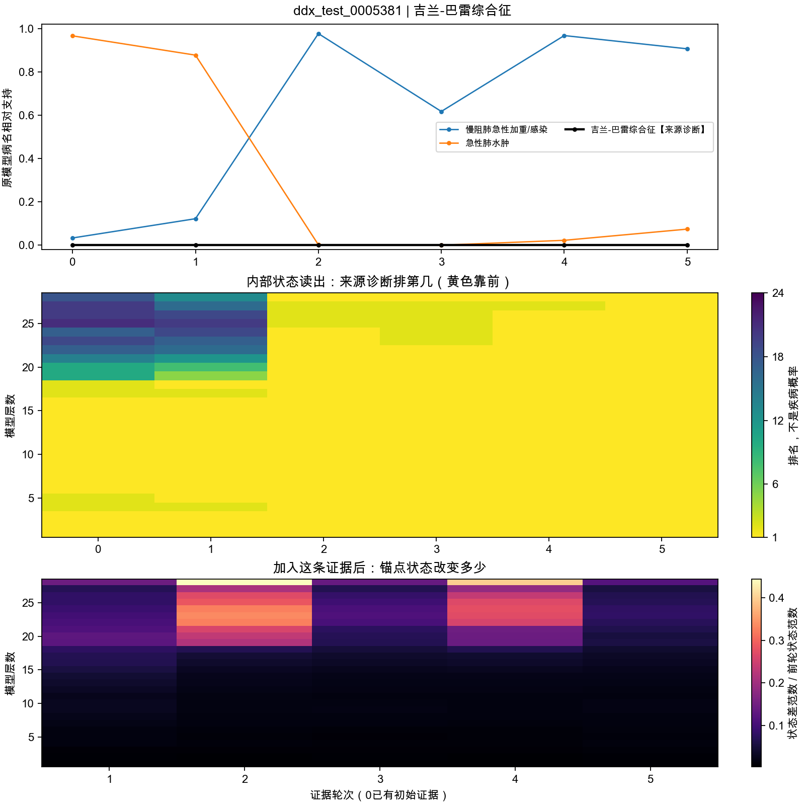

# ddx_test_0005381：吉兰-巴雷综合征

DDxPlus test 原始第5381行（零起始）。轨迹类型：在其他疾病间变动。来源诊断适用于完整病例；中间轮没有逐轮医学标准答案。

| 轮 | 原模型首选（49病） | 来源诊断相对支持 | 第14层读出（24病） | 第21层读出（24病） | 第28层读出（24病） |
|---|---|---:|---|---|---|
| 0 | 急性肺水肿 | 0.0000 | 吉兰-巴雷综合征 | 急性肺水肿 | 急性肺水肿 |
| 1 | 急性肺水肿 | 0.0000 | 吉兰-巴雷综合征 | 急性肺水肿 | 急性肺水肿 |
| 2 | 慢阻肺急性加重/感染 | 0.0000 | 吉兰-巴雷综合征 | 吉兰-巴雷综合征 | 吉兰-巴雷综合征 |
| 3 | 慢阻肺急性加重/感染 | 0.0000 | 吉兰-巴雷综合征 | 吉兰-巴雷综合征 | 吉兰-巴雷综合征 |
| 4 | 慢阻肺急性加重/感染 | 0.0000 | 吉兰-巴雷综合征 | 吉兰-巴雷综合征 | 吉兰-巴雷综合征 |
| 5 | 慢阻肺急性加重/感染 | 0.0000 | 吉兰-巴雷综合征 | 吉兰-巴雷综合征 | 吉兰-巴雷综合征 |

## 原始证据

**第0轮** E_66

明显气短或呼吸困难：是

- Are you experiencing shortness of breath or difficulty breathing in a significant way? **Yes**

**第1轮** E_177

曾有或目前有身体部位麻木、感觉减退或刺痛：是

- Do you currently, or did you ever, have numbness, loss of sensitivity or tingling anywhere on your body? **Yes**

**第2轮** E_0

最近有病毒感染：是

- Have you recently had a viral infection? **Yes**

**第3轮** E_204

近四周出国旅行：否

- Have you traveled out of the country in the last 4 weeks? **No**

**第4轮** E_84

双臂或双腿无力：是

- Do you feel weakness in both arms and/or both legs? **Yes**

**第5轮** E_156

曾有一侧面部无力或瘫痪，可能已恢复：是

- Have you had weakness or paralysis on one side of the face, which may still be present or completely resolved? **Yes**
