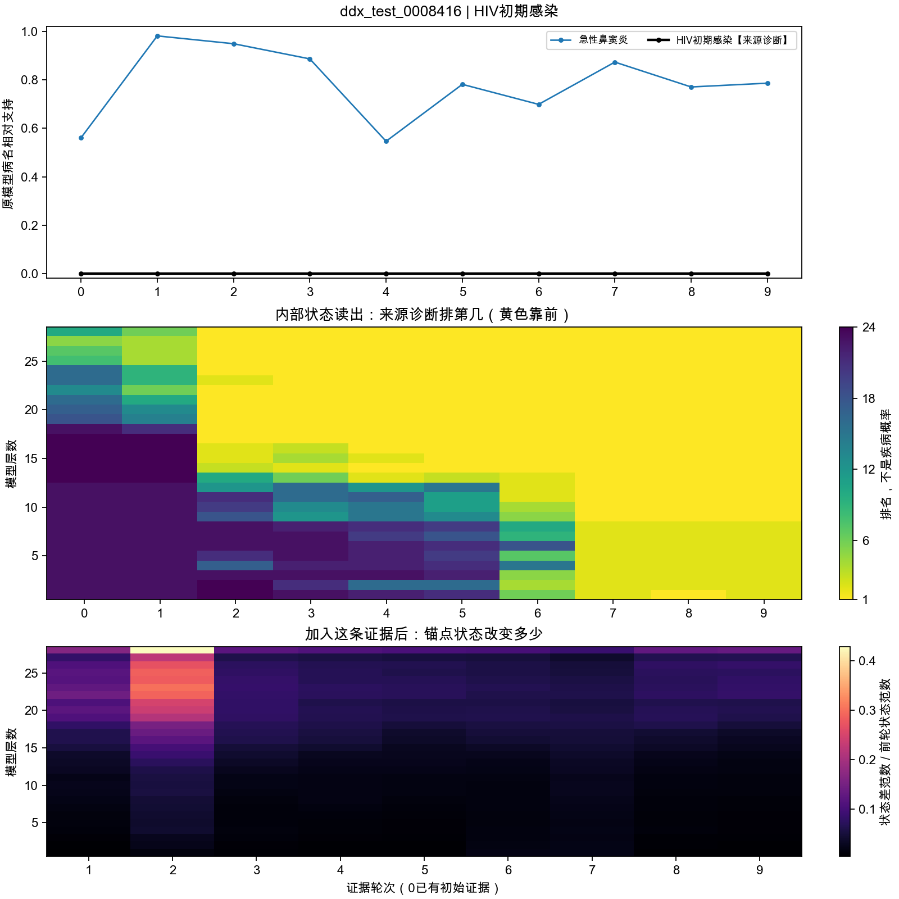

# ddx_test_0008416：HIV初期感染

DDxPlus test 原始第8416行（零起始）。轨迹类型：始终固定另一病。来源诊断适用于完整病例；中间轮没有逐轮医学标准答案。

| 轮 | 原模型首选（49病） | 来源诊断相对支持 | 第14层读出（24病） | 第21层读出（24病） | 第28层读出（24病） |
|---|---|---:|---|---|---|
| 0 | 急性鼻窦炎 | 0.0000 | 吉兰-巴雷综合征 | 急性中耳炎 | 急性中耳炎 |
| 1 | 急性鼻窦炎 | 0.0000 | 吉兰-巴雷综合征 | 上呼吸道感染 | 上呼吸道感染 |
| 2 | 急性鼻窦炎 | 0.0000 | 系统性红斑狼疮 | HIV初期感染 | HIV初期感染 |
| 3 | 急性鼻窦炎 | 0.0000 | 系统性红斑狼疮 | HIV初期感染 | HIV初期感染 |
| 4 | 急性鼻窦炎 | 0.0000 | HIV初期感染 | HIV初期感染 | HIV初期感染 |
| 5 | 急性鼻窦炎 | 0.0000 | HIV初期感染 | HIV初期感染 | HIV初期感染 |
| 6 | 急性鼻窦炎 | 0.0001 | HIV初期感染 | HIV初期感染 | HIV初期感染 |
| 7 | 急性鼻窦炎 | 0.0001 | HIV初期感染 | HIV初期感染 | HIV初期感染 |
| 8 | 急性鼻窦炎 | 0.0000 | HIV初期感染 | HIV初期感染 | HIV初期感染 |
| 9 | 急性鼻窦炎 | 0.0000 | HIV初期感染 | HIV初期感染 | HIV初期感染 |

## 原始证据

**第0轮** E_51

腹泻或排便次数增加：是

- Have you had diarrhea or an increase in stool frequency? **Yes**

**第1轮** E_204

近四周出国旅行：否

- Have you traveled out of the country in the last 4 weeks? **No**

**第2轮** E_129

有自认为与本次就诊相关的皮肤问题（同时揭示颜色、位置、程度等记录）：是；皮疹颜色：pale；皮损脱屑：否；皮疹肿胀程度记录：原始量表值2（0–10，端点含义未给出）；皮损部位：lower gum; labia majora(L); internal cheek(L); bottom lip(R); palace；How intense is the pain caused by the rash?：原始量表值5（0–10，端点含义未给出）；皮损大于1厘米：是；瘙痒程度记录：原始量表值0（0–10，端点含义未给出）

- Do you have any lesions, redness or problems on your skin that you believe are related to the condition you are consulting for? **Yes**
- What color is the rash? **pale**
- Do your lesions peel off? **No**
- Is the rash swollen? **Recorded scale value 2 on the dataset's 0-10 scale; endpoint meanings are unspecified**
- Where is the affected region located? **lower gum; labia majora(L); internal cheek(L); bottom lip(R); palace**
- How intense is the pain caused by the rash? **Recorded scale value 5 on the dataset's 0-10 scale; endpoint meanings are unspecified**
- Is the lesion (or are the lesions) larger than 1cm? **Yes**
- How severe is the itching? **Recorded scale value 0 on the dataset's 0-10 scale; endpoint meanings are unspecified**

**第3轮** E_148

恶心或想吐：是

- Are you feeling nauseous or do you feel like vomiting? **Yes**

**第4轮** E_162

近3个月非主动减重：是

- Have you had an involuntary weight loss over the last 3 months? **Yes**

**第5轮** E_88

疲劳到无法日常活动或整日卧床：是

- Do you feel so tired that you are unable to do your usual activities or are you stuck in your bed all day long? **Yes**

**第6轮** E_189

过去12个月与HIV阳性伴侣有性行为：是

- Have you had sexual intercourse with an HIV-positive partner in the past 12 months? **Yes**

**第7轮** E_53

本次就诊相关疼痛（同时揭示性质、位置、程度、放射等记录）：是；疼痛性质：sensitive; a pulse; exhausting；疼痛部位：back of head; back of the neck; temple(R); temple(L)；疼痛强度记录：原始量表值6（0–10，端点含义未给出）；疼痛放射部位：nowhere；疼痛定位精确度记录：原始量表值7（0–10，端点含义未给出）；疼痛起病速度记录：原始量表值0（0–10，端点含义未给出）

- Do you have pain somewhere, related to your reason for consulting? **Yes**
- Characterize your pain: **sensitive; a pulse; exhausting**
- Do you feel pain somewhere? **back of head; back of the neck; temple(R); temple(L)**
- How intense is the pain? **Recorded scale value 6 on the dataset's 0-10 scale; endpoint meanings are unspecified**
- Does the pain radiate to another location? **nowhere**
- How precisely is the pain located? **Recorded scale value 7 on the dataset's 0-10 scale; endpoint meanings are unspecified**
- How fast did the pain appear? **Recorded scale value 0 on the dataset's 0-10 scale; endpoint meanings are unspecified**

**第8轮** E_61

目前使用静脉注射毒品：是

- Are you currently using intravenous drugs? **Yes**

**第9轮** E_9

淋巴结肿大或疼痛：是

- Do you have swollen or painful lymph nodes? **Yes**
