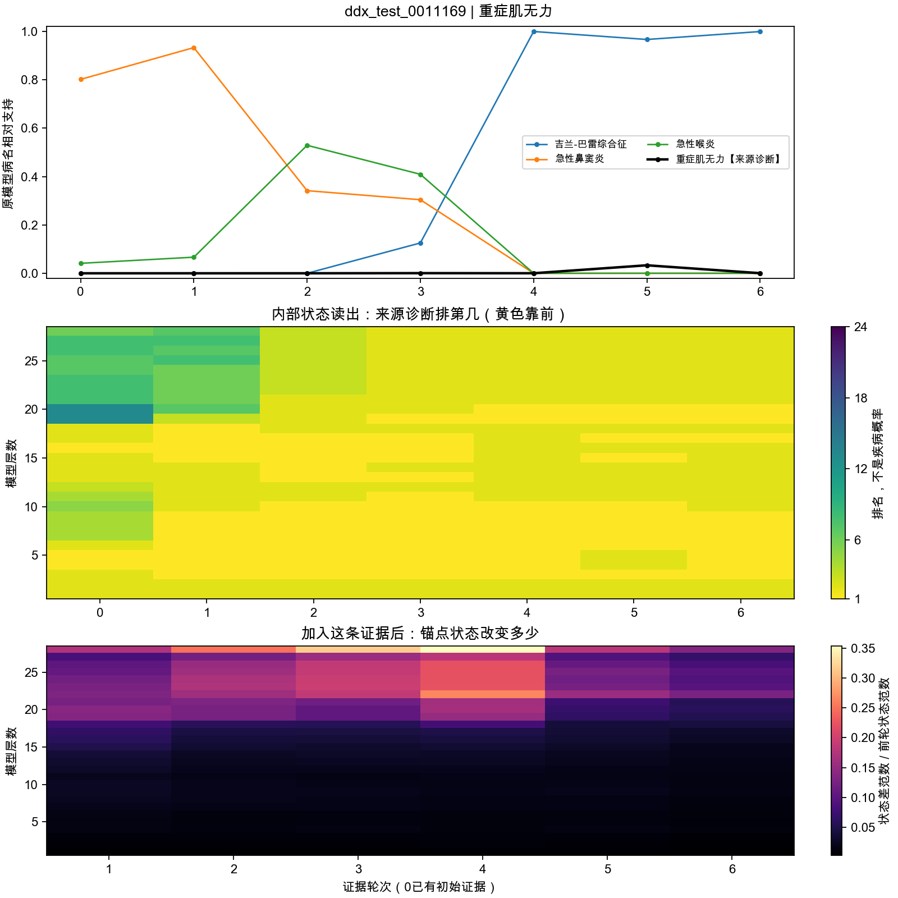

# ddx_test_0011169：重症肌无力

DDxPlus test 原始第11169行（零起始）。轨迹类型：在其他疾病间变动。来源诊断适用于完整病例；中间轮没有逐轮医学标准答案。

| 轮 | 原模型首选（49病） | 来源诊断相对支持 | 第14层读出（24病） | 第21层读出（24病） | 第28层读出（24病） |
|---|---|---:|---|---|---|
| 0 | 急性鼻窦炎 | 0.0000 | 吉兰-巴雷综合征 | 急性中耳炎 | 急性肌张力障碍反应 |
| 1 | 急性鼻窦炎 | 0.0000 | 吉兰-巴雷综合征 | 急性中耳炎 | 病毒性咽炎 |
| 2 | 急性喉炎 | 0.0000 | 重症肌无力 | 吉兰-巴雷综合征 | 吉兰-巴雷综合征 |
| 3 | 急性喉炎 | 0.0005 | 吉兰-巴雷综合征 | 吉兰-巴雷综合征 | 吉兰-巴雷综合征 |
| 4 | 吉兰-巴雷综合征 | 0.0002 | 吉兰-巴雷综合征 | 吉兰-巴雷综合征 | 吉兰-巴雷综合征 |
| 5 | 吉兰-巴雷综合征 | 0.0331 | 吉兰-巴雷综合征 | 吉兰-巴雷综合征 | 吉兰-巴雷综合征 |
| 6 | 吉兰-巴雷综合征 | 0.0004 | 吉兰-巴雷综合征 | 吉兰-巴雷综合征 | 吉兰-巴雷综合征 |

## 原始证据

**第0轮** E_38

下颌疼痛或无力：是

- Do you have pain or weakness in your jaw? **Yes**

**第1轮** E_63

说话或吐字困难：是

- Do you have difficulty articulating words/speaking? **Yes**

**第2轮** E_84

双臂或双腿无力：是

- Do you feel weakness in both arms and/or both legs? **Yes**

**第3轮** E_204

近四周出国旅行：否

- Have you traveled out of the country in the last 4 weeks? **No**

**第4轮** E_176

曾有或目前有肢体/面部无力或瘫痪：是

- Did you previously, or do you currently, have any weakness/paralysis in one or more of your limbs or in your face? **Yes**

**第5轮** E_52

看一个物体时出现两个影像（复视）：是

- Do you have the perception of seeing two images of a single object seen overlapping or adjacent to each other (double vision)? **Yes**

**第6轮** E_172

难以睁开或抬起一侧/双侧眼睑：是

- Do you have a hard time opening/raising one or both eyelids? **Yes**
