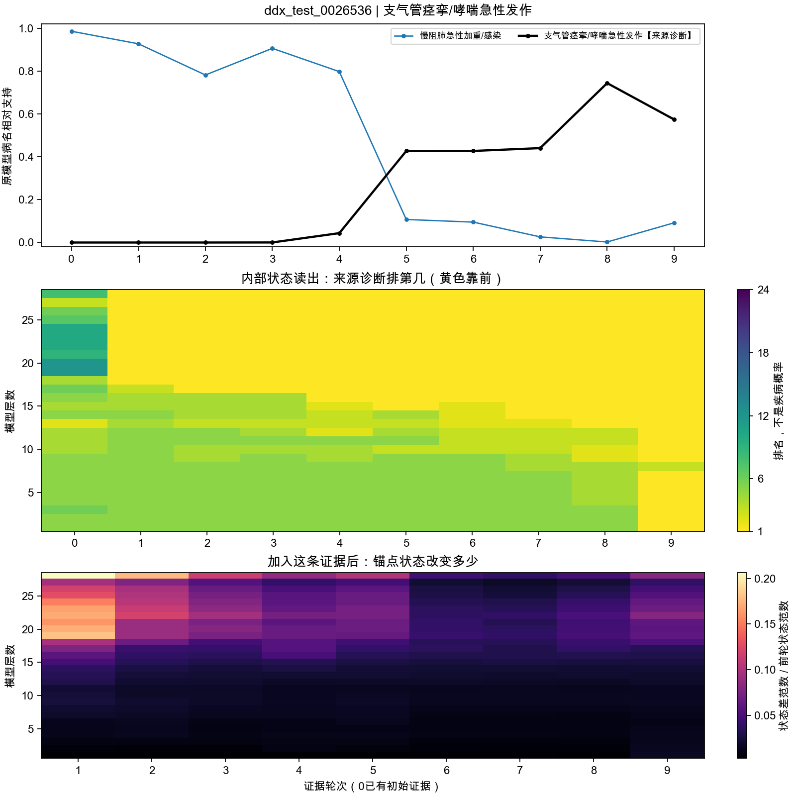

# ddx_test_0026536：支气管痉挛/哮喘急性发作

DDxPlus test 原始第26536行（零起始）。轨迹类型：转向来源病后保持。来源诊断适用于完整病例；中间轮没有逐轮医学标准答案。

| 轮 | 原模型首选（49病） | 来源诊断相对支持 | 第14层读出（24病） | 第21层读出（24病） | 第28层读出（24病） |
|---|---|---:|---|---|---|
| 0 | 慢阻肺急性加重/感染 | 0.0000 | 吉兰-巴雷综合征 | 支气管炎 | 支气管炎 |
| 1 | 慢阻肺急性加重/感染 | 0.0000 | 吉兰-巴雷综合征 | 支气管痉挛/哮喘急性发作 | 支气管痉挛/哮喘急性发作 |
| 2 | 慢阻肺急性加重/感染 | 0.0000 | 吉兰-巴雷综合征 | 支气管痉挛/哮喘急性发作 | 支气管痉挛/哮喘急性发作 |
| 3 | 慢阻肺急性加重/感染 | 0.0003 | 吉兰-巴雷综合征 | 支气管痉挛/哮喘急性发作 | 支气管痉挛/哮喘急性发作 |
| 4 | 慢阻肺急性加重/感染 | 0.0438 | 吉兰-巴雷综合征 | 支气管痉挛/哮喘急性发作 | 支气管痉挛/哮喘急性发作 |
| 5 | 支气管痉挛/哮喘急性发作 | 0.4273 | 吉兰-巴雷综合征 | 支气管痉挛/哮喘急性发作 | 支气管痉挛/哮喘急性发作 |
| 6 | 支气管痉挛/哮喘急性发作 | 0.4275 | 吉兰-巴雷综合征 | 支气管痉挛/哮喘急性发作 | 支气管痉挛/哮喘急性发作 |
| 7 | 支气管痉挛/哮喘急性发作 | 0.4406 | 支气管痉挛/哮喘急性发作 | 支气管痉挛/哮喘急性发作 | 支气管痉挛/哮喘急性发作 |
| 8 | 支气管痉挛/哮喘急性发作 | 0.7440 | 支气管痉挛/哮喘急性发作 | 支气管痉挛/哮喘急性发作 | 支气管痉挛/哮喘急性发作 |
| 9 | 支气管痉挛/哮喘急性发作 | 0.5744 | 支气管痉挛/哮喘急性发作 | 支气管痉挛/哮喘急性发作 | 支气管痉挛/哮喘急性发作 |

## 原始证据

**第0轮** E_66

明显气短或呼吸困难：是

- Are you experiencing shortness of breath or difficulty breathing in a significant way? **Yes**

**第1轮** E_101

过去一年因哮喘住院：是

- Have you been hospitalized for an asthma attack in the past year? **Yes**

**第2轮** E_226

更容易发生常见过敏：是

- Are you more likely to develop common allergies than the general population? **Yes**

**第3轮** E_46

过去一年哮喘发作至少两次：是

- Have you had 2 or more asthma attacks in the past year? **Yes**

**第4轮** E_207

住在大城市：是

- Do you live in in a big city? **Yes**

**第5轮** E_124

有哮喘或曾用支气管扩张药：是

- Do you have asthma or have you ever had to use a bronchodilator in the past? **Yes**

**第6轮** E_201

咳嗽：是

- Do you have a cough? **Yes**

**第7轮** E_204

近四周出国旅行：否

- Have you traveled out of the country in the last 4 weeks? **No**

**第8轮** E_214

呼气时有喘鸣：是

- Have you noticed a wheezing sound when you exhale? **Yes**

**第9轮** E_116

近两周有感冒：是

- Have you had a cold in the last 2 weeks? **Yes**
