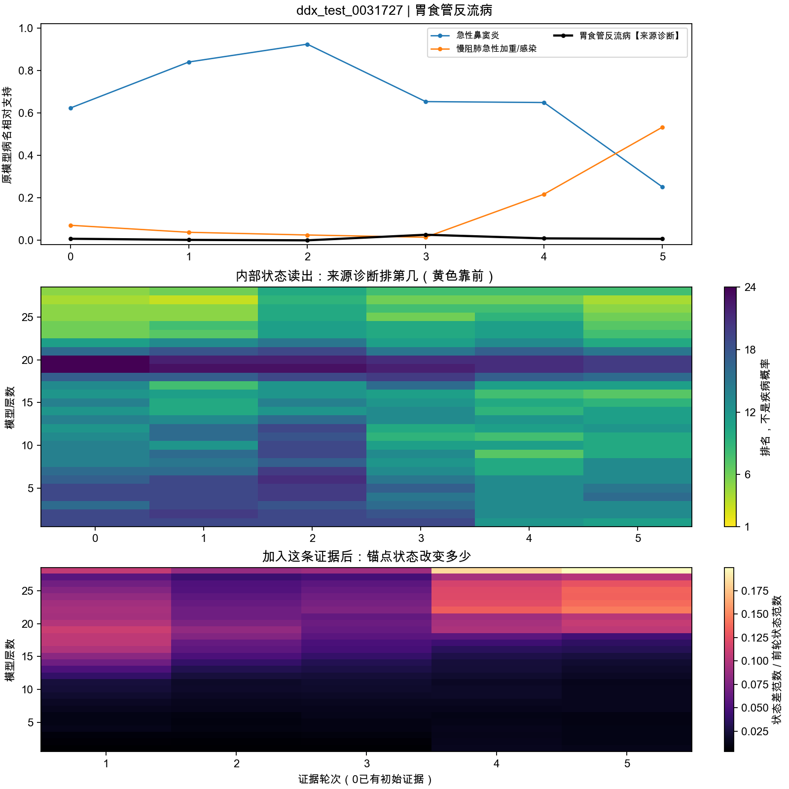

# ddx_test_0031727：胃食管反流病

DDxPlus test 原始第31727行（零起始）。轨迹类型：在其他疾病间变动。来源诊断适用于完整病例；中间轮没有逐轮医学标准答案。

| 轮 | 原模型首选（49病） | 来源诊断相对支持 | 第14层读出（24病） | 第21层读出（24病） | 第28层读出（24病） |
|---|---|---:|---|---|---|
| 0 | 急性鼻窦炎 | 0.0077 | 丛集性头痛 | 腹股沟疝 | 腹股沟疝 |
| 1 | 急性鼻窦炎 | 0.0023 | 病毒性咽炎 | 腹股沟疝 | 腹股沟疝 |
| 2 | 急性鼻窦炎 | 0.0002 | 丛集性头痛 | 支气管炎 | 支气管炎 |
| 3 | 急性鼻窦炎 | 0.0265 | 丛集性头痛 | 腹股沟疝 | 腹股沟疝 |
| 4 | 急性鼻窦炎 | 0.0094 | 丛集性头痛 | 支气管炎 | 支气管炎 |
| 5 | 慢阻肺急性加重/感染 | 0.0070 | 丛集性头痛 | 支气管炎 | 腹股沟疝 |

## 原始证据

**第0轮** E_53

本次就诊相关疼痛（同时揭示性质、位置、程度、放射等记录）：是；疼痛性质：sensitive; a knife stroke; tugging; burning; scary；疼痛部位：lower chest; hypochondrium(L); belly; epigastric；疼痛强度记录：原始量表值4（0–10，端点含义未给出）；疼痛放射部位：lower chest; upper chest；疼痛定位精确度记录：原始量表值8（0–10，端点含义未给出）；疼痛起病速度记录：原始量表值4（0–10，端点含义未给出）

- Do you have pain somewhere, related to your reason for consulting? **Yes**
- Characterize your pain: **sensitive; a knife stroke; tugging; burning; scary**
- Do you feel pain somewhere? **lower chest; hypochondrium(L); belly; epigastric**
- How intense is the pain? **Recorded scale value 4 on the dataset's 0-10 scale; endpoint meanings are unspecified**
- Does the pain radiate to another location? **lower chest; upper chest**
- How precisely is the pain located? **Recorded scale value 8 on the dataset's 0-10 scale; endpoint meanings are unspecified**
- How fast did the pain appear? **Recorded scale value 4 on the dataset's 0-10 scale; endpoint meanings are unspecified**

**第1轮** E_204

近四周出国旅行：否

- Have you traveled out of the country in the last 4 weeks? **No**

**第2轮** E_201

咳嗽：是

- Do you have a cough? **Yes**

**第3轮** E_217

平躺时症状加重、坐起时缓解：是

- Are your symptoms worse when lying down and alleviated while sitting up? **Yes**

**第4轮** E_124

有哮喘或曾用支气管扩张药：是

- Do you have asthma or have you ever had to use a bronchodilator in the past? **Yes**

**第5轮** E_79

吸烟：是

- Do you smoke cigarettes? **Yes**
