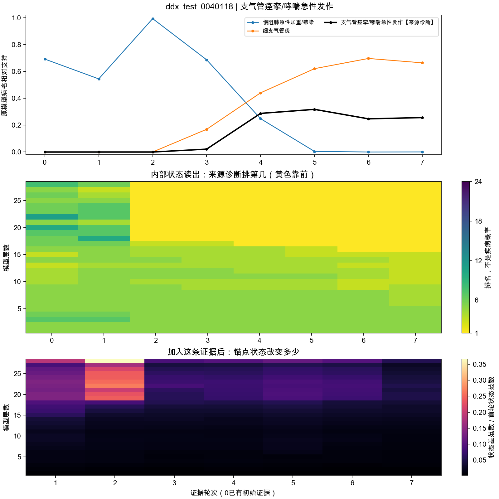

# ddx_test_0040118：支气管痉挛/哮喘急性发作

DDxPlus test 原始第40118行（零起始）。轨迹类型：在其他疾病间变动。来源诊断适用于完整病例；中间轮没有逐轮医学标准答案。

| 轮 | 原模型首选（49病） | 来源诊断相对支持 | 第14层读出（24病） | 第21层读出（24病） | 第28层读出（24病） |
|---|---|---:|---|---|---|
| 0 | 慢阻肺急性加重/感染 | 0.0000 | 吉兰-巴雷综合征 | 支气管炎 | 支气管炎 |
| 1 | 慢阻肺急性加重/感染 | 0.0000 | 吉兰-巴雷综合征 | 支气管炎 | 支气管炎 |
| 2 | 慢阻肺急性加重/感染 | 0.0000 | 吉兰-巴雷综合征 | 支气管痉挛/哮喘急性发作 | 支气管痉挛/哮喘急性发作 |
| 3 | 慢阻肺急性加重/感染 | 0.0216 | 吉兰-巴雷综合征 | 支气管痉挛/哮喘急性发作 | 支气管痉挛/哮喘急性发作 |
| 4 | 细支气管炎 | 0.2877 | 吉兰-巴雷综合征 | 支气管痉挛/哮喘急性发作 | 支气管痉挛/哮喘急性发作 |
| 5 | 细支气管炎 | 0.3177 | 吉兰-巴雷综合征 | 支气管痉挛/哮喘急性发作 | 支气管痉挛/哮喘急性发作 |
| 6 | 细支气管炎 | 0.2472 | 吉兰-巴雷综合征 | 支气管痉挛/哮喘急性发作 | 支气管痉挛/哮喘急性发作 |
| 7 | 细支气管炎 | 0.2566 | 吉兰-巴雷综合征 | 支气管痉挛/哮喘急性发作 | 支气管痉挛/哮喘急性发作 |

## 原始证据

**第0轮** E_201

咳嗽：是

- Do you have a cough? **Yes**

**第1轮** E_66

明显气短或呼吸困难：是

- Are you experiencing shortness of breath or difficulty breathing in a significant way? **Yes**

**第2轮** E_46

过去一年哮喘发作至少两次：是

- Have you had 2 or more asthma attacks in the past year? **Yes**

**第3轮** E_226

更容易发生常见过敏：是

- Are you more likely to develop common allergies than the general population? **Yes**

**第4轮** E_124

有哮喘或曾用支气管扩张药：是

- Do you have asthma or have you ever had to use a bronchodilator in the past? **Yes**

**第5轮** E_119

曾被诊断慢性鼻窦炎：是

- Have you been diagnosed with chronic sinusitis? **Yes**

**第6轮** E_85

Do you have any family members who have asthma?：是

- Do you have any family members who have asthma? **Yes**

**第7轮** E_204

近四周出国旅行：否

- Have you traveled out of the country in the last 4 weeks? **No**
