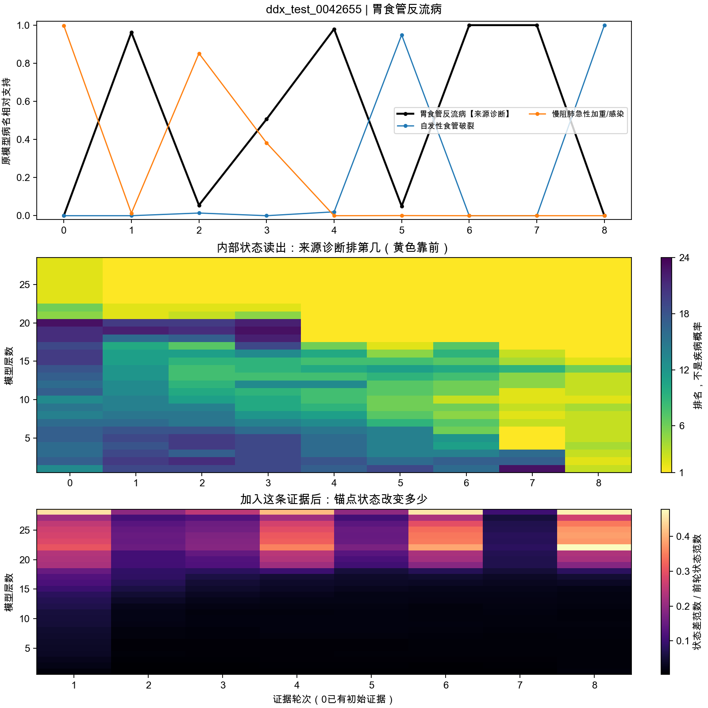

# ddx_test_0042655：胃食管反流病

DDxPlus test 原始第42655行（零起始）。轨迹类型：曾选来源病，最后离开。来源诊断适用于完整病例；中间轮没有逐轮医学标准答案。

| 轮 | 原模型首选（49病） | 来源诊断相对支持 | 第14层读出（24病） | 第21层读出（24病） | 第28层读出（24病） |
|---|---|---:|---|---|---|
| 0 | 慢阻肺急性加重/感染 | 0.0000 | 吉兰-巴雷综合征 | 贫血 | 贫血 |
| 1 | 胃食管反流病 | 0.9622 | 吉兰-巴雷综合征 | 贫血 | 胃食管反流病 |
| 2 | 慢阻肺急性加重/感染 | 0.0554 | 急性中耳炎 | 贫血 | 胃食管反流病 |
| 3 | 胃食管反流病 | 0.5063 | 急性中耳炎 | 贫血 | 胃食管反流病 |
| 4 | 胃食管反流病 | 0.9797 | 丛集性头痛 | 胃食管反流病 | 胃食管反流病 |
| 5 | 自发性食管破裂 | 0.0503 | 急性中耳炎 | 胃食管反流病 | 胃食管反流病 |
| 6 | 胃食管反流病 | 1.0000 | 自发性食管破裂 | 胃食管反流病 | 胃食管反流病 |
| 7 | 胃食管反流病 | 1.0000 | 自发性气胸 | 胃食管反流病 | 胃食管反流病 |
| 8 | 自发性食管破裂 | 0.0000 | 自发性气胸 | 胃食管反流病 | 胃食管反流病 |

## 原始证据

**第0轮** E_140

近期有黑色如煤的粪便：是

- Have you recently had stools that were black (like coal)? **Yes**

**第1轮** E_53

本次就诊相关疼痛（同时揭示性质、位置、程度、放射等记录）：是；疼痛性质：haunting; sensitive; a knife stroke; tugging; burning；疼痛部位：hypochondrium(R); hypochondrium(L); belly; epigastric；疼痛强度记录：原始量表值6（0–10，端点含义未给出）；疼痛放射部位：upper chest；疼痛定位精确度记录：原始量表值4（0–10，端点含义未给出）；疼痛起病速度记录：原始量表值3（0–10，端点含义未给出）

- Do you have pain somewhere, related to your reason for consulting? **Yes**
- Characterize your pain: **haunting; sensitive; a knife stroke; tugging; burning**
- Do you feel pain somewhere? **hypochondrium(R); hypochondrium(L); belly; epigastric**
- How intense is the pain? **Recorded scale value 6 on the dataset's 0-10 scale; endpoint meanings are unspecified**
- Does the pain radiate to another location? **upper chest**
- How precisely is the pain located? **Recorded scale value 4 on the dataset's 0-10 scale; endpoint meanings are unspecified**
- How fast did the pain appear? **Recorded scale value 3 on the dataset's 0-10 scale; endpoint meanings are unspecified**

**第2轮** E_204

近四周出国旅行：否

- Have you traveled out of the country in the last 4 weeks? **No**

**第3轮** E_79

吸烟：是

- Do you smoke cigarettes? **Yes**

**第4轮** E_98

患食管裂孔疝：是

- Do you have a hiatal hernia? **Yes**

**第5轮** E_215

症状在进食后加重：是

- Do you have symptoms that get worse after eating? **Yes**

**第6轮** E_217

平躺时症状加重、坐起时缓解：是

- Are your symptoms worse when lying down and alleviated while sitting up? **Yes**

**第7轮** E_124

有哮喘或曾用支气管扩张药：是

- Do you have asthma or have you ever had to use a bronchodilator in the past? **Yes**

**第8轮** E_201

咳嗽：是

- Do you have a cough? **Yes**
