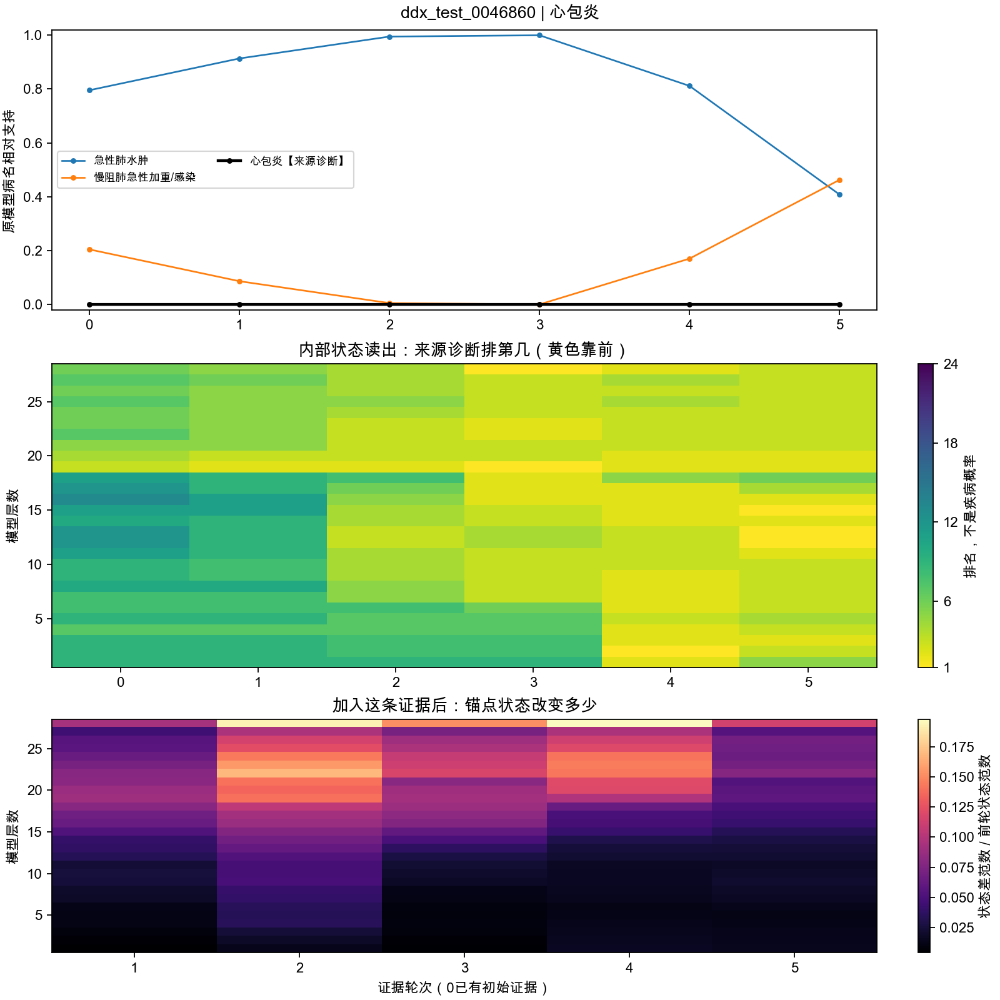

# ddx_test_0046860：心包炎

DDxPlus test 原始第46860行（零起始）。轨迹类型：在其他疾病间变动。来源诊断适用于完整病例；中间轮没有逐轮医学标准答案。

| 轮 | 原模型首选（49病） | 来源诊断相对支持 | 第14层读出（24病） | 第21层读出（24病） | 第28层读出（24病） |
|---|---|---:|---|---|---|
| 0 | 急性肺水肿 | 0.0000 | 吉兰-巴雷综合征 | 急性肺水肿 | 急性肺水肿 |
| 1 | 急性肺水肿 | 0.0000 | 吉兰-巴雷综合征 | 急性肺水肿 | 急性肺水肿 |
| 2 | 急性肺水肿 | 0.0000 | 吉兰-巴雷综合征 | 急性肺水肿 | 急性肺水肿 |
| 3 | 急性肺水肿 | 0.0000 | 急性中耳炎 | 急性肺水肿 | 心包炎 |
| 4 | 急性肺水肿 | 0.0000 | 急性中耳炎 | 支气管炎 | 稳定型心绞痛 |
| 5 | 慢阻肺急性加重/感染 | 0.0000 | 急性中耳炎 | 支气管炎 | 稳定型心绞痛 |

## 原始证据

**第0轮** E_66

明显气短或呼吸困难：是

- Are you experiencing shortness of breath or difficulty breathing in a significant way? **Yes**

**第1轮** E_217

平躺时症状加重、坐起时缓解：是

- Are your symptoms worse when lying down and alleviated while sitting up? **Yes**

**第2轮** E_53

本次就诊相关疼痛（同时揭示性质、位置、程度、放射等记录）：是；疼痛性质：sharp；疼痛部位：lower chest; breast(R); breast(L)；疼痛强度记录：原始量表值9（0–10，端点含义未给出）；疼痛放射部位：thoracic spine; posterior chest wall(R)；疼痛定位精确度记录：原始量表值6（0–10，端点含义未给出）；疼痛起病速度记录：原始量表值4（0–10，端点含义未给出）

- Do you have pain somewhere, related to your reason for consulting? **Yes**
- Characterize your pain: **sharp**
- Do you feel pain somewhere? **lower chest; breast(R); breast(L)**
- How intense is the pain? **Recorded scale value 9 on the dataset's 0-10 scale; endpoint meanings are unspecified**
- Does the pain radiate to another location? **thoracic spine; posterior chest wall(R)**
- How precisely is the pain located? **Recorded scale value 6 on the dataset's 0-10 scale; endpoint meanings are unspecified**
- How fast did the pain appear? **Recorded scale value 4 on the dataset's 0-10 scale; endpoint meanings are unspecified**

**第3轮** E_155

心跳快、不规律或心悸：是

- Do you feel your heart is beating fast (racing), irregularly (missing a beat) or do you feel palpitations? **Yes**

**第4轮** E_0

最近有病毒感染：是

- Have you recently had a viral infection? **Yes**

**第5轮** E_204

近四周出国旅行：否

- Have you traveled out of the country in the last 4 weeks? **No**
