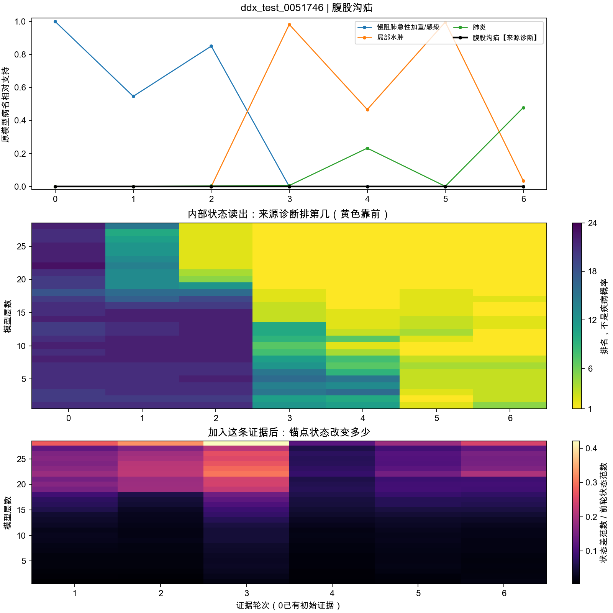

# ddx_test_0051746：腹股沟疝

DDxPlus test 原始第51746行（零起始）。轨迹类型：在其他疾病间变动。来源诊断适用于完整病例；中间轮没有逐轮医学标准答案。

| 轮 | 原模型首选（49病） | 来源诊断相对支持 | 第14层读出（24病） | 第21层读出（24病） | 第28层读出（24病） |
|---|---|---:|---|---|---|
| 0 | 慢阻肺急性加重/感染 | 0.0000 | 吉兰-巴雷综合征 | 支气管炎 | 支气管炎 |
| 1 | 慢阻肺急性加重/感染 | 0.0000 | 吉兰-巴雷综合征 | 支气管炎 | 支气管炎 |
| 2 | 慢阻肺急性加重/感染 | 0.0000 | 吉兰-巴雷综合征 | 支气管炎 | 急性肺水肿 |
| 3 | 局部水肿 | 0.0000 | 系统性红斑狼疮 | 腹股沟疝 | 腹股沟疝 |
| 4 | 局部水肿 | 0.0000 | HIV初期感染 | 腹股沟疝 | 腹股沟疝 |
| 5 | 局部水肿 | 0.0000 | HIV初期感染 | 腹股沟疝 | 腹股沟疝 |
| 6 | 肺炎 | 0.0001 | HIV初期感染 | 腹股沟疝 | 腹股沟疝 |

## 原始证据

**第0轮** E_203

剧烈阵发性咳嗽：是

- Do you have intense coughing fits? **Yes**

**第1轮** E_204

近四周出国旅行：否

- Have you traveled out of the country in the last 4 weeks? **No**

**第2轮** E_30

感到腹胀：是

- Do you feel your abdomen is bloated or distended (swollen due to pressure from inside)? **Yes**

**第3轮** E_129

有自认为与本次就诊相关的皮肤问题（同时揭示颜色、位置、程度等记录）：是；皮疹颜色：pale；皮损脱屑：否；皮疹肿胀程度记录：原始量表值2（0–10，端点含义未给出）；皮损部位：iliac fossa(R); iliac fossa(L)；How intense is the pain caused by the rash?：原始量表值2（0–10，端点含义未给出）；皮损大于1厘米：是；瘙痒程度记录：原始量表值0（0–10，端点含义未给出）

- Do you have any lesions, redness or problems on your skin that you believe are related to the condition you are consulting for? **Yes**
- What color is the rash? **pale**
- Do your lesions peel off? **No**
- Is the rash swollen? **Recorded scale value 2 on the dataset's 0-10 scale; endpoint meanings are unspecified**
- Where is the affected region located? **iliac fossa(R); iliac fossa(L)**
- How intense is the pain caused by the rash? **Recorded scale value 2 on the dataset's 0-10 scale; endpoint meanings are unspecified**
- Is the lesion (or are the lesions) larger than 1cm? **Yes**
- How severe is the itching? **Recorded scale value 0 on the dataset's 0-10 scale; endpoint meanings are unspecified**

**第4轮** E_150

症状加重后仍能排便或排气：是

- Have you been able to pass stools or gas since your symptoms increased? **Yes**

**第5轮** E_53

本次就诊相关疼痛（同时揭示性质、位置、程度、放射等记录）：是；疼痛性质：heavy；疼痛部位：iliac fossa(R); iliac fossa(L); hip(L); testicle(R)；疼痛强度记录：原始量表值7（0–10，端点含义未给出）；疼痛放射部位：nowhere；疼痛定位精确度记录：原始量表值0（0–10，端点含义未给出）；疼痛起病速度记录：原始量表值2（0–10，端点含义未给出）

- Do you have pain somewhere, related to your reason for consulting? **Yes**
- Characterize your pain: **heavy**
- Do you feel pain somewhere? **iliac fossa(R); iliac fossa(L); hip(L); testicle(R)**
- How intense is the pain? **Recorded scale value 7 on the dataset's 0-10 scale; endpoint meanings are unspecified**
- Does the pain radiate to another location? **nowhere**
- How precisely is the pain located? **Recorded scale value 0 on the dataset's 0-10 scale; endpoint meanings are unspecified**
- How fast did the pain appear? **Recorded scale value 2 on the dataset's 0-10 scale; endpoint meanings are unspecified**

**第6轮** E_160

早产或出生时有并发症：是

- Were you born prematurely or did you suffer any complication at birth? **Yes**
