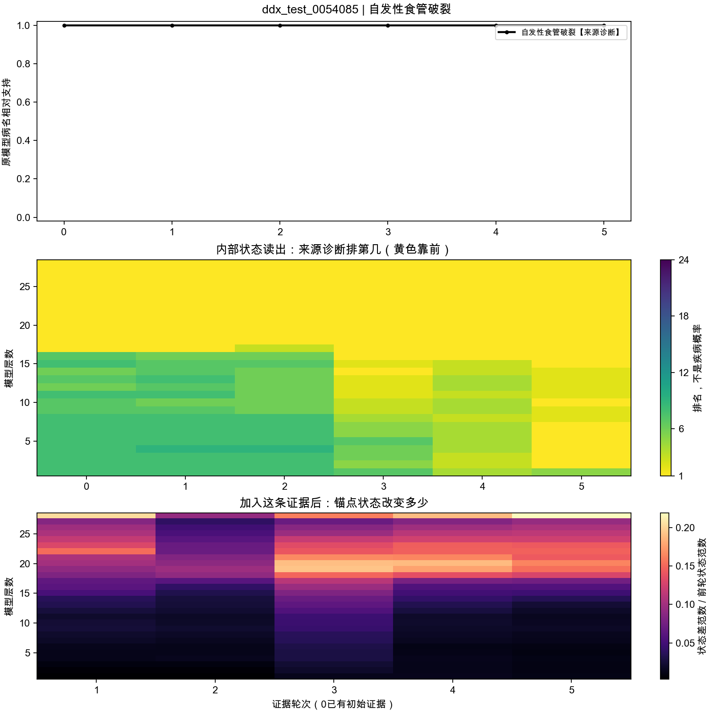

# ddx_test_0054085：自发性食管破裂

DDxPlus test 原始第54085行（零起始）。轨迹类型：始终首选来源病。来源诊断适用于完整病例；中间轮没有逐轮医学标准答案。

| 轮 | 原模型首选（49病） | 来源诊断相对支持 | 第14层读出（24病） | 第21层读出（24病） | 第28层读出（24病） |
|---|---|---:|---|---|---|
| 0 | 自发性食管破裂 | 1.0000 | 吉兰-巴雷综合征 | 自发性食管破裂 | 自发性食管破裂 |
| 1 | 自发性食管破裂 | 1.0000 | 吉兰-巴雷综合征 | 自发性食管破裂 | 自发性食管破裂 |
| 2 | 自发性食管破裂 | 1.0000 | 吉兰-巴雷综合征 | 自发性食管破裂 | 自发性食管破裂 |
| 3 | 自发性食管破裂 | 1.0000 | 自发性食管破裂 | 自发性食管破裂 | 自发性食管破裂 |
| 4 | 自发性食管破裂 | 1.0000 | 病毒性咽炎 | 自发性食管破裂 | 自发性食管破裂 |
| 5 | 自发性食管破裂 | 1.0000 | 急性中耳炎 | 自发性食管破裂 | 自发性食管破裂 |

## 原始证据

**第0轮** E_210

近期吐血或吐出类似咖啡豆的东西：是

- Have you recently thrown up blood or something resembling coffee beans? **Yes**

**第1轮** E_148

恶心或想吐：是

- Are you feeling nauseous or do you feel like vomiting? **Yes**

**第2轮** E_204

近四周出国旅行：否

- Have you traveled out of the country in the last 4 weeks? **No**

**第3轮** E_53

本次就诊相关疼痛（同时揭示性质、位置、程度、放射等记录）：是；疼痛性质：heartbreaking; haunting; a knife stroke; violent; sickening；疼痛部位：lower chest; upper chest; belly; epigastric；疼痛强度记录：原始量表值6（0–10，端点含义未给出）；疼痛放射部位：scapula(R); scapula(L)；疼痛定位精确度记录：原始量表值4（0–10，端点含义未给出）；疼痛起病速度记录：原始量表值6（0–10，端点含义未给出）

- Do you have pain somewhere, related to your reason for consulting? **Yes**
- Characterize your pain: **heartbreaking; haunting; a knife stroke; violent; sickening**
- Do you feel pain somewhere? **lower chest; upper chest; belly; epigastric**
- How intense is the pain? **Recorded scale value 6 on the dataset's 0-10 scale; endpoint meanings are unspecified**
- Does the pain radiate to another location? **scapula(R); scapula(L)**
- How precisely is the pain located? **Recorded scale value 4 on the dataset's 0-10 scale; endpoint meanings are unspecified**
- How fast did the pain appear? **Recorded scale value 6 on the dataset's 0-10 scale; endpoint meanings are unspecified**

**第4轮** E_66

明显气短或呼吸困难：是

- Are you experiencing shortness of breath or difficulty breathing in a significant way? **Yes**

**第5轮** E_78

过量饮酒或酒精依赖：是

- Do you drink alcohol excessively or do you have an addiction to alcohol? **Yes**
