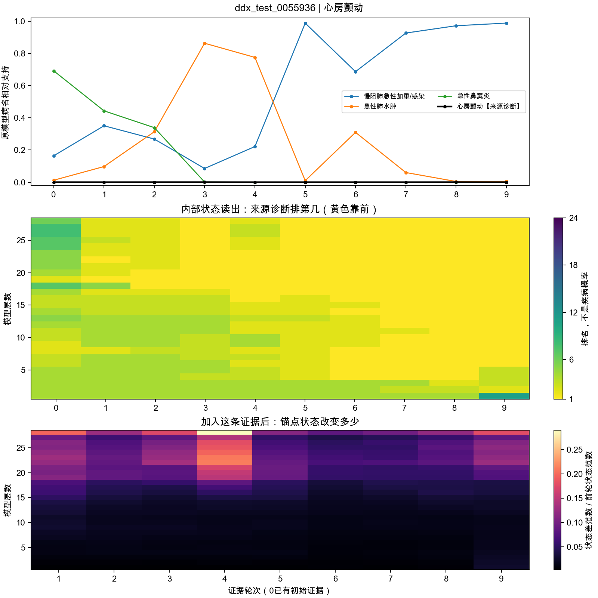

# ddx_test_0055936：心房颤动

DDxPlus test 原始第55936行（零起始）。轨迹类型：在其他疾病间变动。来源诊断适用于完整病例；中间轮没有逐轮医学标准答案。

| 轮 | 原模型首选（49病） | 来源诊断相对支持 | 第14层读出（24病） | 第21层读出（24病） | 第28层读出（24病） |
|---|---|---:|---|---|---|
| 0 | 急性鼻窦炎 | 0.0001 | 吉兰-巴雷综合征 | 急性肌张力障碍反应 | 急性肌张力障碍反应 |
| 1 | 急性鼻窦炎 | 0.0000 | 吉兰-巴雷综合征 | 贫血 | 贫血 |
| 2 | 急性鼻窦炎 | 0.0001 | 吉兰-巴雷综合征 | 贫血 | 贫血 |
| 3 | 急性肺水肿 | 0.0002 | 吉兰-巴雷综合征 | 心房颤动 | 心房颤动 |
| 4 | 急性肺水肿 | 0.0000 | 吉兰-巴雷综合征 | 心房颤动 | 急性肺水肿 |
| 5 | 慢阻肺急性加重/感染 | 0.0000 | 吉兰-巴雷综合征 | 心房颤动 | 心房颤动 |
| 6 | 慢阻肺急性加重/感染 | 0.0000 | 心房颤动 | 心房颤动 | 心房颤动 |
| 7 | 慢阻肺急性加重/感染 | 0.0000 | 心房颤动 | 心房颤动 | 心房颤动 |
| 8 | 慢阻肺急性加重/感染 | 0.0002 | 心房颤动 | 心房颤动 | 心房颤动 |
| 9 | 慢阻肺急性加重/感染 | 0.0000 | 心房颤动 | 心房颤动 | 心房颤动 |

## 原始证据

**第0轮** E_76

轻微头晕或头重脚轻：是

- Do you feel slightly dizzy or lightheaded? **Yes**

**第1轮** E_104

有高血压或服用降压药：是

- Do you have high blood pressure or do you take medications to treat high blood pressure? **Yes**

**第2轮** E_70

相比同身高者明显超重：是

- Are you significantly overweight compared to people of the same height as you? **Yes**

**第3轮** E_22

有已知心脏瓣膜问题：是

- Do you have a known issue with one of your heart valves? **Yes**

**第4轮** E_31

患严重慢阻肺：是

- Do you have severe Chronic Obstructive Pulmonary Disease (COPD)? **Yes**

**第5轮** E_155

心跳快、不规律或心悸：是

- Do you feel your heart is beating fast (racing), irregularly (missing a beat) or do you feel palpitations? **Yes**

**第6轮** E_139

有已知心脏缺陷：是

- Do you have a known heart defect? **Yes**

**第7轮** E_105

曾有心肌梗死或有心绞痛：是

- Have you ever had a heart attack or do you have angina (chest pain)? **Yes**

**第8轮** E_204

近四周出国旅行：否

- Have you traveled out of the country in the last 4 weeks? **No**

**第9轮** E_66

明显气短或呼吸困难：是

- Are you experiencing shortness of breath or difficulty breathing in a significant way? **Yes**
