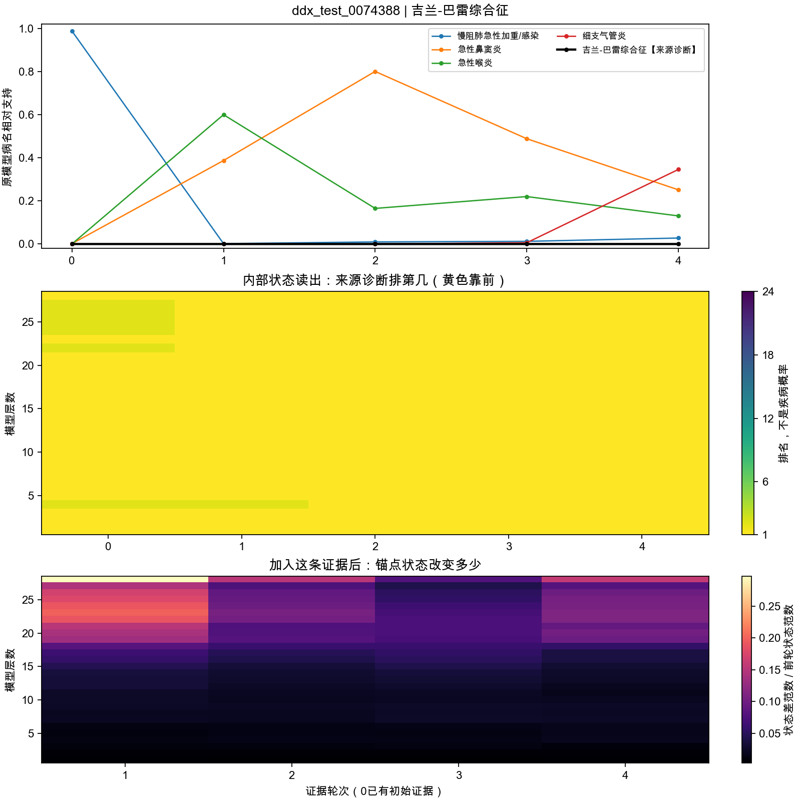

# ddx_test_0074388：吉兰-巴雷综合征

DDxPlus test 原始第74388行（零起始）。轨迹类型：在其他疾病间变动。来源诊断适用于完整病例；中间轮没有逐轮医学标准答案。

| 轮 | 原模型首选（49病） | 来源诊断相对支持 | 第14层读出（24病） | 第21层读出（24病） | 第28层读出（24病） |
|---|---|---:|---|---|---|
| 0 | 慢阻肺急性加重/感染 | 0.0000 | 吉兰-巴雷综合征 | 吉兰-巴雷综合征 | 吉兰-巴雷综合征 |
| 1 | 急性喉炎 | 0.0000 | 吉兰-巴雷综合征 | 吉兰-巴雷综合征 | 吉兰-巴雷综合征 |
| 2 | 急性鼻窦炎 | 0.0000 | 吉兰-巴雷综合征 | 吉兰-巴雷综合征 | 吉兰-巴雷综合征 |
| 3 | 急性鼻窦炎 | 0.0000 | 吉兰-巴雷综合征 | 吉兰-巴雷综合征 | 吉兰-巴雷综合征 |
| 4 | 细支气管炎 | 0.0000 | 吉兰-巴雷综合征 | 吉兰-巴雷综合征 | 吉兰-巴雷综合征 |

## 原始证据

**第0轮** E_157

近期双臂双腿及口周麻木、感觉减退或刺痛：是

- Have you recently had numbness, loss of sensation or tingling, in both arms and legs and around your mouth? **Yes**

**第1轮** E_83

面部肌肉或眼部无力：是

- Have you noticed weakness in your facial muscles and/or eyes? **Yes**

**第2轮** E_204

近四周出国旅行：否

- Have you traveled out of the country in the last 4 weeks? **No**

**第3轮** E_177

曾有或目前有身体部位麻木、感觉减退或刺痛：是

- Do you currently, or did you ever, have numbness, loss of sensitivity or tingling anywhere on your body? **Yes**

**第4轮** E_176

曾有或目前有肢体/面部无力或瘫痪：是

- Did you previously, or do you currently, have any weakness/paralysis in one or more of your limbs or in your face? **Yes**
