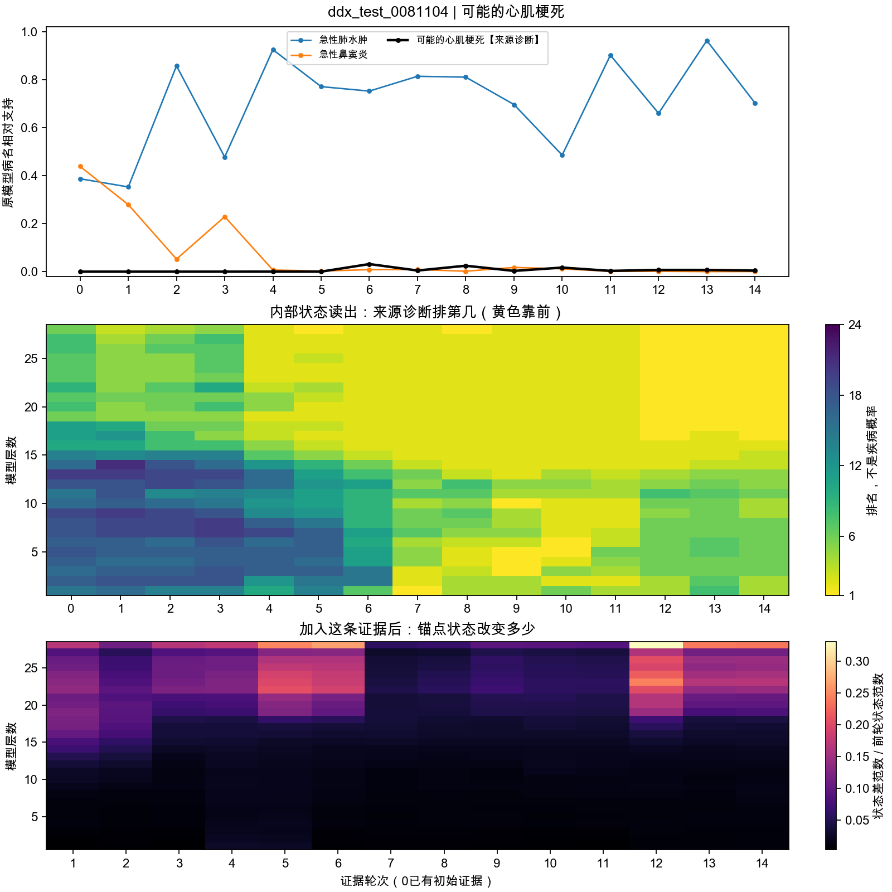

# ddx_test_0081104：可能的心肌梗死

DDxPlus test 原始第81104行（零起始）。轨迹类型：在其他疾病间变动。来源诊断适用于完整病例；中间轮没有逐轮医学标准答案。

| 轮 | 原模型首选（49病） | 来源诊断相对支持 | 第14层读出（24病） | 第21层读出（24病） | 第28层读出（24病） |
|---|---|---:|---|---|---|
| 0 | 急性鼻窦炎 | 0.0000 | 丛集性头痛 | 稳定型心绞痛 | 稳定型心绞痛 |
| 1 | 急性肺水肿 | 0.0000 | 病毒性咽炎 | 稳定型心绞痛 | 支气管炎 |
| 2 | 急性肺水肿 | 0.0000 | 丛集性头痛 | 稳定型心绞痛 | 稳定型心绞痛 |
| 3 | 急性肺水肿 | 0.0000 | 急性中耳炎 | 稳定型心绞痛 | 稳定型心绞痛 |
| 4 | 急性肺水肿 | 0.0002 | 丛集性头痛 | 稳定型心绞痛 | 稳定型心绞痛 |
| 5 | 急性肺水肿 | 0.0001 | 稳定型心绞痛 | 稳定型心绞痛 | 可能的心肌梗死 |
| 6 | 急性肺水肿 | 0.0316 | 稳定型心绞痛 | 稳定型心绞痛 | 稳定型心绞痛 |
| 7 | 急性肺水肿 | 0.0047 | 稳定型心绞痛 | 稳定型心绞痛 | 稳定型心绞痛 |
| 8 | 急性肺水肿 | 0.0247 | 稳定型心绞痛 | 稳定型心绞痛 | 可能的心肌梗死 |
| 9 | 急性肺水肿 | 0.0031 | 稳定型心绞痛 | 稳定型心绞痛 | 稳定型心绞痛 |
| 10 | 急性肺水肿 | 0.0170 | 稳定型心绞痛 | 稳定型心绞痛 | 稳定型心绞痛 |
| 11 | 急性肺水肿 | 0.0032 | 稳定型心绞痛 | 稳定型心绞痛 | 稳定型心绞痛 |
| 12 | 急性肺水肿 | 0.0073 | 稳定型心绞痛 | 可能的心肌梗死 | 可能的心肌梗死 |
| 13 | 急性肺水肿 | 0.0072 | 稳定型心绞痛 | 可能的心肌梗死 | 可能的心肌梗死 |
| 14 | 急性肺水肿 | 0.0044 | 稳定型心绞痛 | 可能的心肌梗死 | 可能的心肌梗死 |

## 原始证据

**第0轮** E_53

本次就诊相关疼痛（同时揭示性质、位置、程度、放射等记录）：是；疼痛性质：heavy; sharp; sickening；疼痛部位：lower chest; upper chest; breast(R); breast(L); epigastric；疼痛强度记录：原始量表值10（0–10，端点含义未给出）；疼痛放射部位：biceps(R); biceps(L); under the jaw; shoulder(R); shoulder(L)；疼痛定位精确度记录：原始量表值4（0–10，端点含义未给出）；疼痛起病速度记录：原始量表值8（0–10，端点含义未给出）

- Do you have pain somewhere, related to your reason for consulting? **Yes**
- Characterize your pain: **heavy; sharp; sickening**
- Do you feel pain somewhere? **lower chest; upper chest; breast(R); breast(L); epigastric**
- How intense is the pain? **Recorded scale value 10 on the dataset's 0-10 scale; endpoint meanings are unspecified**
- Does the pain radiate to another location? **biceps(R); biceps(L); under the jaw; shoulder(R); shoulder(L)**
- How precisely is the pain located? **Recorded scale value 4 on the dataset's 0-10 scale; endpoint meanings are unspecified**
- How fast did the pain appear? **Recorded scale value 8 on the dataset's 0-10 scale; endpoint meanings are unspecified**

**第1轮** E_70

相比同身高者明显超重：是

- Are you significantly overweight compared to people of the same height as you? **Yes**

**第2轮** E_104

有高血压或服用降压药：是

- Do you have high blood pressure or do you take medications to treat high blood pressure? **Yes**

**第3轮** E_191

以前吸烟：是

- Are you a former smoker? **Yes**

**第4轮** E_225

近亲在50岁前患心血管疾病：是

- Do you have close family members who had a cardiovascular disease problem before the age of 50? **Yes**

**第5轮** E_105

曾有心肌梗死或有心绞痛：是

- Have you ever had a heart attack or do you have angina (chest pain)? **Yes**

**第6轮** E_204

近四周出国旅行：否

- Have you traveled out of the country in the last 4 weeks? **No**

**第7轮** E_79

吸烟：是

- Do you smoke cigarettes? **Yes**

**第8轮** E_89

持续疲劳或睡眠不能恢复精力：是

- Do you constantly feel fatigued or do you have non-restful sleep? **Yes**

**第9轮** E_66

明显气短或呼吸困难：是

- Are you experiencing shortness of breath or difficulty breathing in a significant way? **Yes**

**第10轮** E_68

Do you have diabetes?：是

- Do you have diabetes? **Yes**

**第11轮** E_108

血液循环不良：是

- Do you have a problem with poor circulation? **Yes**

**第12轮** E_2

感染HIV：是

- Are you infected with the human immunodeficiency virus (HIV)? **Yes**

**第13轮** E_50

出汗明显增多：是

- Have you had significantly increased sweating? **Yes**

**第14轮** E_161

近期食欲下降或更容易饱：是

- Have you recently had a loss of appetite or do you get full more quickly then usually? **Yes**
