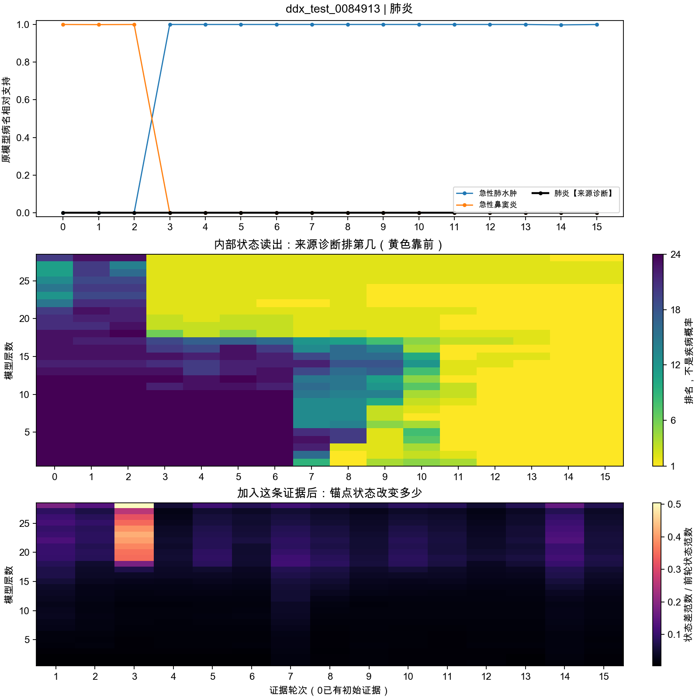

# ddx_test_0084913：肺炎

DDxPlus test 原始第84913行（零起始）。轨迹类型：在其他疾病间变动。来源诊断适用于完整病例；中间轮没有逐轮医学标准答案。

| 轮 | 原模型首选（49病） | 来源诊断相对支持 | 第14层读出（24病） | 第21层读出（24病） | 第28层读出（24病） |
|---|---|---:|---|---|---|
| 0 | 急性鼻窦炎 | 0.0000 | 吉兰-巴雷综合征 | 急性中耳炎 | 急性中耳炎 |
| 1 | 急性鼻窦炎 | 0.0000 | 吉兰-巴雷综合征 | 急性中耳炎 | 急性中耳炎 |
| 2 | 急性鼻窦炎 | 0.0000 | 吉兰-巴雷综合征 | 急性中耳炎 | 急性中耳炎 |
| 3 | 急性肺水肿 | 0.0000 | 吉兰-巴雷综合征 | 急性肺水肿 | 急性肺水肿 |
| 4 | 急性肺水肿 | 0.0000 | 吉兰-巴雷综合征 | 急性肺水肿 | 急性肺水肿 |
| 5 | 急性肺水肿 | 0.0000 | 吉兰-巴雷综合征 | 急性肺水肿 | 急性肺水肿 |
| 6 | 急性肺水肿 | 0.0000 | 吉兰-巴雷综合征 | 急性肺水肿 | 急性肺水肿 |
| 7 | 急性肺水肿 | 0.0000 | 急性肺水肿 | 急性肺水肿 | 急性肺水肿 |
| 8 | 急性肺水肿 | 0.0000 | 病毒性咽炎 | 急性肺水肿 | 急性肺水肿 |
| 9 | 急性肺水肿 | 0.0000 | 病毒性咽炎 | 急性肺水肿 | 急性肺水肿 |
| 10 | 急性肺水肿 | 0.0000 | 急性肺水肿 | 急性肺水肿 | 急性肺水肿 |
| 11 | 急性肺水肿 | 0.0000 | 可能的心肌梗死 | 急性肺水肿 | 急性肺水肿 |
| 12 | 急性肺水肿 | 0.0000 | 可能的心肌梗死 | 肺炎 | 急性肺水肿 |
| 13 | 急性肺水肿 | 0.0000 | 肺炎 | 肺炎 | 急性肺水肿 |
| 14 | 急性肺水肿 | 0.0000 | 肺炎 | 肺炎 | 肺炎 |
| 15 | 急性肺水肿 | 0.0000 | 肺炎 | 肺炎 | 肺炎 |

## 原始证据

**第0轮** E_181

鼻塞或流清鼻涕：是

- Do you have nasal congestion or a clear runny nose? **Yes**

**第1轮** E_161

近期食欲下降或更容易饱：是

- Have you recently had a loss of appetite or do you get full more quickly then usually? **Yes**

**第2轮** E_220

深吸气使疼痛加重：是

- Do you have pain that is increased when you breathe in deeply? **Yes**

**第3轮** E_106

有心力衰竭病史：是

- Do you have heart failure? **Yes**

**第4轮** E_208

BMI低于18.5或体重过低：是

- Is your BMI less than 18.5, or are you underweight? **Yes**

**第5轮** E_204

近四周出国旅行：否

- Have you traveled out of the country in the last 4 weeks? **No**

**第6轮** E_77

咳嗽，痰变色或增多：是

- Do you have a cough that produces colored or more abundant sputum than usual? **Yes**

**第7轮** E_53

本次就诊相关疼痛（同时揭示性质、位置、程度、放射等记录）：是；疼痛性质：sharp；疼痛部位：side of the chest(L); upper chest; breast(R); posterior chest wall(L)；疼痛强度记录：原始量表值5（0–10，端点含义未给出）；疼痛放射部位：nowhere；疼痛定位精确度记录：原始量表值3（0–10，端点含义未给出）；疼痛起病速度记录：原始量表值1（0–10，端点含义未给出）

- Do you have pain somewhere, related to your reason for consulting? **Yes**
- Characterize your pain: **sharp**
- Do you feel pain somewhere? **side of the chest(L); upper chest; breast(R); posterior chest wall(L)**
- How intense is the pain? **Recorded scale value 5 on the dataset's 0-10 scale; endpoint meanings are unspecified**
- Does the pain radiate to another location? **nowhere**
- How precisely is the pain located? **Recorded scale value 3 on the dataset's 0-10 scale; endpoint meanings are unspecified**
- How fast did the pain appear? **Recorded scale value 1 on the dataset's 0-10 scale; endpoint meanings are unspecified**

**第8轮** E_94

寒战：是

- Have you had chills or shivers? **Yes**

**第9轮** E_196

近一个月接受过手术：是

- Have you had surgery within the last month? **Yes**

**第10轮** E_122

Do you have a chronic obstructive pulmonary disease (COPD)?：是

- Do you have a chronic obstructive pulmonary disease (COPD)? **Yes**

**第11轮** E_95

有帕金森病史：是

- Do you have Parkinson’s disease? **Yes**

**第12轮** E_117

Have you ever had pneumonia?：是

- Have you ever had pneumonia? **Yes**

**第13轮** E_144

广泛肌肉疼痛：是

- Do you have diffuse (widespread) muscle pain? **Yes**

**第14轮** E_129

有自认为与本次就诊相关的皮肤问题（同时揭示颜色、位置、程度等记录）：是；皮疹颜色：pink；皮损脱屑：是；皮疹肿胀程度记录：原始量表值1（0–10，端点含义未给出）；皮损部位：posterior chest wall(R); shoulder(R); shoulder(L)；How intense is the pain caused by the rash?：原始量表值2（0–10，端点含义未给出）；皮损大于1厘米：否；瘙痒程度记录：原始量表值2（0–10，端点含义未给出）

- Do you have any lesions, redness or problems on your skin that you believe are related to the condition you are consulting for? **Yes**
- What color is the rash? **pink**
- Do your lesions peel off? **Yes**
- Is the rash swollen? **Recorded scale value 1 on the dataset's 0-10 scale; endpoint meanings are unspecified**
- Where is the affected region located? **posterior chest wall(R); shoulder(R); shoulder(L)**
- How intense is the pain caused by the rash? **Recorded scale value 2 on the dataset's 0-10 scale; endpoint meanings are unspecified**
- Is the lesion (or are the lesions) larger than 1cm? **No**
- How severe is the itching? **Recorded scale value 2 on the dataset's 0-10 scale; endpoint meanings are unspecified**

**第15轮** E_175

本次出现疲倦、全身不适、肌痛或整体状态变化：是

- Have you noticed any new fatigue, generalized and vague discomfort, diffuse (widespread) muscle aches or a change in your general well-being related to your consultation today? **Yes**
