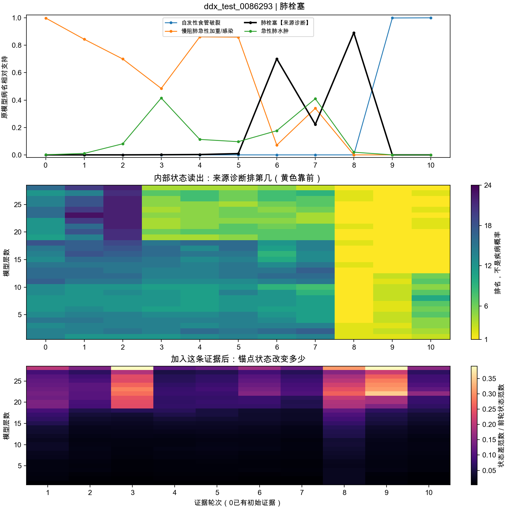

# ddx_test_0086293：肺栓塞

DDxPlus test 原始第86293行（零起始）。轨迹类型：曾选来源病，最后离开。来源诊断适用于完整病例；中间轮没有逐轮医学标准答案。

| 轮 | 原模型首选（49病） | 来源诊断相对支持 | 第14层读出（24病） | 第21层读出（24病） | 第28层读出（24病） |
|---|---|---:|---|---|---|
| 0 | 慢阻肺急性加重/感染 | 0.0000 | 吉兰-巴雷综合征 | 贫血 | 支气管炎 |
| 1 | 慢阻肺急性加重/感染 | 0.0000 | 吉兰-巴雷综合征 | 贫血 | 贫血 |
| 2 | 慢阻肺急性加重/感染 | 0.0002 | 吉兰-巴雷综合征 | 贫血 | 支气管炎 |
| 3 | 慢阻肺急性加重/感染 | 0.0011 | 吉兰-巴雷综合征 | 心房颤动 | 贫血 |
| 4 | 慢阻肺急性加重/感染 | 0.0026 | 吉兰-巴雷综合征 | 贫血 | 贫血 |
| 5 | 慢阻肺急性加重/感染 | 0.0094 | 吉兰-巴雷综合征 | 心房颤动 | 贫血 |
| 6 | 肺栓塞 | 0.7010 | 吉兰-巴雷综合征 | 贫血 | 贫血 |
| 7 | 急性肺水肿 | 0.2222 | 吉兰-巴雷综合征 | 贫血 | 贫血 |
| 8 | 肺栓塞 | 0.8910 | 病毒性咽炎 | 自发性气胸 | 肺栓塞 |
| 9 | 自发性食管破裂 | 0.0000 | 肺栓塞 | 肺栓塞 | 肺栓塞 |
| 10 | 自发性食管破裂 | 0.0000 | 肺栓塞 | 自发性食管破裂 | 肺栓塞 |

## 原始证据

**第0轮** E_45

咯血：是

- Have you been coughing up blood? **Yes**

**第1轮** E_110

过去四周有连续超过三天不能活动或起床：是

- Have you been unable to move or get up for more than 3 consecutive days within the last 4 weeks? **Yes**

**第2轮** E_196

近一个月接受过手术：是

- Have you had surgery within the last month? **Yes**

**第3轮** E_159

曾失去意识：是

- Did you lose consciousness? **Yes**

**第4轮** E_204

近四周出国旅行：North America

- Have you traveled out of the country in the last 4 weeks? **North America**

**第5轮** E_220

深吸气使疼痛加重：是

- Do you have pain that is increased when you breathe in deeply? **Yes**

**第6轮** E_109

曾有深静脉血栓：是

- Have you ever had deep vein thrombosis (DVT)? **Yes**

**第7轮** E_100

目前服用激素：是

- Do you currently take hormones? **Yes**

**第8轮** E_53

本次就诊相关疼痛（同时揭示性质、位置、程度、放射等记录）：是；疼痛性质：sensitive; a knife stroke; sharp；疼痛部位：side of the chest(R); scapula(R); scapula(L); posterior chest wall(R); posterior chest wall(L)；疼痛强度记录：原始量表值1（0–10，端点含义未给出）；疼痛放射部位：side of the chest(R); side of the chest(L); scapula(L); posterior chest wall(R); posterior chest wall(L)；疼痛定位精确度记录：原始量表值6（0–10，端点含义未给出）；疼痛起病速度记录：原始量表值6（0–10，端点含义未给出）

- Do you have pain somewhere, related to your reason for consulting? **Yes**
- Characterize your pain: **sensitive; a knife stroke; sharp**
- Do you feel pain somewhere? **side of the chest(R); scapula(R); scapula(L); posterior chest wall(R); posterior chest wall(L)**
- How intense is the pain? **Recorded scale value 1 on the dataset's 0-10 scale; endpoint meanings are unspecified**
- Does the pain radiate to another location? **side of the chest(R); side of the chest(L); scapula(L); posterior chest wall(R); posterior chest wall(L)**
- How precisely is the pain located? **Recorded scale value 6 on the dataset's 0-10 scale; endpoint meanings are unspecified**
- How fast did the pain appear? **Recorded scale value 6 on the dataset's 0-10 scale; endpoint meanings are unspecified**

**第9轮** E_151

身体局部肿胀（同时揭示部位）：是；Where is the swelling located?：posterior aspect of the ankle(R)

- Do you have swelling in one or more areas of your body? **Yes**
- Where is the swelling located? **posterior aspect of the ankle(R)**

**第10轮** E_66

明显气短或呼吸困难：是

- Are you experiencing shortness of breath or difficulty breathing in a significant way? **Yes**
