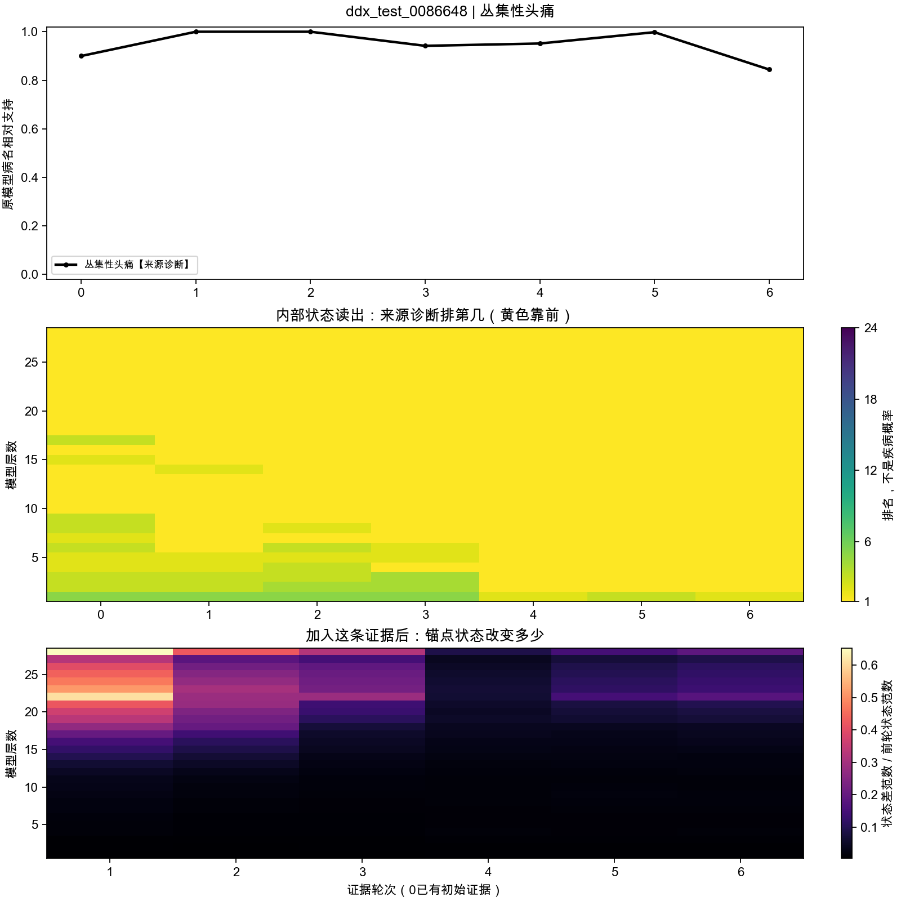

# ddx_test_0086648：丛集性头痛

DDxPlus test 原始第86648行（零起始）。轨迹类型：始终首选来源病。来源诊断适用于完整病例；中间轮没有逐轮医学标准答案。

| 轮 | 原模型首选（49病） | 来源诊断相对支持 | 第14层读出（24病） | 第21层读出（24病） | 第28层读出（24病） |
|---|---|---:|---|---|---|
| 0 | 丛集性头痛 | 0.9000 | 丛集性头痛 | 丛集性头痛 | 丛集性头痛 |
| 1 | 丛集性头痛 | 1.0000 | 病毒性咽炎 | 丛集性头痛 | 丛集性头痛 |
| 2 | 丛集性头痛 | 1.0000 | 丛集性头痛 | 丛集性头痛 | 丛集性头痛 |
| 3 | 丛集性头痛 | 0.9419 | 丛集性头痛 | 丛集性头痛 | 丛集性头痛 |
| 4 | 丛集性头痛 | 0.9515 | 丛集性头痛 | 丛集性头痛 | 丛集性头痛 |
| 5 | 丛集性头痛 | 0.9981 | 丛集性头痛 | 丛集性头痛 | 丛集性头痛 |
| 6 | 丛集性头痛 | 0.8443 | 丛集性头痛 | 丛集性头痛 | 丛集性头痛 |

## 原始证据

**第0轮** E_53

本次就诊相关疼痛（同时揭示性质、位置、程度、放射等记录）：是；疼痛性质：haunting; a knife stroke; tugging; violent; sharp；疼痛部位：forehead; cheek(R); cheek(L); eye(L); temple(R)；疼痛强度记录：原始量表值7（0–10，端点含义未给出）；疼痛放射部位：nowhere；疼痛定位精确度记录：原始量表值10（0–10，端点含义未给出）；疼痛起病速度记录：原始量表值9（0–10，端点含义未给出）

- Do you have pain somewhere, related to your reason for consulting? **Yes**
- Characterize your pain: **haunting; a knife stroke; tugging; violent; sharp**
- Do you feel pain somewhere? **forehead; cheek(R); cheek(L); eye(L); temple(R)**
- How intense is the pain? **Recorded scale value 7 on the dataset's 0-10 scale; endpoint meanings are unspecified**
- Does the pain radiate to another location? **nowhere**
- How precisely is the pain located? **Recorded scale value 10 on the dataset's 0-10 scale; endpoint meanings are unspecified**
- How fast did the pain appear? **Recorded scale value 9 on the dataset's 0-10 scale; endpoint meanings are unspecified**

**第1轮** E_25

家人被诊断为丛集性头痛：是

- Have any of your family members been diagnosed with cluster headaches? **Yes**

**第2轮** E_78

过量饮酒或酒精依赖：是

- Do you drink alcohol excessively or do you have an addiction to alcohol? **Yes**

**第3轮** E_184

服用扩张血管的药物：是

- Do you take medication that dilates your blood vessels? **Yes**

**第4轮** E_127

流泪过多：是

- Do you feel that your eyes produce excessive tears? **Yes**

**第5轮** E_204

近四周出国旅行：否

- Have you traveled out of the country in the last 4 weeks? **No**

**第6轮** E_181

鼻塞或流清鼻涕：是

- Do you have nasal congestion or a clear runny nose? **Yes**
