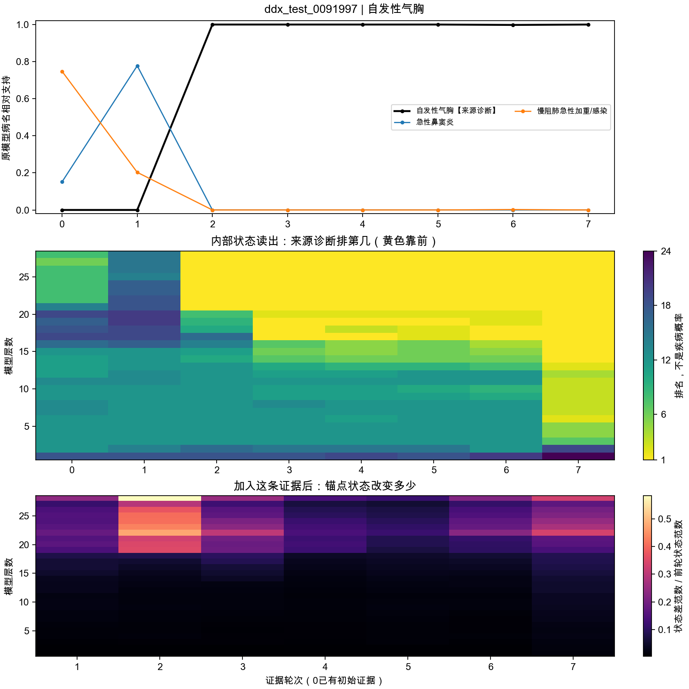

# ddx_test_0091997：自发性气胸

DDxPlus test 原始第91997行（零起始）。轨迹类型：转向来源病后保持。来源诊断适用于完整病例；中间轮没有逐轮医学标准答案。

| 轮 | 原模型首选（49病） | 来源诊断相对支持 | 第14层读出（24病） | 第21层读出（24病） | 第28层读出（24病） |
|---|---|---:|---|---|---|
| 0 | 慢阻肺急性加重/感染 | 0.0000 | 吉兰-巴雷综合征 | 支气管炎 | 支气管炎 |
| 1 | 急性鼻窦炎 | 0.0000 | 吉兰-巴雷综合征 | 上呼吸道感染 | 支气管炎 |
| 2 | 自发性气胸 | 1.0000 | 吉兰-巴雷综合征 | 自发性气胸 | 自发性气胸 |
| 3 | 自发性气胸 | 1.0000 | 吉兰-巴雷综合征 | 自发性气胸 | 自发性气胸 |
| 4 | 自发性气胸 | 0.9999 | 吉兰-巴雷综合征 | 自发性气胸 | 自发性气胸 |
| 5 | 自发性气胸 | 1.0000 | 吉兰-巴雷综合征 | 自发性气胸 | 自发性气胸 |
| 6 | 自发性气胸 | 0.9979 | 吉兰-巴雷综合征 | 自发性气胸 | 自发性气胸 |
| 7 | 自发性气胸 | 1.0000 | 自发性气胸 | 自发性气胸 | 自发性气胸 |

## 原始证据

**第0轮** E_220

深吸气使疼痛加重：是

- Do you have pain that is increased when you breathe in deeply? **Yes**

**第1轮** E_204

近四周出国旅行：否

- Have you traveled out of the country in the last 4 weeks? **No**

**第2轮** E_165

家人曾有气胸：是

- Have any of your family members ever had a pneumothorax? **Yes**

**第3轮** E_21

曾有自发性气胸：是

- Have you ever had a spontaneous pneumothorax? **Yes**

**第4轮** E_79

吸烟：是

- Do you smoke cigarettes? **Yes**

**第5轮** E_218

活动时症状加重、休息时缓解：是

- Do you have symptoms that are increased with physical exertion but alleviated with rest? **Yes**

**第6轮** E_122

Do you have a chronic obstructive pulmonary disease (COPD)?：是

- Do you have a chronic obstructive pulmonary disease (COPD)? **Yes**

**第7轮** E_53

本次就诊相关疼痛（同时揭示性质、位置、程度、放射等记录）：是；疼痛性质：violent；疼痛部位：lower chest; side of the chest(R); side of the chest(L); breast(R); breast(L)；疼痛强度记录：原始量表值10（0–10，端点含义未给出）；疼痛放射部位：nowhere；疼痛定位精确度记录：原始量表值5（0–10，端点含义未给出）；疼痛起病速度记录：原始量表值9（0–10，端点含义未给出）

- Do you have pain somewhere, related to your reason for consulting? **Yes**
- Characterize your pain: **violent**
- Do you feel pain somewhere? **lower chest; side of the chest(R); side of the chest(L); breast(R); breast(L)**
- How intense is the pain? **Recorded scale value 10 on the dataset's 0-10 scale; endpoint meanings are unspecified**
- Does the pain radiate to another location? **nowhere**
- How precisely is the pain located? **Recorded scale value 5 on the dataset's 0-10 scale; endpoint meanings are unspecified**
- How fast did the pain appear? **Recorded scale value 9 on the dataset's 0-10 scale; endpoint meanings are unspecified**
