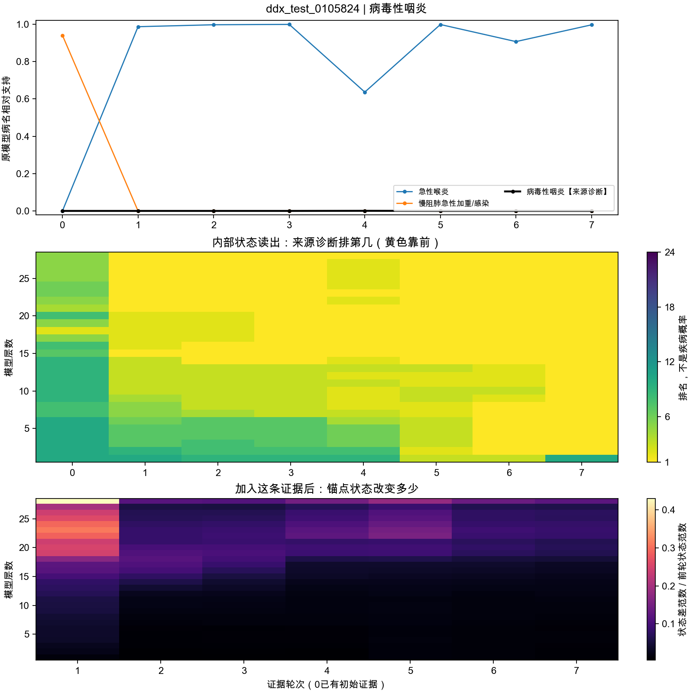

# ddx_test_0105824：病毒性咽炎

DDxPlus test 原始第105824行（零起始）。轨迹类型：在其他疾病间变动。来源诊断适用于完整病例；中间轮没有逐轮医学标准答案。

| 轮 | 原模型首选（49病） | 来源诊断相对支持 | 第14层读出（24病） | 第21层读出（24病） | 第28层读出（24病） |
|---|---|---:|---|---|---|
| 0 | 慢阻肺急性加重/感染 | 0.0000 | 吉兰-巴雷综合征 | 急性中耳炎 | 急性中耳炎 |
| 1 | 急性喉炎 | 0.0000 | 急性中耳炎 | 病毒性咽炎 | 病毒性咽炎 |
| 2 | 急性喉炎 | 0.0000 | 病毒性咽炎 | 病毒性咽炎 | 病毒性咽炎 |
| 3 | 急性喉炎 | 0.0000 | 病毒性咽炎 | 病毒性咽炎 | 病毒性咽炎 |
| 4 | 急性喉炎 | 0.0006 | 急性中耳炎 | 病毒性咽炎 | 病毒性咽炎 |
| 5 | 急性喉炎 | 0.0000 | 病毒性咽炎 | 病毒性咽炎 | 病毒性咽炎 |
| 6 | 急性喉炎 | 0.0000 | 病毒性咽炎 | 病毒性咽炎 | 病毒性咽炎 |
| 7 | 急性喉炎 | 0.0000 | 病毒性咽炎 | 病毒性咽炎 | 病毒性咽炎 |

## 原始证据

**第0轮** E_91

发热：是

- Do you have a fever (either felt or measured with a thermometer)? **Yes**

**第1轮** E_53

本次就诊相关疼痛（同时揭示性质、位置、程度、放射等记录）：是；疼痛性质：sensitive；疼痛部位：tonsil(R); tonsil(L); thyroid cartilage; pharynx; under the jaw；疼痛强度记录：原始量表值9（0–10，端点含义未给出）；疼痛放射部位：nowhere；疼痛定位精确度记录：原始量表值10（0–10，端点含义未给出）；疼痛起病速度记录：原始量表值5（0–10，端点含义未给出）

- Do you have pain somewhere, related to your reason for consulting? **Yes**
- Characterize your pain: **sensitive**
- Do you feel pain somewhere? **tonsil(R); tonsil(L); thyroid cartilage; pharynx; under the jaw**
- How intense is the pain? **Recorded scale value 9 on the dataset's 0-10 scale; endpoint meanings are unspecified**
- Does the pain radiate to another location? **nowhere**
- How precisely is the pain located? **Recorded scale value 10 on the dataset's 0-10 scale; endpoint meanings are unspecified**
- How fast did the pain appear? **Recorded scale value 5 on the dataset's 0-10 scale; endpoint meanings are unspecified**

**第2轮** E_201

咳嗽：是

- Do you have a cough? **Yes**

**第3轮** E_204

近四周出国旅行：否

- Have you traveled out of the country in the last 4 weeks? **No**

**第4轮** E_79

吸烟：是

- Do you smoke cigarettes? **Yes**

**第5轮** E_181

鼻塞或流清鼻涕：是

- Do you have nasal congestion or a clear runny nose? **Yes**

**第6轮** E_48

与4人或更多人共同居住：是

- Do you live with 4 or more people? **Yes**

**第7轮** E_49

在日托机构就读或工作：是

- Do you attend or work in a daycare? **Yes**
