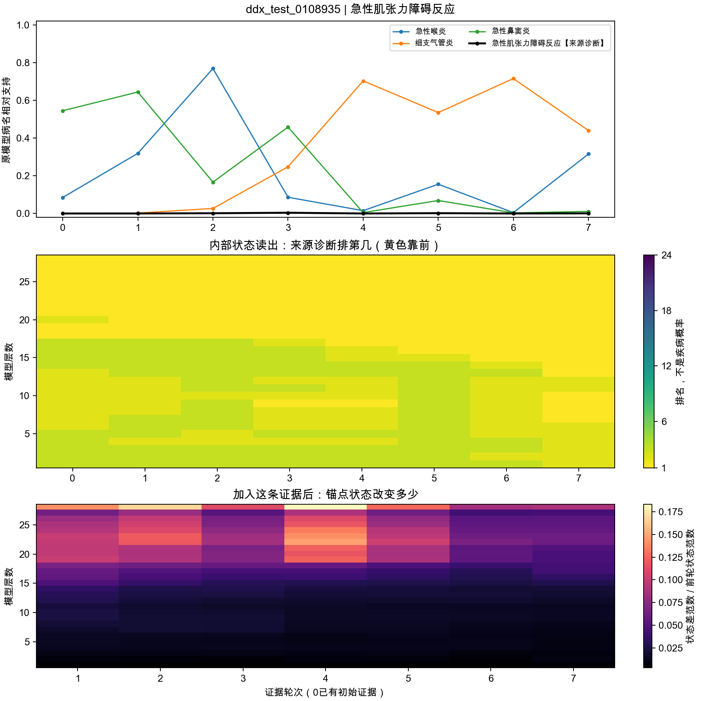

# ddx_test_0108935：急性肌张力障碍反应

DDxPlus test 原始第108935行（零起始）。轨迹类型：在其他疾病间变动。来源诊断适用于完整病例；中间轮没有逐轮医学标准答案。

| 轮 | 原模型首选（49病） | 来源诊断相对支持 | 第14层读出（24病） | 第21层读出（24病） | 第28层读出（24病） |
|---|---|---:|---|---|---|
| 0 | 急性鼻窦炎 | 0.0000 | 吉兰-巴雷综合征 | 急性肌张力障碍反应 | 急性肌张力障碍反应 |
| 1 | 急性鼻窦炎 | 0.0001 | 吉兰-巴雷综合征 | 急性肌张力障碍反应 | 急性肌张力障碍反应 |
| 2 | 急性喉炎 | 0.0013 | 重症肌无力 | 急性肌张力障碍反应 | 急性肌张力障碍反应 |
| 3 | 急性鼻窦炎 | 0.0040 | 重症肌无力 | 急性肌张力障碍反应 | 急性肌张力障碍反应 |
| 4 | 细支气管炎 | 0.0000 | 重症肌无力 | 急性肌张力障碍反应 | 急性肌张力障碍反应 |
| 5 | 细支气管炎 | 0.0017 | 重症肌无力 | 急性肌张力障碍反应 | 急性肌张力障碍反应 |
| 6 | 细支气管炎 | 0.0001 | 吉兰-巴雷综合征 | 急性肌张力障碍反应 | 急性肌张力障碍反应 |
| 7 | 细支气管炎 | 0.0008 | 急性肌张力障碍反应 | 急性肌张力障碍反应 | 急性肌张力障碍反应 |

## 原始证据

**第0轮** E_168

难以将舌头保持在口内：是

- Do you have trouble keeping your tongue in your mouth? **Yes**

**第1轮** E_62

经常使用兴奋剂：是

- Do you regularly take stimulant drugs? **Yes**

**第2轮** E_180

无法控制眼球方向：是

- Are you unable to control the direction of your eyes? **Yes**

**第3轮** E_204

近四周出国旅行：否

- Have you traveled out of the country in the last 4 weeks? **No**

**第4轮** E_205

突然张口困难、不能张口或张口时下颌疼痛：是

- Do you suddenly have difficulty or an inability to open your mouth or have jaw pain when opening it? **Yes**

**第5轮** E_128

曾短暂窒息且无法呼吸或说话：是

- Have you ever felt like you were suffocating for a very short time associated with inability to breathe or speak? **Yes**

**第6轮** E_66

明显气短或呼吸困难：是

- Are you experiencing shortness of breath or difficulty breathing in a significant way? **Yes**

**第7轮** E_192

颈部痉挛或酸痛使头不能向一侧转动：是

- Do you feel that muscle spasms or soreness in your neck are keeping you from turning your head to one side? **Yes**
