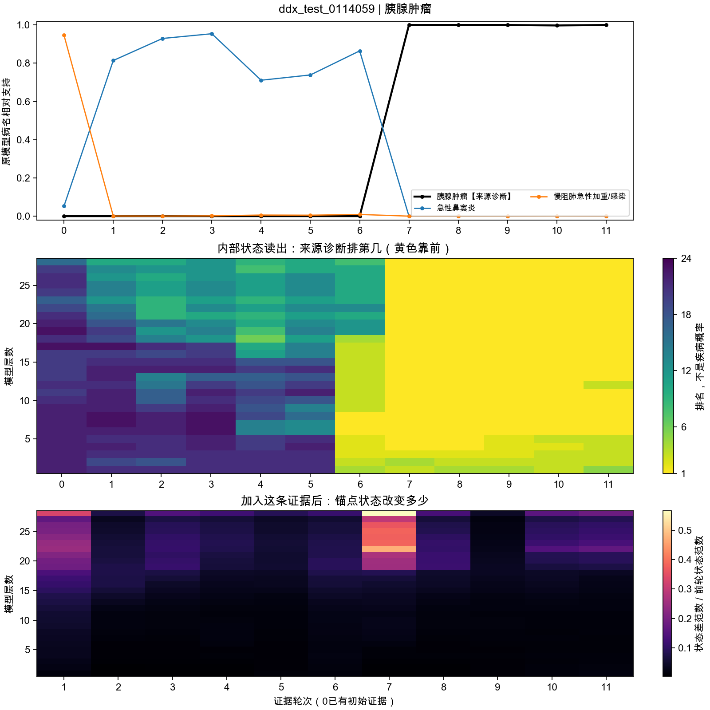

# ddx_test_0114059：胰腺肿瘤

DDxPlus test 原始第114059行（零起始）。轨迹类型：转向来源病后保持。来源诊断适用于完整病例；中间轮没有逐轮医学标准答案。

| 轮 | 原模型首选（49病） | 来源诊断相对支持 | 第14层读出（24病） | 第21层读出（24病） | 第28层读出（24病） |
|---|---|---:|---|---|---|
| 0 | 慢阻肺急性加重/感染 | 0.0000 | 吉兰-巴雷综合征 | 急性肌张力障碍反应 | 上呼吸道感染 |
| 1 | 急性鼻窦炎 | 0.0000 | 急性中耳炎 | 腹股沟疝 | 腹股沟疝 |
| 2 | 急性鼻窦炎 | 0.0000 | 急性中耳炎 | 腹股沟疝 | 腹股沟疝 |
| 3 | 急性鼻窦炎 | 0.0000 | 急性中耳炎 | 上呼吸道感染 | 支气管炎 |
| 4 | 急性鼻窦炎 | 0.0000 | 急性中耳炎 | 贫血 | HIV初期感染 |
| 5 | 急性鼻窦炎 | 0.0000 | 急性中耳炎 | 腹股沟疝 | HIV初期感染 |
| 6 | 急性鼻窦炎 | 0.0001 | 系统性红斑狼疮 | HIV初期感染 | HIV初期感染 |
| 7 | 胰腺肿瘤 | 0.9999 | 胰腺肿瘤 | 胰腺肿瘤 | 胰腺肿瘤 |
| 8 | 胰腺肿瘤 | 1.0000 | 胰腺肿瘤 | 胰腺肿瘤 | 胰腺肿瘤 |
| 9 | 胰腺肿瘤 | 1.0000 | 胰腺肿瘤 | 胰腺肿瘤 | 胰腺肿瘤 |
| 10 | 胰腺肿瘤 | 0.9973 | 胰腺肿瘤 | 胰腺肿瘤 | 胰腺肿瘤 |
| 11 | 胰腺肿瘤 | 1.0000 | 胰腺肿瘤 | 胰腺肿瘤 | 胰腺肿瘤 |

## 原始证据

**第0轮** E_89

持续疲劳或睡眠不能恢复精力：是

- Do you constantly feel fatigued or do you have non-restful sleep? **Yes**

**第1轮** E_53

本次就诊相关疼痛（同时揭示性质、位置、程度、放射等记录）：是；疼痛性质：sensitive；疼痛部位：flank(L); hypochondrium(L); epigastric；疼痛强度记录：原始量表值3（0–10，端点含义未给出）；疼痛放射部位：thoracic spine；疼痛定位精确度记录：原始量表值5（0–10，端点含义未给出）；疼痛起病速度记录：原始量表值0（0–10，端点含义未给出）

- Do you have pain somewhere, related to your reason for consulting? **Yes**
- Characterize your pain: **sensitive**
- Do you feel pain somewhere? **flank(L); hypochondrium(L); epigastric**
- How intense is the pain? **Recorded scale value 3 on the dataset's 0-10 scale; endpoint meanings are unspecified**
- Does the pain radiate to another location? **thoracic spine**
- How precisely is the pain located? **Recorded scale value 5 on the dataset's 0-10 scale; endpoint meanings are unspecified**
- How fast did the pain appear? **Recorded scale value 0 on the dataset's 0-10 scale; endpoint meanings are unspecified**

**第2轮** E_204

近四周出国旅行：否

- Have you traveled out of the country in the last 4 weeks? **No**

**第3轮** E_162

近3个月非主动减重：是

- Have you had an involuntary weight loss over the last 3 months? **Yes**

**第4轮** E_68

Do you have diabetes?：是

- Do you have diabetes? **Yes**

**第5轮** E_51

腹泻或排便次数增加：是

- Have you had diarrhea or an increase in stool frequency? **Yes**

**第6轮** E_129

皮疹颜色：NA；皮损脱屑：否；皮疹肿胀程度记录：原始量表值0（0–10，端点含义未给出）；皮损部位：nowhere；How intense is the pain caused by the rash?：原始量表值0（0–10，端点含义未给出）；皮损大于1厘米：否；瘙痒程度记录：原始量表值0（0–10，端点含义未给出）

- What color is the rash? **NA**
- Do your lesions peel off? **No**
- Is the rash swollen? **Recorded scale value 0 on the dataset's 0-10 scale; endpoint meanings are unspecified**
- Where is the affected region located? **nowhere**
- How intense is the pain caused by the rash? **Recorded scale value 0 on the dataset's 0-10 scale; endpoint meanings are unspecified**
- Is the lesion (or are the lesions) larger than 1cm? **No**
- How severe is the itching? **Recorded scale value 0 on the dataset's 0-10 scale; endpoint meanings are unspecified**

**第7轮** E_223

家人被诊断为胰腺癌：是

- Are there members of your family who have been diagnosed with pancreatic cancer? **Yes**

**第8轮** E_79

吸烟：是

- Do you smoke cigarettes? **Yes**

**第9轮** E_201

咳嗽：是

- Do you have a cough? **Yes**

**第10轮** E_148

恶心或想吐：是

- Are you feeling nauseous or do you feel like vomiting? **Yes**

**第11轮** E_188

粪便苍白且尿色深：是

- Do you have pale stools and dark urine? **Yes**
