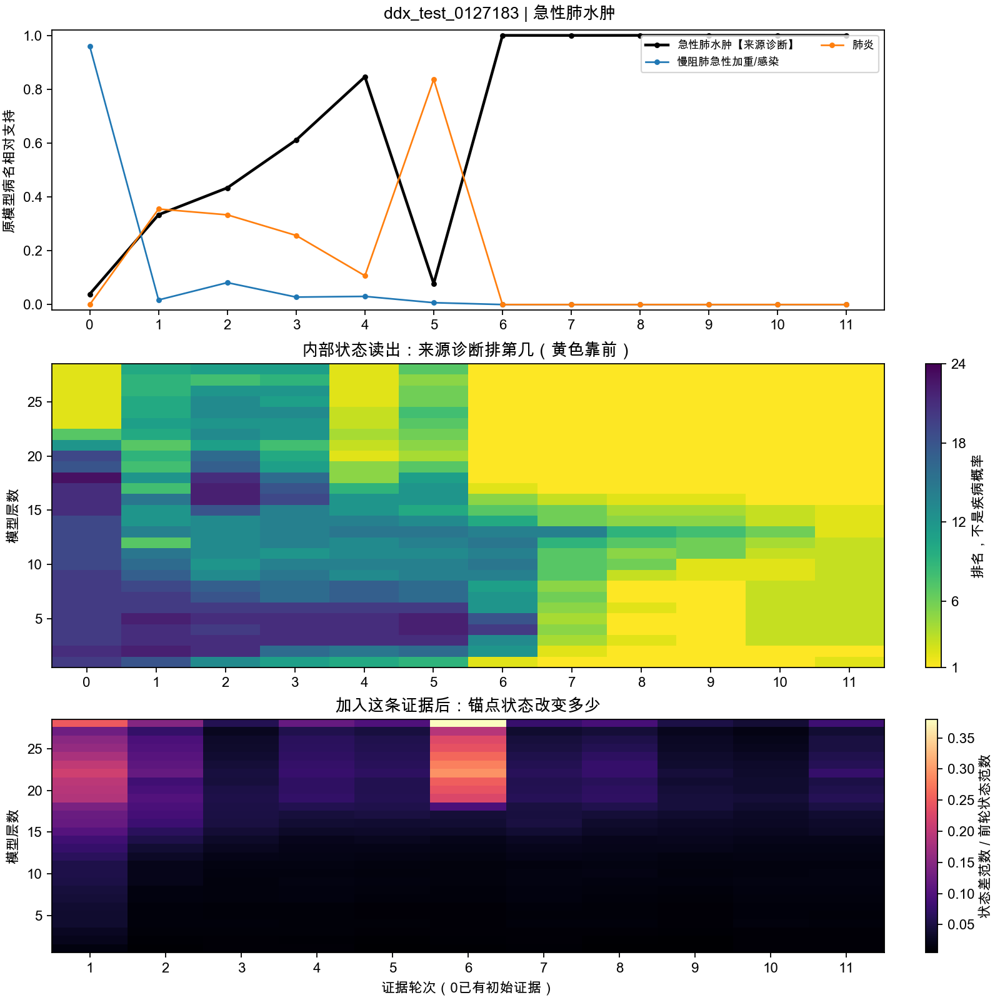

# ddx_test_0127183：急性肺水肿

DDxPlus test 原始第127183行（零起始）。轨迹类型：曾离开来源病，最后回来。来源诊断适用于完整病例；中间轮没有逐轮医学标准答案。

| 轮 | 原模型首选（49病） | 来源诊断相对支持 | 第14层读出（24病） | 第21层读出（24病） | 第28层读出（24病） |
|---|---|---:|---|---|---|
| 0 | 慢阻肺急性加重/感染 | 0.0390 | 吉兰-巴雷综合征 | 支气管炎 | 支气管炎 |
| 1 | 肺炎 | 0.3338 | 急性中耳炎 | 腹股沟疝 | 稳定型心绞痛 |
| 2 | 急性肺水肿 | 0.4336 | 急性中耳炎 | 稳定型心绞痛 | 稳定型心绞痛 |
| 3 | 急性肺水肿 | 0.6111 | 急性中耳炎 | 腹股沟疝 | 稳定型心绞痛 |
| 4 | 急性肺水肿 | 0.8460 | 急性中耳炎 | 腹股沟疝 | 稳定型心绞痛 |
| 5 | 肺炎 | 0.0778 | 自发性食管破裂 | 腹股沟疝 | 稳定型心绞痛 |
| 6 | 急性肺水肿 | 0.9999 | 上呼吸道感染 | 急性肺水肿 | 急性肺水肿 |
| 7 | 急性肺水肿 | 0.9998 | 胃食管反流病 | 急性肺水肿 | 急性肺水肿 |
| 8 | 急性肺水肿 | 1.0000 | 腹股沟疝 | 急性肺水肿 | 急性肺水肿 |
| 9 | 急性肺水肿 | 1.0000 | 腹股沟疝 | 急性肺水肿 | 急性肺水肿 |
| 10 | 急性肺水肿 | 1.0000 | 肺炎 | 急性肺水肿 | 急性肺水肿 |
| 11 | 急性肺水肿 | 1.0000 | 肺炎 | 急性肺水肿 | 急性肺水肿 |

## 原始证据

**第0轮** E_217

平躺时症状加重、坐起时缓解：是

- Are your symptoms worse when lying down and alleviated while sitting up? **Yes**

**第1轮** E_53

本次就诊相关疼痛（同时揭示性质、位置、程度、放射等记录）：是；疼痛性质：tedious; sensitive; heavy；疼痛部位：lower chest; ankle(R); ankle(L); side of the chest(L); posterior chest wall(L)；疼痛强度记录：原始量表值4（0–10，端点含义未给出）；疼痛放射部位：biceps(L); scapula(R); triceps(R); triceps(L); shoulder(R)；疼痛定位精确度记录：原始量表值5（0–10，端点含义未给出）；疼痛起病速度记录：原始量表值7（0–10，端点含义未给出）

- Do you have pain somewhere, related to your reason for consulting? **Yes**
- Characterize your pain: **tedious; sensitive; heavy**
- Do you feel pain somewhere? **lower chest; ankle(R); ankle(L); side of the chest(L); posterior chest wall(L)**
- How intense is the pain? **Recorded scale value 4 on the dataset's 0-10 scale; endpoint meanings are unspecified**
- Does the pain radiate to another location? **biceps(L); scapula(R); triceps(R); triceps(L); shoulder(R)**
- How precisely is the pain located? **Recorded scale value 5 on the dataset's 0-10 scale; endpoint meanings are unspecified**
- How fast did the pain appear? **Recorded scale value 7 on the dataset's 0-10 scale; endpoint meanings are unspecified**

**第2轮** E_175

本次出现疲倦、全身不适、肌痛或整体状态变化：是

- Have you noticed any new fatigue, generalized and vague discomfort, diffuse (widespread) muscle aches or a change in your general well-being related to your consultation today? **Yes**

**第3轮** E_50

出汗明显增多：是

- Have you had significantly increased sweating? **Yes**

**第4轮** E_8

目前接受透析：是

- Do you currently undergo dialysis? **Yes**

**第5轮** E_204

近四周出国旅行：否

- Have you traveled out of the country in the last 4 weeks? **No**

**第6轮** E_106

有心力衰竭病史：是

- Do you have heart failure? **Yes**

**第7轮** E_151

身体局部肿胀（同时揭示部位）：是；Where is the swelling located?：ankle(L); calf(R); calf(L); tibia(L)

- Do you have swelling in one or more areas of your body? **Yes**
- Where is the swelling located? **ankle(L); calf(R); calf(L); tibia(L)**

**第8轮** E_66

明显气短或呼吸困难：是

- Are you experiencing shortness of breath or difficulty breathing in a significant way? **Yes**

**第9轮** E_5

曾有肺部积液：是

- Have you ever had fluid in your lungs? **Yes**

**第10轮** E_67

夜间因憋气或气短醒来：是

- Do you have bouts of choking or shortness of breath that wake you up at night? **Yes**

**第11轮** E_105

曾有心肌梗死或有心绞痛：是

- Have you ever had a heart attack or do you have angina (chest pain)? **Yes**
